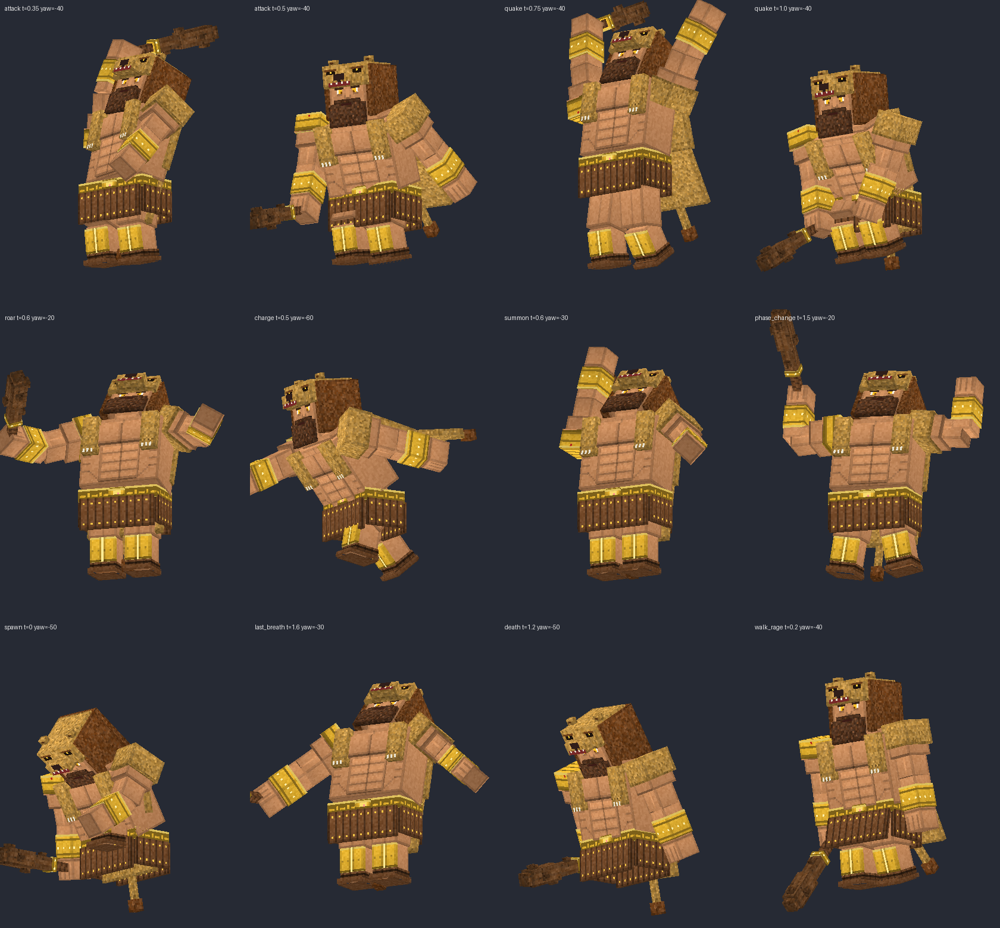
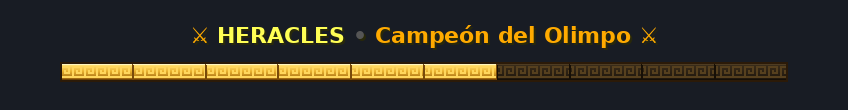

# HERACLES: modelo de ModelEngine (Java 1.21.10)

Boss 01 del servidor. Es un modelo personalizado para **ModelEngine R4**, preparado para **MythicMobs** (y compatible con el pack de **Mythic Crucible**).




## Contenido

| Archivo | Qué es |
|---|---|
| `ModelEngine/blueprints/heracles/heracles.bbmodel` | Modelo de Blockbench (formato *Generic Model*) con la textura incrustada y 14 animaciones |
| `ModelEngine/blueprints/heracles/heracles_texture.png` | La textura, por si quieres retocarla aparte |
| `MythicMobs/Mobs/Boss_01_Heracles/Heracles_Mobs.yml` | Mob `Heracles`, ahora con `model{mid=heracles}` |
| `MythicMobs/Skills/heracles_skills.yml` | Skills con animaciones y sonidos sincronizados |
| `ResourcePack/HeraclesPack/` | Textura griega de la bossbar (se fusiona con el pack de ItemsAdder) |
| `preview/*.gif` | Vista previa de cada animación |
| `../tools/generate_heracles.py` | Script que genera el `.bbmodel` (sirve para regenerarlo o hacer cambios) |
| `../tools/render_preview.py` | Script que renderiza las imágenes y los GIF |
| `../tools/generate_bossbar.py` | Script que genera la textura de la bossbar y `preview/bossbar.png` |

## Instalación

1. Copia `ModelEngine/blueprints/heracles/` en `plugins/ModelEngine/blueprints/heracles/`.
2. Sustituye los archivos de MythicMobs:
   - `plugins/MythicMobs/Mobs/Boss_01_Heracles/Heracles_Mobs.yml`
   - `plugins/MythicMobs/Skills/heracles_skills.yml`
3. Ejecuta `/meg reload` y después `/mm reload`.
4. Aplica el resource pack que genera ModelEngine (`plugins/ModelEngine/resource pack.zip`), o combínalo con tu pack de MythicMobs/Crucible.
5. Pruébalo con `/mm m spawn Heracles`.

> Haz copia de seguridad de los dos `.yml` originales antes de sustituirlos. Solo cambia la parte visual: animaciones, sonidos y partículas. Vida, daño, fases e invocaciones se quedan igual.

## Bossbar y títulos personalizados



La bossbar usa una textura propia: oro con meandro griego y los 10 segmentos ya dibujados. Va en `ResourcePack/HeraclesPack/` y sustituye la textura de la barra **amarilla** (`YELLOW`) de Minecraft.

Instalación con ItemsAdder:

1. Copia `ResourcePack/HeraclesPack/` en `plugins/HeraclesPack/`.
2. Añádela en `plugins/ItemsAdder/config.yml`:
   ```yaml
   merge_other_plugins_resourcepacks_folders:
     - ModelEngine/resource pack
     - WeaponMechanicsPack
     - DextralityArmas/DextralityArmas/resource pack/resource pack
     - HeraclesPack
   ```
3. `/iazip` y después `/mm reload`. Vuelve a entrar al servidor para recibir el pack.

> Cualquier otra bossbar `YELLOW` del servidor también tendrá esta textura. Si eso molesta, usa otro color en las demás bossbars.

Títulos en pantalla (todos con `title{}` de MythicMobs):

| Momento | Título | Subtítulo |
|---|---|---|
| Aparece (`Heracles_Intro`) | ⚔ HERACLES ⚔ | Greek Village • El campeón del Olimpo ha despertado |
| Fase 2 | FURIA DIVINA | Heracles ha perdido la paciencia |
| Fase 3 | LA ÚLTIMA PRUEBA | Los hoplitas acuden a su llamado |
| Último aliento | ÚLTIMO ALIENTO | Heracles se niega a caer... |
| Muere | ⚔ VICTORIA ⚔ | Heracles ha caído • ¡El Dungeon está liberado! |

## Huesos (bones)

- `hitbox`: define el hitbox, de 1.5 × 2.9 bloques. La altura de los ojos está en Y = 42 px.
- `h_head`: la cabeza sigue al jugador al que mira el boss.
- `tag_name`: hueso para el nombre flotante. Es opcional.
- Huesos animados: `body`, `torso`, `right_arm` / `left_arm` (con `_forearm` y `_hand`), `club` (garrote), `right_leg` / `left_leg` (con `_lower_leg`), `pelt` / `pelt_lower` / `tail` (piel de león y cola), `skirt_front` / `skirt_back`.

## Animaciones

| Animación | Tipo | Duración | Cuándo se usa | Momento clave |
|---|---|---|---|---|
| `idle` | loop | 3.0 s | De pie (fase 1) | — |
| `walk` | loop | 1.2 s | Andando (fase 1) | — |
| `spawn` | once | 3.0 s | `Heracles_Intro` | Se levanta (1.4–2.1 s) y alza el garrote (2.45 s) |
| `attack` | once | 1.0 s | `Heracles_Slam` | Impacto a 0.5 s (10 ticks) |
| `quake` | once | 1.6 s | `Heracles_Quake` | Salto (0.45 s) e impacto (1.0 s / 20 ticks) |
| `roar` | once | 2.0 s | `Heracles_OlympusRoar` | Rugido a 0.4 s |
| `charge` | once | 1.2 s | `Heracles_Charge` | Embestida a 0.5 s |
| `phase_change` | once | 2.2 s | `Heracles_PhaseShield` (cambio de fase) | Golpe al suelo (0.6 s) y pose de fuerza (1.35 s) |
| `summon` | once | 1.6 s | Llamadas a espartanos, arqueros y Minotauro | Garrote al cielo (0.4 s) |
| `last_breath` | once | 2.0 s | `Heracles_LastBreath` | Cae de rodilla (0.8 s) y se levanta (1.6 s) |
| `hurt` | once | 0.4 s | Al recibir daño (35 %) | — |
| `idle_rage` / `walk_rage` | loop | 1.4 / 0.9 s | Desde la FASE 2 (`defaultstate`) | Más encorvado y agresivo |
| `death` | hold | 3.0 s | Automática al morir | De rodillas (1.2 s) y cae (2.6 s) |

## Sonidos

Todos los sonidos son **sonidos vanilla de 1.21.10** combinados entre sí, con el tono ajustado. Se disparan desde las skills con `delay` sincronizados con cada animación, así que no hace falta añadir sonidos al resource pack.

Si más adelante quieres sonidos propios (`.ogg`), añádelos en `assets/heracles/sounds/` de tu pack y cambia los `effect:sound{s=...}` por `heracles:<nombre>`.

## Cómo editarlo

Abre el `.bbmodel` en **Blockbench** (con el plugin de ModelEngine si lo usas). También puedes cambiar el script y regenerarlo:

```bash
python3 tools/generate_heracles.py          # regenera el .bbmodel y la textura
python3 tools/render_preview.py out.png attack:0.5@-40 quake:1.0@-40   # imágenes de prueba
```
