# OLD ENDER: boss 02 con modelos de ModelEngine

Faraón enderman: cuerpo del vacío con vetas moradas, nemes dorado y azul con cobra, collar usekh, vendas de lino, garras moradas y dos orbes flotando. Va con cuatro súbditos del desierto.

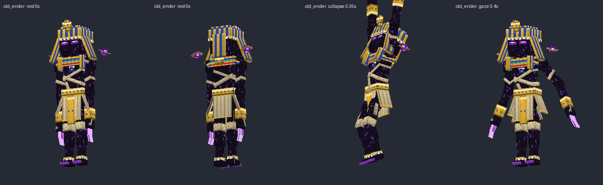
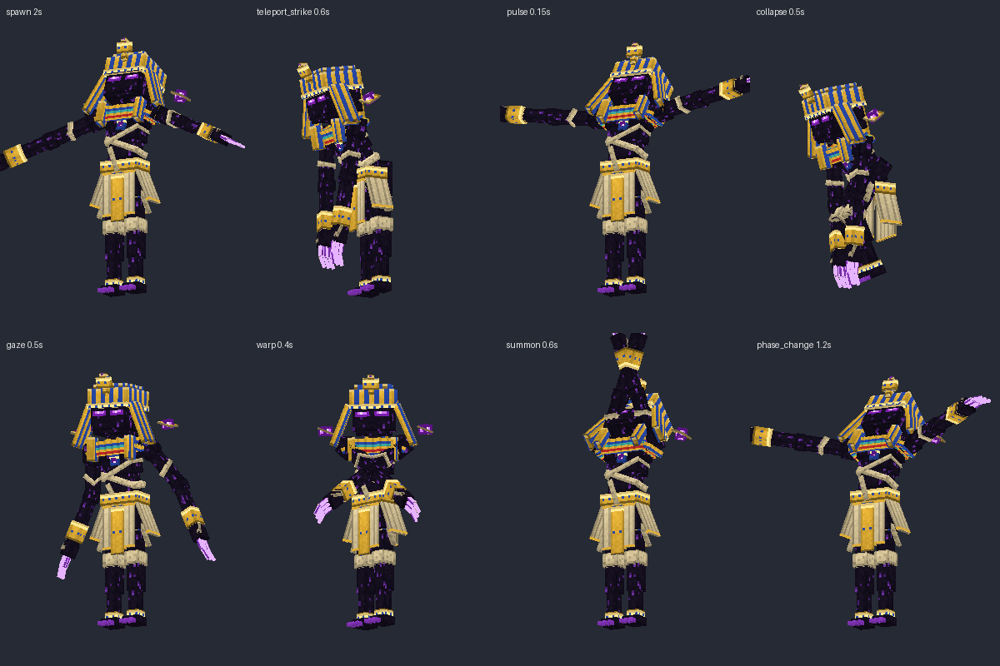

## Contenido

| Archivo | Qué es |
|---|---|
| `ModelEngine/blueprints/old_ender/` | Modelo del boss: 88 cubos y 14 animaciones |
| `ModelEngine/blueprints/sand_warden/`, `mummy_guardian/`, `giant_scarab/`, `desert_priest/` | Súbditos |
| `ModelEngine/blueprints/oe_fx_*/` | Efectos de los ataques (portal, onda, pinchos, ojo, remolino) |
| `../../MythicMobs-3D/Mobs/Boss_02_OldEnder/OldEnder_Mobs.yml` | Mobs con `model{}`, bossbar con moldura |
| `../../MythicMobs-3D/Skills/old_ender_skills.yml` | Skills con animaciones, sonidos y título |
| `../DextraBossesPack/assets/dextra/sounds/old_ender/` | Sonidos propios (`dextra:old_ender.*`) |
| `../DextraBossesPack/assets/dextra/textures/font/old_ender/` | Logo del título |
| `../ItemsAdder/contents/dextra_bosses/old_ender.yml` | Moldura de la bossbar |
| `preview/` | Imágenes, `hud_preview.png` y `sonidos_demo.mp3` |
| `../../tools/b02_oldender.py`, `b02_fx.py`, `b02_sounds.py`, `b02_hud.py` | Scripts que lo generan todo |

## Instalación

1. Copia todas las carpetas de `ModelEngine/blueprints/` (5 mobs y 5 efectos) en `plugins/ModelEngine/blueprints/` y ejecuta `/meg reload`.
2. Sustituye en el servidor 3D:
   - `plugins/MythicMobs/Mobs/Boss_02_OldEnder/OldEnder_Mobs.yml`
   - `plugins/MythicMobs/Skills/old_ender_skills.yml`
3. Si aún no lo hiciste, instala el pack compartido. Los pasos están en [`../README.md`](../README.md#pack-compartido-bosses-02-17).
4. `/iazip`, `/mm reload` y vuelve a entrar. Pruébalo con `/mm m spawn OldEnder`.

## Bossbar y título

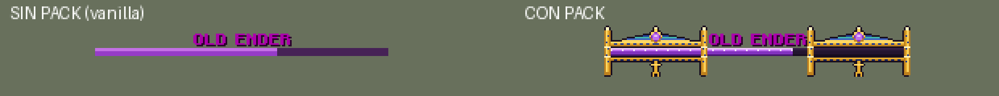
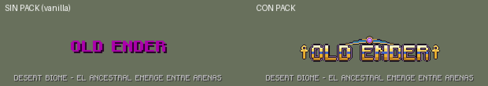

| | Sin pack | Con pack |
|---|---|---|
| Bossbar | `OLD ENDER` morado y barra morada vanilla | Moldura egipcia con obeliscos, sol alado con gema y ankh; barra morada con brillo |
| Título al aparecer | `OLD ENDER` como siempre | Logo dorado con franja de lapislázuli, sol alado y dos ankh |
| Sonidos | Los vanilla de siempre | Los vanilla más los propios |

- **Bossbar:** el título es `&f &5&lOLD ENDER&f `. En vanilla, ` ` es un espacio en blanco. Con el pack, ItemsAdder lo convierte en media moldura.
- **Título de aparición:** se manda con `/title` y un texto traducible. Si el jugador no tiene el pack, Minecraft muestra el texto de siempre; con el pack, el logo.
- **Barra morada:** con el pack también cambia la textura de la barra morada. La usan Old Ender, Kronos, Azathoth, Lady of Laments y Kukulkan.

## Efectos de los ataques

Cada ataque saca un efecto en 3D con su propia animación. Es un mob invisible (`OD_FX_*`, armor stand marcador) que lleva el modelo y se borra solo al terminar.

| Efecto | Modelo | Ataques |
|---|---|---|
| Portal del vacío que se abre, gira y se cierra | `oe_fx_portal` | `OD_TeleportStrike` (donde sale y donde cae), `OD_SandWarp` |
| Onda de arena que llega a 8 bloques | `oe_fx_shockwave` | `OD_SandPulse`, impactos de `OD_DesertCollapse`, `OD_SandWarp` y `OD_SandstormRift` |
| Dos anillos de pinchos de arenisca con runas, y grietas moradas | `oe_fx_collapse` | `OD_DesertCollapse`, `OD_SandstormRift` |
| Ojo de Horus gigante sobre el jugador; la pupila se dilata al golpear | `oe_fx_eye` | `OD_EnderGaze` |
| Remolino de arena con núcleo del vacío | `oe_fx_tornado` | `OD_Sandstorm`, carga de `OD_SandstormRift` |

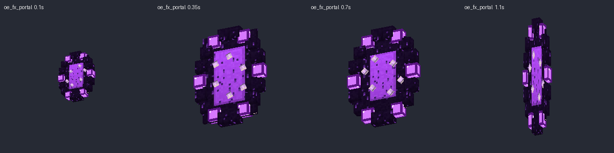
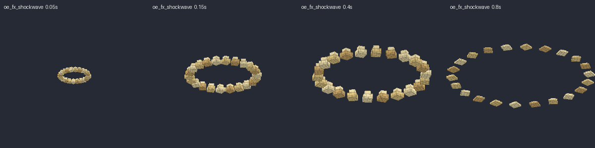
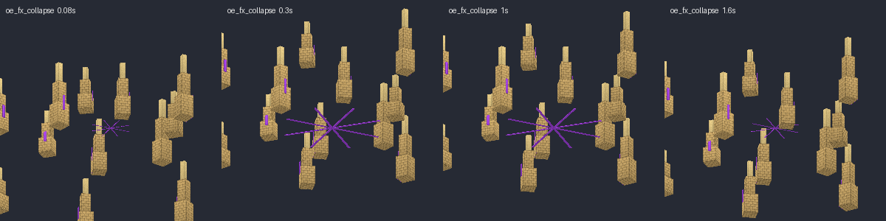
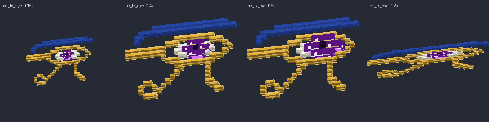
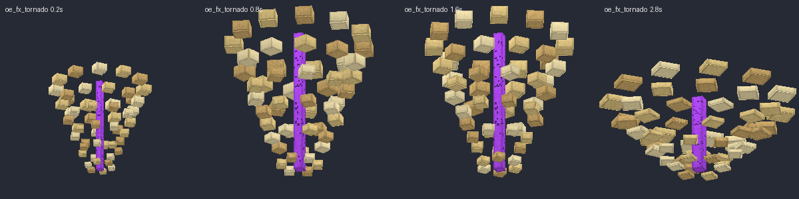

## Súbditos

| Mob | Modelo | Aspecto | Animaciones |
|---|---|---|---|
| `SandWarden` | `sand_warden` | Gólem de arenisca con núcleo encendido, rocas en los hombros y púas en la espalda | idle, walk, attack (puñetazo 0.30 s), hurt, spawn (sale de la arena), death (se deshace) |
| `MummyGuardian` | `mummy_guardian` | Momia encorvada con vendas cruzadas, tiras sueltas, ojos verdes, collar roto y amuleto | idle, walk, attack (agarre 0.35 s), hurt, spawn, death |
| `GiantScarab` | `giant_scarab` | Escarabajo de lapislázuli y oro con caparazón abombado, cuerno y mandíbulas | idle, walk (trípode), attack (mordisco 0.25 s), hurt, spawn, death (patas arriba) |
| `DesertPriest` | `desert_priest` | Sacerdote con máscara de Anubis, collar usekh, faldellín plisado y bastón con ankh | idle, walk, attack, cast (cura 1.4 s), hurt, spawn, death |

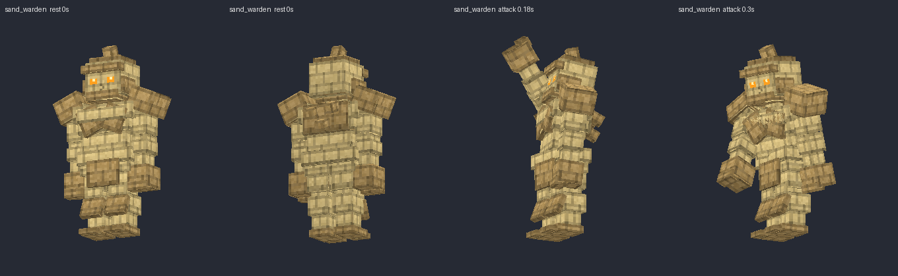
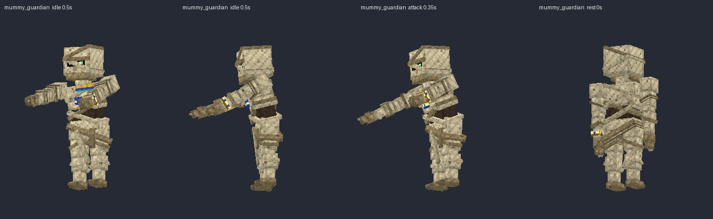
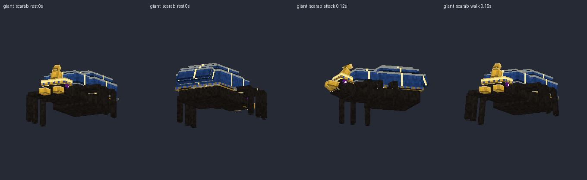
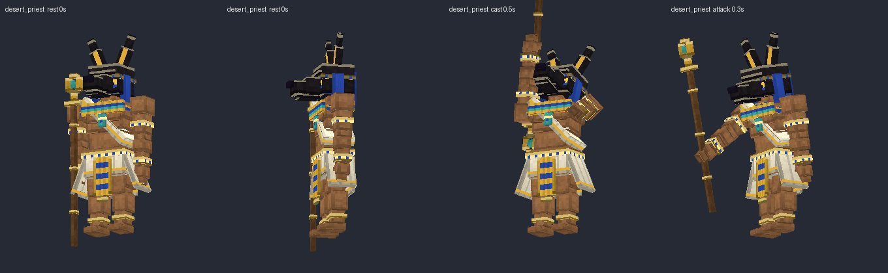

## Animaciones del boss

| Animación | Duración | Skill | Golpe |
|---|---|---|---|
| `spawn` | 2.4 s | `OD_Spawn` | — |
| `attack` | 0.6 s | `OD_Melee` (golpe normal) | 0.25 s |
| `teleport_strike` | 1.0 s | `OD_TeleportStrike` | 0.6 s (`delay 12`) |
| `pulse` | 0.9 s | `OD_SandPulse` | 0.15 s |
| `collapse` | 1.1 s | `OD_DesertCollapse` | 0.5 s (`delay 10`) |
| `gaze` | 1.1 s | `OD_EnderGaze` | 0.5 s (`delay 10`) |
| `warp` | 0.9 s | `OD_SandWarp` | 0.4 s (`delay 8`) |
| `sandstorm` | 1.6 s | `OD_Sandstorm`, `OD_SandstormRift` | — |
| `summon` | 1.4 s | `OD_SummonWardens`, invocaciones por vida | — |
| `phase_change` | 1.8 s | `OD_PhaseShield` (cada cambio de fase) | — |
| `hurt` | 0.35 s | `OD_Hurt` (35 % al recibir daño) | — |
| `idle` / `walk` | loop | automáticas | — |
| `death` | 2.6 s | automática al morir | — |

## Sonidos propios

| Sonido | Dónde suena |
|---|---|
| `dextra:old_ender.intro` | Al aparecer: viento, coro en escala frigia, flauta ney y grito |
| `dextra:old_ender.teleport` / `strike` | `OD_TeleportStrike`, `OD_SandWarp` y golpe normal |
| `dextra:old_ender.pulse` | `OD_SandPulse` y golpe de `OD_SandWarp` |
| `dextra:old_ender.collapse` | Impacto de `OD_DesertCollapse` y `OD_SandstormRift` |
| `dextra:old_ender.gaze` | `OD_EnderGaze` |
| `dextra:old_ender.sandstorm` | `OD_Sandstorm` y la carga de `OD_SandstormRift` |
| `dextra:old_ender.summon` | Sistro y coro al invocar |
| `dextra:old_ender.phase` | Cambio de fase |
| `dextra:old_ender.roar` / `hurt` / `death` | Grito, daño y muerte |
| `warden_rise` / `warden_hit` / `mummy_groan` / `scarab_hiss` / `priest_chant` | Súbditos |

Escúchalos en `preview/sonidos_demo.mp3`.
