# BAAL: boss 03 con modelos de ModelEngine

Baal es el espíritu samurái demoníaco del Templo Sakura. Lleva:

- **Cabeza:** kabuto en cúpula con cuernos dorados curvos y máscara oni roja con colmillos.
- **Armadura:** o-yoroi lacado con hombreras curvas, hakama morado y haori espectral.
- **Arma y estandarte:** nodachi enorme y estandarte con la flor de sakura a la espalda.

Va con tres súbditos.

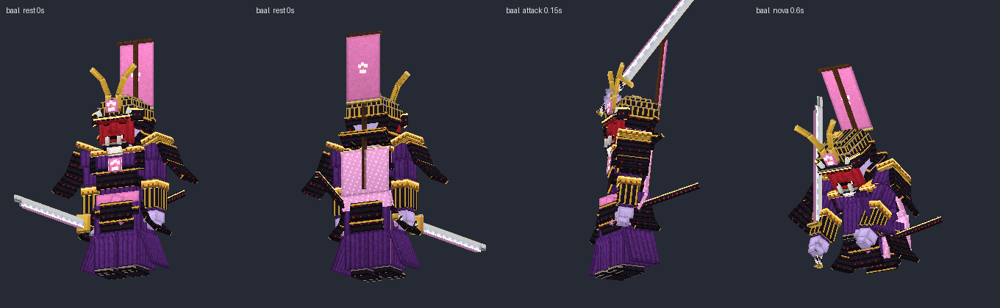
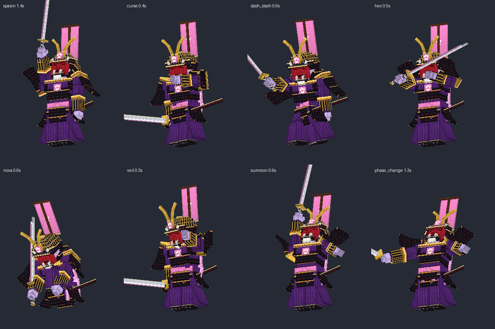

## Contenido

| Archivo | Qué es |
|---|---|
| `ModelEngine/blueprints/baal/` | Modelo del boss: 127 cubos y 13 animaciones |
| `ModelEngine/blueprints/undead_samurai/`, `yokai/`, `shadow_ninja/` | Súbditos |
| `ModelEngine/blueprints/bl_fx_*/` | Efectos de los ataques |
| `../../MythicMobs-3D/Mobs/Boss_03_Baal/baal_mobs.yml` | Mobs con `model{}`, bossbar con moldura y mobs de efectos `BL_FX_*` |
| `../../MythicMobs-3D/Skills/baal_skills.yml` | Skills con animaciones, sonidos, efectos y título |
| `../DextraBossesPack/assets/dextra/sounds/baal/` | Sonidos propios (`dextra:baal.*`) |
| `../DextraBossesPack/assets/dextra/textures/font/baal/` | Logo del título |
| `../ItemsAdder/contents/dextra_bosses/baal.yml` | Moldura de la bossbar |
| `../../tools/b03_baal.py`, `b03_fx.py`, `b03_sounds.py`, `b03_hud.py` | Scripts que lo generan todo |

## Instalación

1. Copia todas las carpetas de `ModelEngine/blueprints/` en `plugins/ModelEngine/blueprints/`: 4 mobs y 6 efectos.
2. Sustituye en el servidor 3D:
   - `plugins/MythicMobs/Mobs/Boss_03_Baal/baal_mobs.yml`
   - `plugins/MythicMobs/Skills/baal_skills.yml`
3. Copia de nuevo `Modelos/DextraBossesPack/` y `Modelos/ItemsAdder/contents/dextra_bosses/`. Así se suman los archivos de Baal; los de Old Ender siguen ahí.
4. Ejecuta `/meg reload`, `/iazip` y `/mm reload`, y vuelve a entrar. Pruébalo con `/mm m spawn Baal`.

## Bossbar y título

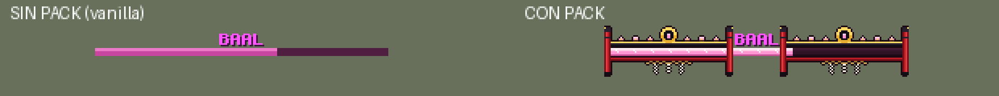
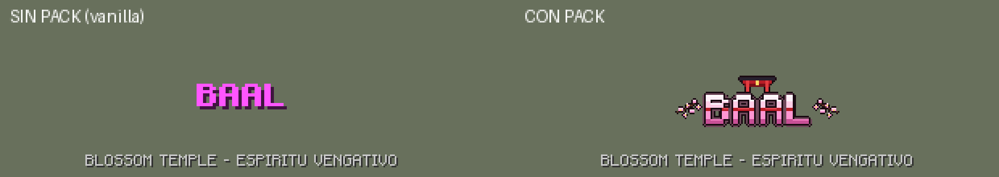

| | Sin pack | Con pack |
|---|---|---|
| Bossbar | `BAAL` rosa y barra rosa vanilla | Moldura con pilares de torii, banda de laca con flores de sakura, mon dorado y shimenawa con papeles shide |
| Título | `BAAL` como siempre | Logo blanco y rosa con franja carmesí, un torii encima y ramas de sakura |
| Sonidos | Los vanilla | Los vanilla más los propios |

Con el pack, la textura de la barra rosa también la usa Leviatán.

## Animaciones y efectos de cada ataque

| Skill | Animación | Golpe | Efecto 3D | Sonido |
|---|---|---|---|---|
| `Baal_Spawn` | `spawn` (se levanta y alza la nodachi) | — | Torii rojo que sale del suelo | `intro`: campana, shakuhachi, koto y taiko |
| Golpe normal (`Baal_Melee`) | `attack` (tajo diagonal) | 0.3 s | — | `slash` |
| `Baal_SpiritCurse` | `curse` (lanza una ofuda) | 0.4 s (`delay 8`) | Círculo de ofuda que gira y se cierra sobre el jugador | `curse` |
| `Baal_ShadowStep` | `dash_slash` (embestida y tajo) | 0.6 s (`delay 12`) | Humo al salir y media luna rosa al cortar | `step` y `slash` |
| `Baal_SakuraHex` | `hex` (gira con la nodachi) | 0.5 s (`delay 10`) | Tormenta de pétalos en espiral hasta 7 bloques | `hex` |
| `Baal_SpiritNova` | `nova` (clava la nodachi en el suelo) | 0.6 s (`delay 12`) | Anillo de llamas de alma hasta 8 bloques | `nova` |
| `Baal_ShadowVeil` | `veil` (se cubre con el brazo) | — | Cúpula de humo de sombra | `veil` |
| Invocaciones | `summon` (nodachi al cielo) | — | Torii | `summon`: tambores taiko y campana |
| Cambio de fase | `phase_change` (se arrodilla y se levanta furioso) | — | Torii | `phase` |
| Daño / muerte | `hurt` / `death` | — | — | `hurt` / `death` |

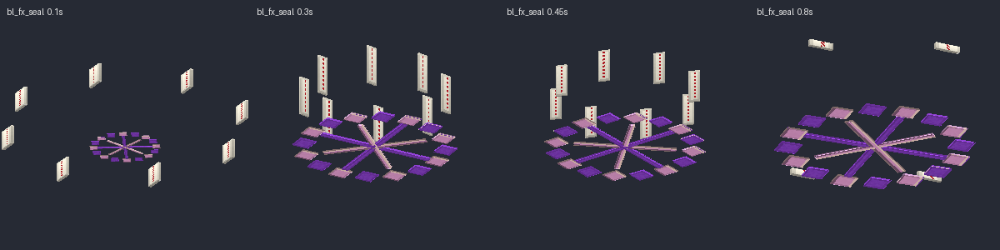
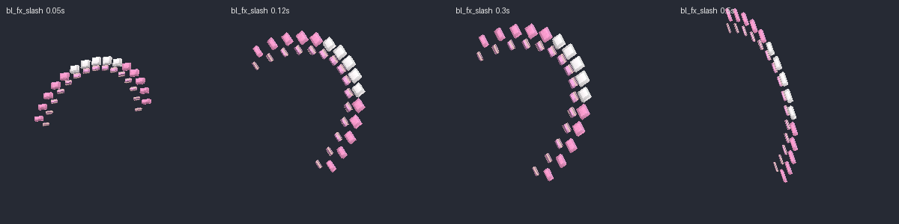
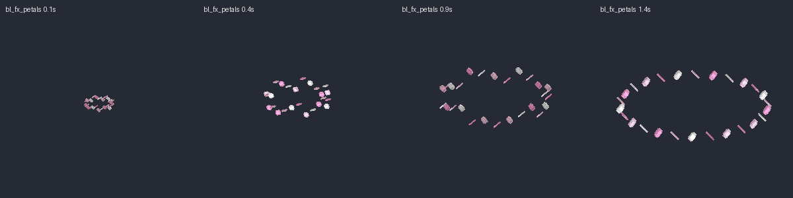
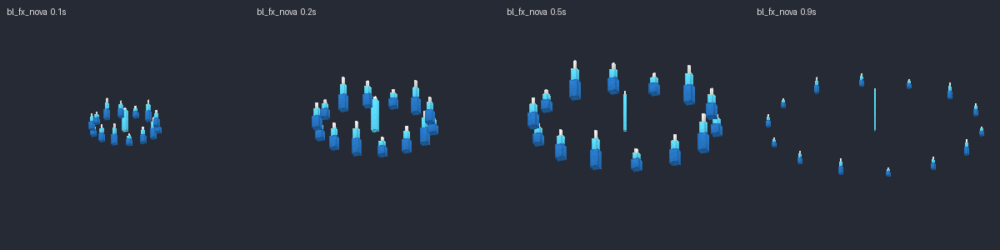
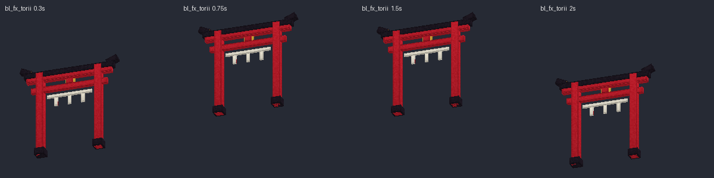
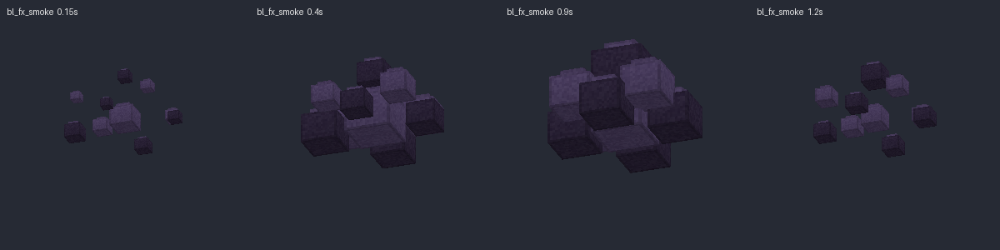

> En `Baal_SpiritCurse`, `Baal_SakuraHex` y `Baal_SpiritNova` el daño llega ahora unos ticks después, justo con el golpe de la animación. El daño y los efectos son los mismos.

## Súbditos

| Mob | Modelo | Aspecto | Sonidos |
|---|---|---|---|
| `UndeadSamurai` | `undead_samurai` | Samurái esqueleto con jingasa de paja, costillas a la vista, hombrera y coraza oxidadas y katana mellada | `samurai_rise`, `samurai_hit` |
| `Yokai` | `yokai` | Espíritu kitsune: máscara de zorro, cuerpo de llama morada, tres colas y dos hitodama girando | `yokai_laugh`, `yokai_curse` |
| `ShadowNinja` | `shadow_ninja` | Ninja de sombra con ojos rosas, bufanda roja, tanto y piernas que acaban en humo | `ninja_vanish`, `ninja_strike` |

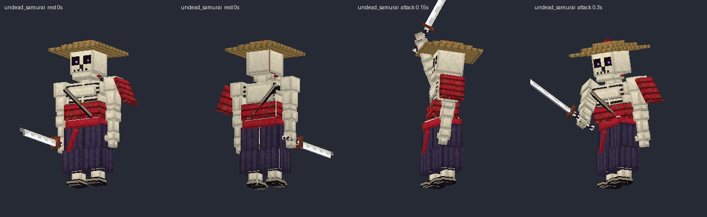
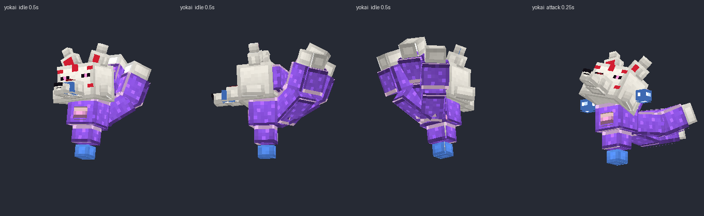
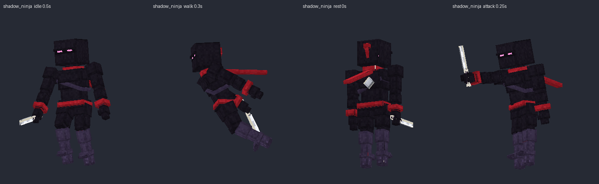

Escucha todos los sonidos en `preview/sonidos_demo.mp3`.
