# RED HAND: boss 04 con modelos de ModelEngine

Red Hand es el caballero oscuro caído del Castillo Rojo. Lleva:

- **Cabeza:** yelmo con frente en punta y visor en T encendido, corona de pinchos rota y cuernos curvos.
- **Armadura:** placas negras en láminas con filo carmesí y peto en V, hombreras enormes en tres láminas con pinchos y capa carmesí hecha jirones.
- **Armas:** mandoble de runas rojas y **la mano roja**, un guantelete gigante con garras y venas encendidas.

Va con tres súbditos. Sus charcos de sangre también tienen modelo.

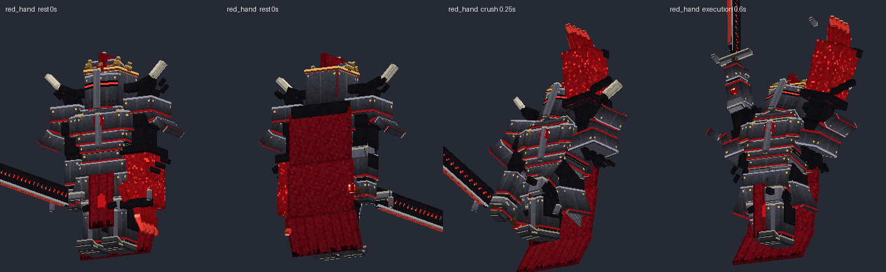
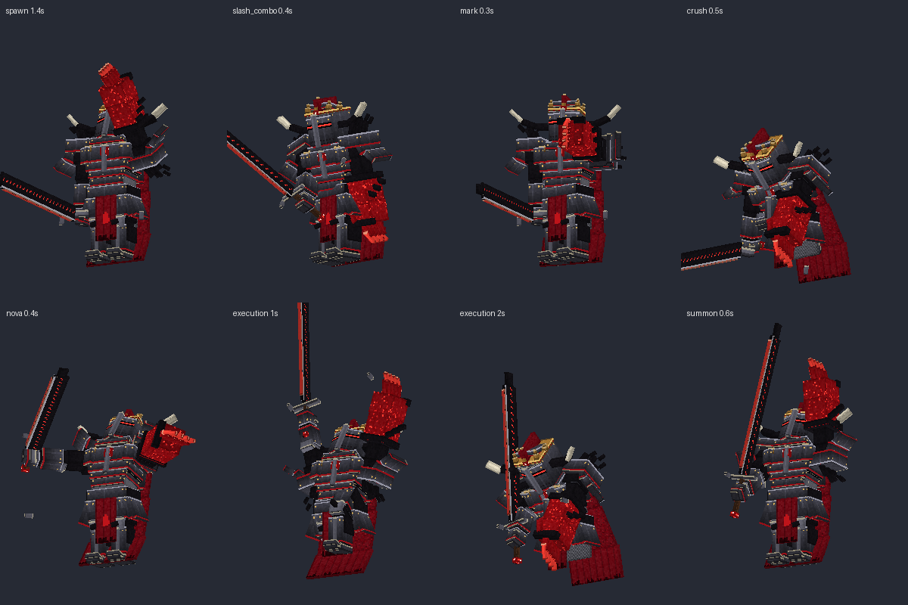

## Contenido

| Archivo | Qué es |
|---|---|
| `ModelEngine/blueprints/red_hand/` | Modelo del boss: 144 cubos y 15 animaciones |
| `ModelEngine/blueprints/fallen_squire/`, `corrupt_knight/`, `condemned_soul/` | Súbditos |
| `ModelEngine/blueprints/rh_blood_pool/` | Charco de sangre que burbujea (`RH_BloodPool`) |
| `ModelEngine/blueprints/rh_fx_*/` | Efectos de los ataques |
| `../../MythicMobs-3D/Mobs/Boss_04_RedHand/Redhand_mobs.yml` | Mobs con `model{}`, bossbar con moldura y mobs de efectos `RH_FX_*` |
| `../../MythicMobs-3D/Skills/redhand_skills.yml` | Skills con animaciones, sonidos, efectos y título |
| `../DextraBossesPack/assets/dextra/sounds/red_hand/` | Sonidos propios (`dextra:red_hand.*`) |
| `../DextraBossesPack/assets/dextra/textures/font/red_hand/` | Logo del título |
| `../ItemsAdder/contents/dextra_bosses/red_hand.yml` | Moldura de la bossbar |
| `../../tools/b04_redhand.py`, `b04_fx.py`, `b04_sounds.py`, `b04_hud.py` | Scripts que lo generan todo |

## Instalación

1. Copia todas las carpetas de `ModelEngine/blueprints/` en `plugins/ModelEngine/blueprints/`: 5 modelos y 7 efectos.
2. Sustituye en el servidor 3D:
   - `plugins/MythicMobs/Mobs/Boss_04_RedHand/Redhand_mobs.yml`
   - `plugins/MythicMobs/Skills/redhand_skills.yml`
3. Copia de nuevo `Modelos/DextraBossesPack/` y `Modelos/ItemsAdder/contents/dextra_bosses/`.
4. Ejecuta `/meg reload`, `/iazip` y `/mm reload`, y vuelve a entrar. Pruébalo con `/mm m spawn RedHand`.

## Bossbar y título

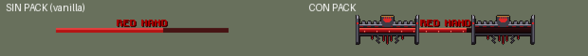
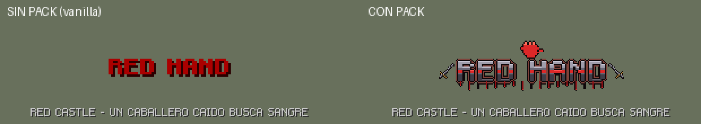

| | Sin pack | Con pack |
|---|---|---|
| Bossbar | `RED HAND` rojo y barra roja vanilla | Moldura gótica de hierro con agujas, almenas, escudo con la mano roja, cadenas y gotas de sangre |
| Título | `RED HAND` como siempre | Logo de acero con franja de sangre, la mano roja encima, espadas a los lados y sangre que gotea |
| Sonidos | Los vanilla | Los vanilla más los propios |

Con el pack, la textura de la barra roja también la usa Xylar.

## Animaciones y efectos de cada ataque

| Skill | Animación | Golpe | Efecto 3D | Sonido |
|---|---|---|---|---|
| `RH_Spawn` | `spawn` (se levanta y alza la mano roja) | — | Columna de sangre | `intro`: campanas, órgano y voz de demonio |
| Golpe normal (`RH_Melee`) | `attack` (tajo horizontal) | 0.3 s | — | `slash` |
| `RH_SlashCombo` | `slash_combo` (tres tajos) | 0.1, 0.4 y 0.7 s | Tajo carmesí en cada golpe | `slash` ×3 |
| `RH_RedMark` | `mark` (señala con la mano roja) | 0.3 s | Sello de la mano roja girando sobre el jugador (3 s) | `mark`: latidos y lamento |
| `RH_ShadowDash` | `dash` (se hunde en la sombra) | 0.4 s | Estallido de sombra al irse y al llegar | `dash` |
| `RH_HandCrush` | `crush` (alza la mano y aplasta el suelo) | 0.5 s | **Mano roja gigante** que sale del suelo y se cierra en un puño | `crush` |
| `RH_BloodNova` | `nova` (abre los brazos) | 0.4 s | Ola de sangre con pinchos, 9 bloques | `nova` |
| `RH_BloodPools` | `pools` (lanza sangre) | — | Los charcos tienen modelo y burbujean | `pools`, `pool_bubble` |
| `RH_Execution` | `execution` (carga el mandoble 2 s y lo hunde) | 2.0 s | Círculo de runas que crece 2 s y estalla en una columna de sangre | `execution` |
| Invocaciones | `summon` | — | Estallido de sombra | `summon`: cadenas y campana |
| Cambio de fase | `phase_change` | — | Columna de sangre | `phase` |
| Daño / muerte | `hurt` / `death` | — | — | `hurt` / `death` |

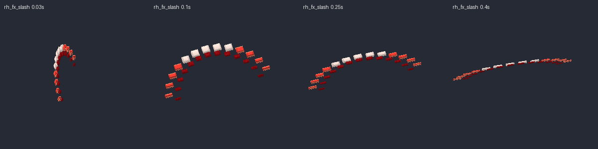
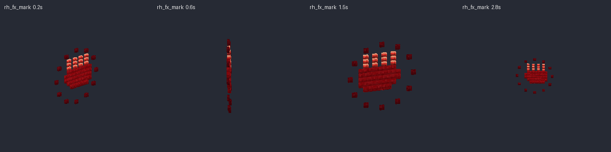
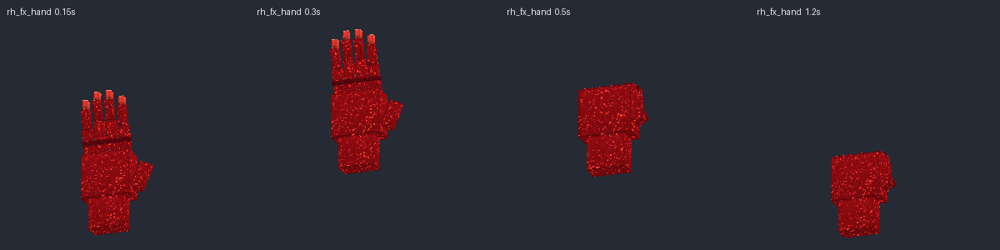
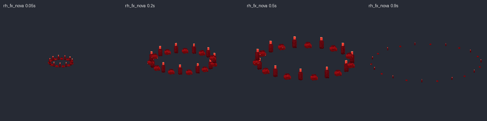
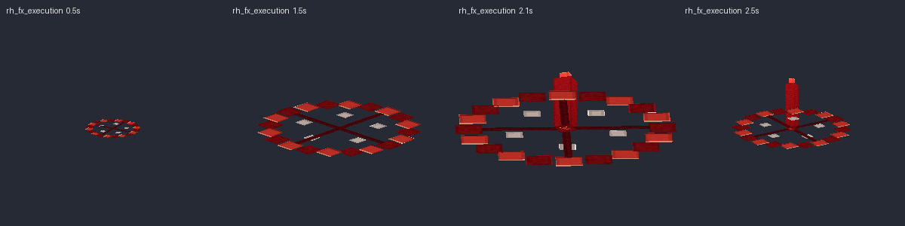
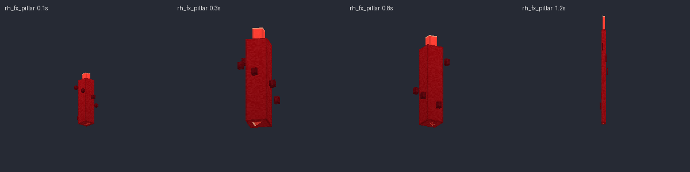

> En `RH_SlashCombo` el primer golpe llega 2 ticks después, para que coincida con la animación. El daño es el mismo.

## Súbditos

| Mob | Modelo | Aspecto | Sonidos |
|---|---|---|---|
| `FallenSquire` | `fallen_squire` | Escudero zombi con capelina de hierro, cofia de malla, gambesón acolchado y tabardo rojo con la mano | `squire_groan`, `squire_hit` |
| `CorruptKnight` | `corrupt_knight` | Caballero esqueleto con bacinete de hocico, armadura oxidada, escudo negro con la mano roja y espada larga | `knight_clank`, `knight_bash` |
| `CondemnedSoul` | `condemned_soul` | Alma en pena encapuchada con calavera de ojos rojos, manos esqueléticas, cadenas y cola de espectro | `soul_wail`, `soul_hit` |

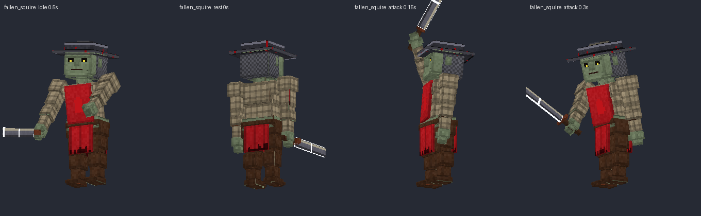
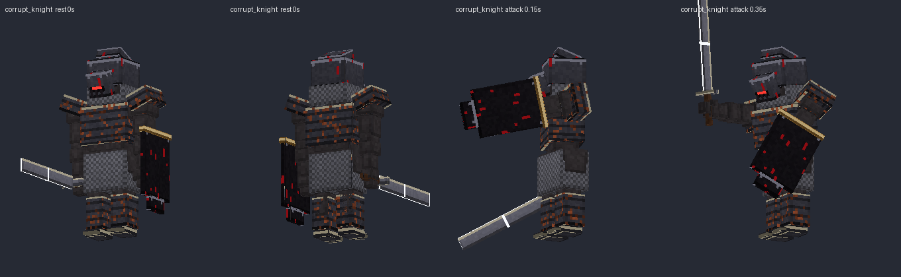
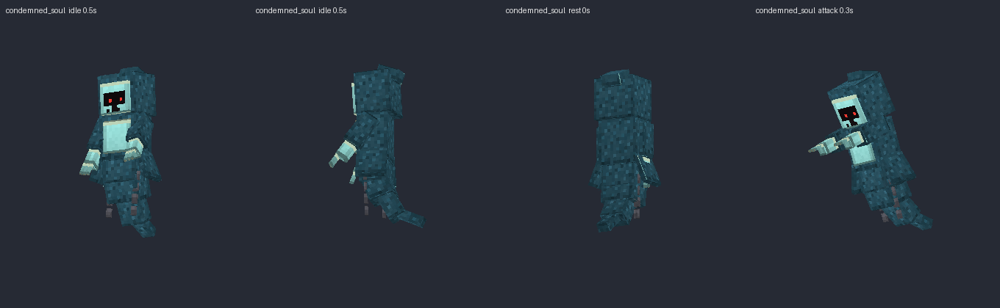
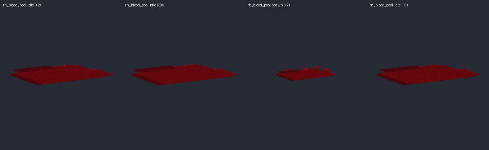

Escucha todos los sonidos en `preview/sonidos_demo.mp3`.
