# RAGNAROK: boss 05 con modelos de ModelEngine

Ragnarok es un gigante de hielo vikingo que surge del volcán. Lleva:

- **Cabeza:** casco con nudos dorados, cuernos curvos de marfil y una corona de cristales de hielo.
- **Barba y manto:** barba blanca trenzada con anillos de oro y manto de piel de lobo con cabeza de lobo.
- **Cuerpo:** brazos con tatuajes de runas que brillan, cristales de hielo en el hombro y botas de piel.
- **Arma:** gran hacha de hielo con filo brillante.

Va con tres súbditos.

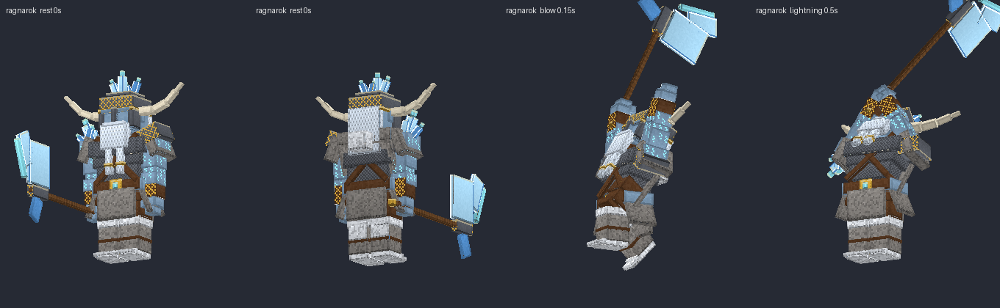
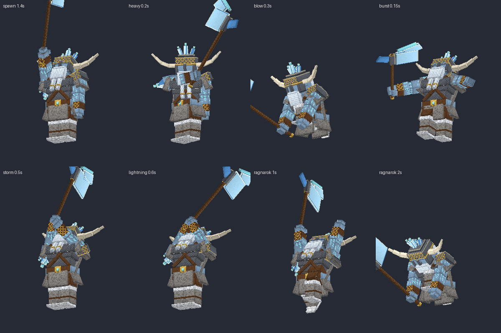

## Contenido

| Archivo | Qué es |
|---|---|
| `ModelEngine/blueprints/ragnarok/` | Modelo del boss: 116 cubos y 14 animaciones |
| `ModelEngine/blueprints/draugr/`, `spectral_valkyrie/`, `viking_warrior/` | Súbditos |
| `ModelEngine/blueprints/rg_fx_*/` | Efectos de los ataques |
| `../../MythicMobs-3D/Mobs/Boss_05_Ragnarok/Ragnarok_mobs.yml` | Mobs con `model{}`, bossbar con moldura y mobs de efectos `RG_FX_*` |
| `../../MythicMobs-3D/Skills/ragnarok_skills.yml` | Skills con animaciones, sonidos, efectos y título |
| `../DextraBossesPack/assets/dextra/sounds/ragnarok/` | Sonidos propios (`dextra:ragnarok.*`) |
| `../DextraBossesPack/assets/dextra/textures/font/ragnarok/` | Logo del título |
| `../ItemsAdder/contents/dextra_bosses/ragnarok.yml` | Moldura de la bossbar |
| `../../tools/b05_ragnarok.py`, `b05_fx.py`, `b05_sounds.py`, `b05_hud.py` | Scripts que lo generan todo |

## Instalación

1. Copia todas las carpetas de `ModelEngine/blueprints/` en `plugins/ModelEngine/blueprints/`: 4 modelos y 5 efectos.
2. Sustituye en el servidor 3D:
   - `plugins/MythicMobs/Mobs/Boss_05_Ragnarok/Ragnarok_mobs.yml`
   - `plugins/MythicMobs/Skills/ragnarok_skills.yml`
3. Copia de nuevo `Modelos/DextraBossesPack/` y `Modelos/ItemsAdder/contents/dextra_bosses/`.
4. Ejecuta `/meg reload`, `/iazip` y `/mm reload`, y vuelve a entrar. Pruébalo con `/mm m spawn Ragnarok`.

## Bossbar y título

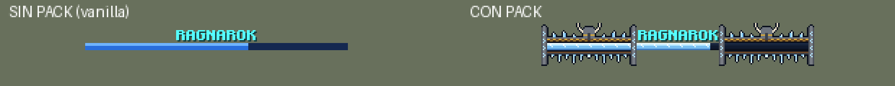
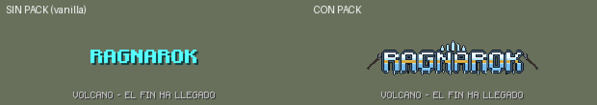

| | Sin pack | Con pack |
|---|---|---|
| Bossbar | `RAGNAROK` celeste y barra azul vanilla | Moldura nórdica: banda de madera con nudos dorados, cristales de hielo, casco con cuernos, carámbanos y piedras rúnicas |
| Título | `RAGNAROK` como siempre | Logo de hielo con franja de oro, cristales encima, hachas a los lados y carámbanos |
| Sonidos | Los vanilla | Los vanilla más los propios |

Con el pack, la textura de la barra azul también la usan Yeti, Samhain, Thor y Nezareth.

## Animaciones y efectos de cada ataque

| Skill | Animación | Golpe | Efecto 3D | Sonido |
|---|---|---|---|---|
| `Ragnarok_Spawn` | `spawn` | — | Círculo de piedras rúnicas con rayo | `intro`: cuerno de guerra, coro, tambores y trueno |
| Golpe normal (`Ragnarok_Melee`) | `attack` | 0.3 s | — | `strike` |
| `Ragnarok_HeavyStrike` | `heavy` (barrido lateral) | 0.2 s (`delay 4`) | Racimo de cristales que brota y estalla | `strike` |
| `Ragnarok_DevastatingBlow` | `blow` (golpe con las dos manos) | 0.3 s (`delay 6`) | Racimo de cristales | `blow` |
| `Ragnarok_FreezeBurst` | `burst` (pisotón) | inmediato | Anillo de pinchos de hielo, 7 bloques | `burst` |
| `Ragnarok_IceStorm` | `storm` (hacha al cielo) | 0.4 s (`delay 8`) | Lluvia de carámbanos gigantes y nube helada | `storm` |
| `Ragnarok_LightningStorm` | `lightning` (brazos al cielo) | — | Piedras rúnicas y rayo | `lightning` |
| `Ragnarok_RunOrDie` | `ragnarok` (carga 2 s y golpea el suelo) | 2.0 s | Cúpula de cristales que crece 2 s y revienta a 12 bloques | `ragnarok` |
| Invocaciones | `summon` (golpe al pecho y grito) | — | Piedras rúnicas | `summon`: cuerno y tambores |
| Cambio de fase | `phase_change` | — | Piedras rúnicas | `phase` |
| Daño / muerte | `hurt` / `death` | — | — | `hurt` / `death` |

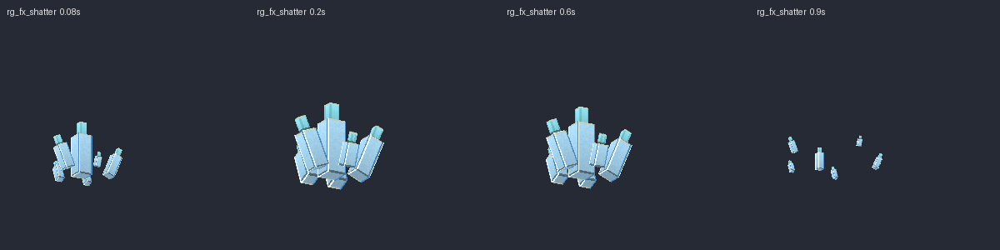
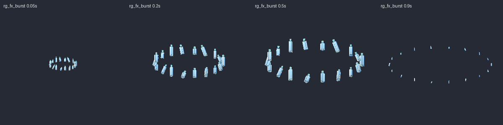
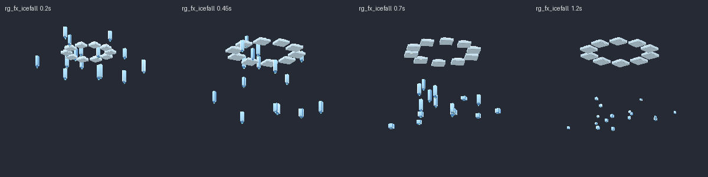
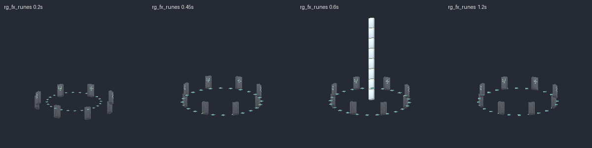
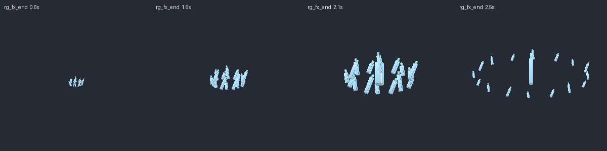

> En `Ragnarok_HeavyStrike` el daño llega ahora 4 ticks después, para que coincida con el barrido. El daño es el mismo.

## Súbditos

| Mob | Modelo | Aspecto | Sonidos |
|---|---|---|---|
| `Draugr_Ragnarok` | `draugr` | Vikingo no muerto encorvado, de piel azulada y ojos que brillan, con casco, barba gris, cota rota y hacha | `draugr_groan`, `draugr_hit` |
| `SpectralVex_Ragnarok` | `spectral_valkyrie` | Valquiria espectral con alas de plumas, casco alado, trenza y lanza de hielo | `valkyrie_cry`, `valkyrie_strike` |
| `VikingWarrior_Ragnarok` | `viking_warrior` | Vikingo pelirrojo con barba trenzada, casco, cota, capa de piel, escudo pintado y hacha barbuda | `viking_shout`, `viking_hit` |

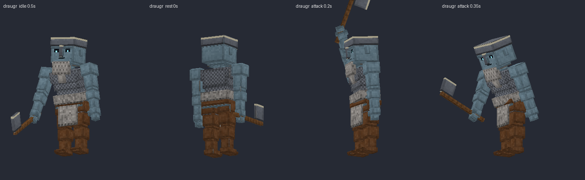
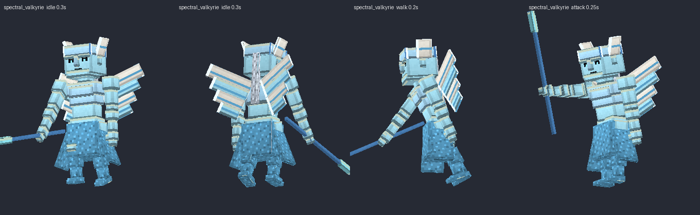
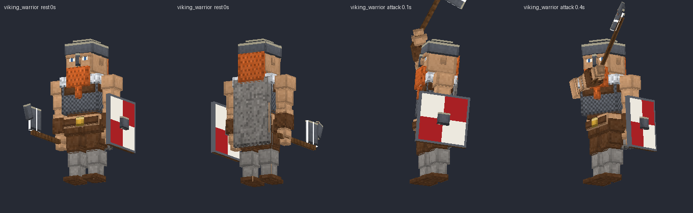

Escucha todos los sonidos en `preview/sonidos_demo.mp3`.
