# MUSHLORD: boss 06 con modelos de ModelEngine

Mushlord es el Señor de las Espiras Corruptas. Lleva:

- **Cabeza:** un gran sombrero de hongo morado con manchas que brillan, láminas debajo, filamentos de micelio colgando y setas pequeñas encima.
- **Cuerpo:** de corteza y musgo, con setas repisa en hombros y espalda, garras de raíz y raíces en los pies.
- **Arma:** bastón con una seta y un orbe de esporas.

Va con tres súbditos. Sus zonas tóxicas y sus nubes también tienen modelo.

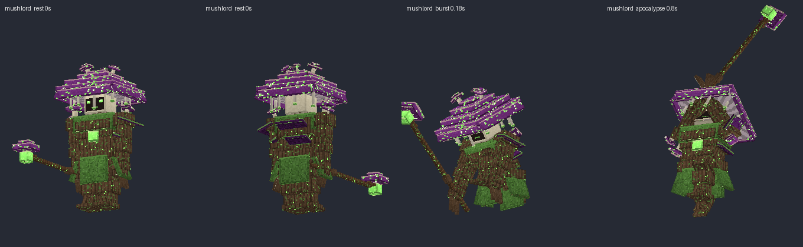
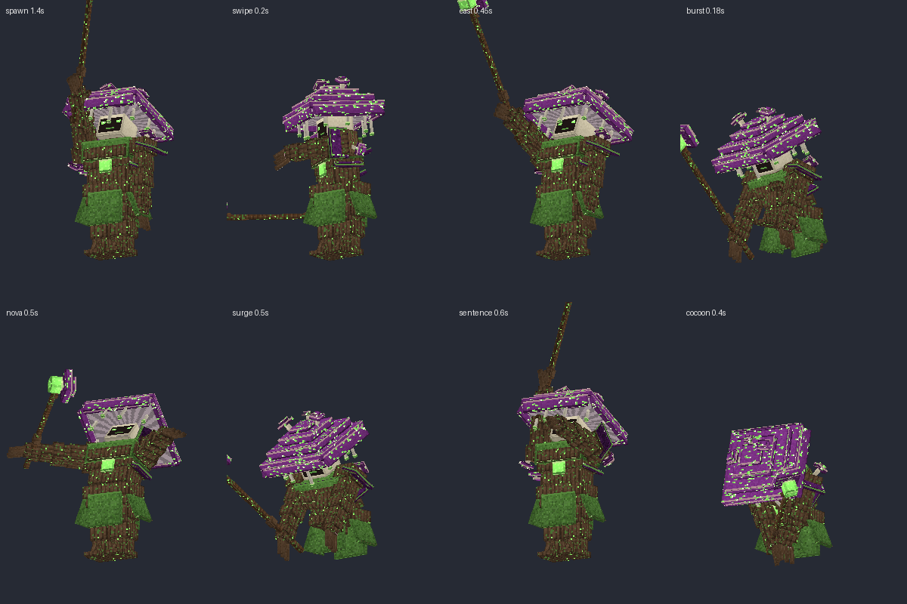

## Contenido

| Archivo | Qué es |
|---|---|
| `ModelEngine/blueprints/mushlord/` | Modelo del boss: 119 cubos y 16 animaciones |
| `ModelEngine/blueprints/mush_zombie/`, `shroom_creeper/`, `living_spore/` | Súbditos |
| `ModelEngine/blueprints/ms_toxic_zone/`, `ms_breath/` | Charco tóxico con setas (`Mushlord_ToxicZone`) y nube tóxica (`Mushlord_PersistentBreath`) |
| `ModelEngine/blueprints/ms_fx_*/` | Efectos de los ataques |
| `../../MythicMobs-3D/Mobs/Boss_06_Mushlord/Mushlord_mobs.yml` | Mobs con `model{}`, bossbar con moldura y mobs de efectos `MS_FX_*` |
| `../../MythicMobs-3D/Skills/mushlord_skills.yml` | Skills con animaciones, sonidos, efectos y título |
| `../DextraBossesPack/assets/dextra/sounds/mushlord/` | Sonidos propios (`dextra:mushlord.*`) |
| `../DextraBossesPack/assets/dextra/textures/font/mushlord/` | Logo del título |
| `../ItemsAdder/contents/dextra_bosses/mushlord.yml` | Moldura de la bossbar |
| `../../tools/b06_mushlord.py`, `b06_fx.py`, `b06_sounds.py`, `b06_hud.py` | Scripts que lo generan todo |

## Instalación

1. Copia todas las carpetas de `ModelEngine/blueprints/` en `plugins/ModelEngine/blueprints/`: 6 modelos y 8 efectos.
2. Sustituye en el servidor 3D:
   - `plugins/MythicMobs/Mobs/Boss_06_Mushlord/Mushlord_mobs.yml`
   - `plugins/MythicMobs/Skills/mushlord_skills.yml`
3. Copia de nuevo `Modelos/DextraBossesPack/` y `Modelos/ItemsAdder/contents/dextra_bosses/`.
4. Ejecuta `/meg reload`, `/iazip` y `/mm reload`, y vuelve a entrar. Pruébalo con `/mm m spawn Mushlord`.

## Bossbar y título

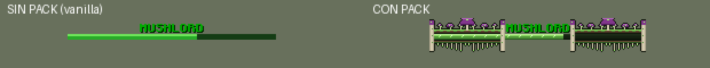
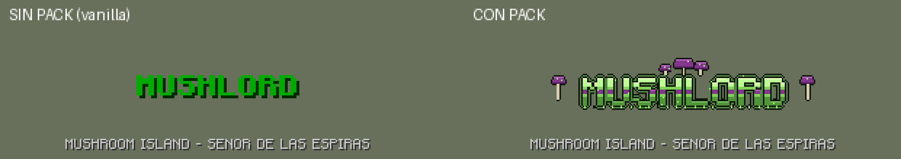

| | Sin pack | Con pack |
|---|---|---|
| Bossbar | `MUSHLORD` verde y barra verde vanilla | Moldura de tronco con musgo, setas, una seta grande en el centro, micelio colgando y troncos de seta en los extremos |
| Título | `MUSHLORD` como siempre | Logo verde con franja morada, esporas que brillan, setas encima y a los lados |
| Sonidos | Los vanilla | Los vanilla más los propios |

## Animaciones y efectos de cada ataque

| Skill | Animación | Golpe | Efecto 3D | Sonido |
|---|---|---|---|---|
| `Mushlord_Spawn` | `spawn` | — | Anillo de setas que brotan | `intro`: coro, burbujas, raíces y voz |
| Golpe normal (`Mushlord_Melee`) | `attack` | 0.3 s | — | `swipe` |
| `Mushlord_ToxicSwipe` | `swipe` (zarpazo) | 0.2 s (`delay 4`) | Zarpazo verde con gotas | `swipe` |
| `Mushlord_SporeBolt` | `cast` (lanza con el bastón) | 0.4 s (`delay 8`) | Bomba de esporas que cae sobre el jugador y revienta | `bolt` |
| `Mushlord_SporeBurst`, `Mushlord_FungalBloom` | `burst` (golpe al suelo) | inmediato | Anillo de setas | `burst` |
| `Mushlord_ToxicCloud` | `cloud` (exhala) | — | Ola de esporas | `cloud` |
| `Mushlord_ToxicZoneCast` | `cast` | — | El charco tóxico tiene modelo y burbujea | `bolt`, `zone_bubble` |
| `Mushlord_MycotoxinNova` | `nova` (recoge y libera) | 0.5 s (`delay 10`) | Ola de esporas de 8 bloques | `nova` |
| `Mushlord_PlagueSurge` | `surge` (atrae y golpea) | 0.5 s (`delay 10`) | Raíces que salen del suelo y se cierran | `surge` |
| `Mushlord_GardenSentence` | `sentence` (bastón al cielo) | 1.2 s (`delay 24`) | Círculo de setas sobre el jugador y una seta gigante que revienta | `sentence` |
| `Mushlord_CorruptionEruption` | `burst` | inmediato | Hongo nuclear tóxico | `eruption` |
| `Mushlord_PlagueApocalypse` | `apocalypse` (carga 1.5 s) | 1.5 s (`delay 30`) | Hongo nuclear tóxico | `sentence` y `eruption` |
| Cambios de fase (`Mushlord_TransitionCocoon`) | `cocoon` (se encoge y revienta) | 0.6 s (`delay 12`) | Capullo de micelio que lo envuelve y revienta | `cocoon` |
| Invocaciones | `summon` | — | Anillo de setas | `summon` |
| Daño / muerte | `hurt` / `death` | — | — | `hurt` / `death` |

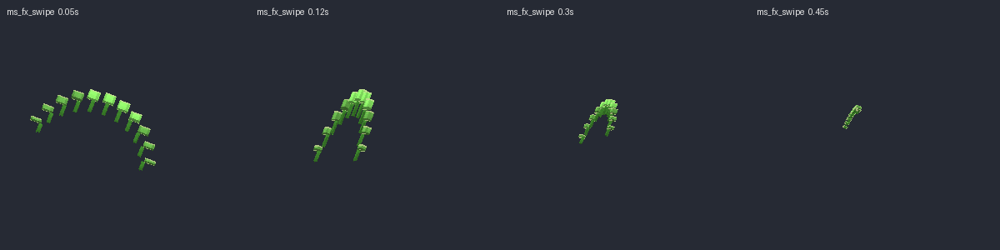
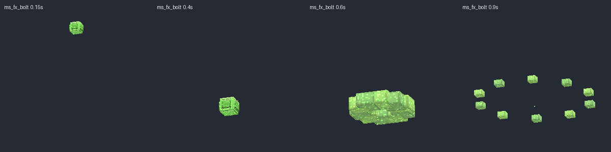
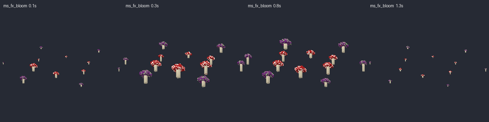
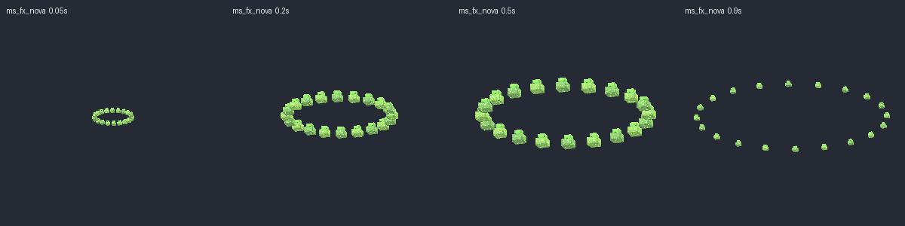
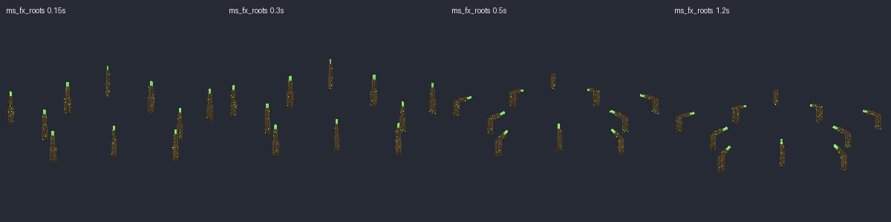
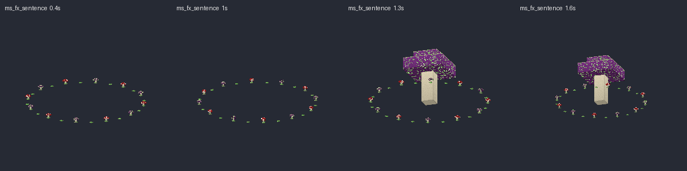
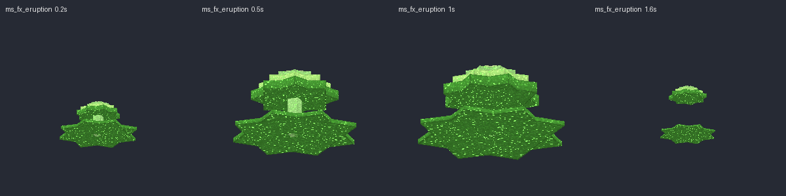
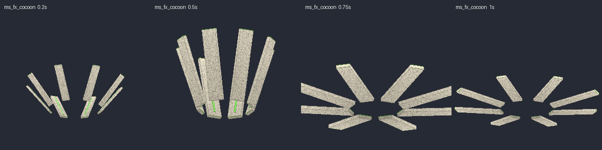

> En `Mushlord_ToxicSwipe` el daño llega ahora 4 ticks después, para que coincida con el zarpazo. El daño es el mismo.

## Súbditos

| Mob | Modelo | Aspecto | Sonidos |
|---|---|---|---|
| `MushZombie` | `mush_zombie` | Zombi podrido con cabeza de seta roja, musgo y setas que le salen del hombro y la espalda | `zombie_groan`, `zombie_hit` |
| `ToxicShroomCreeper` | `shroom_creeper` | Creeper con setas y sacos de esporas que brillan; se hincha antes de reventar (`prime`) | `creeper_swell`, `creeper_pop` |
| `LivingSpore` | `living_spore` | Bola de esporas que flota, con ojitos, filamentos y una seta encima | `spore_squeak`, `spore_pop` |

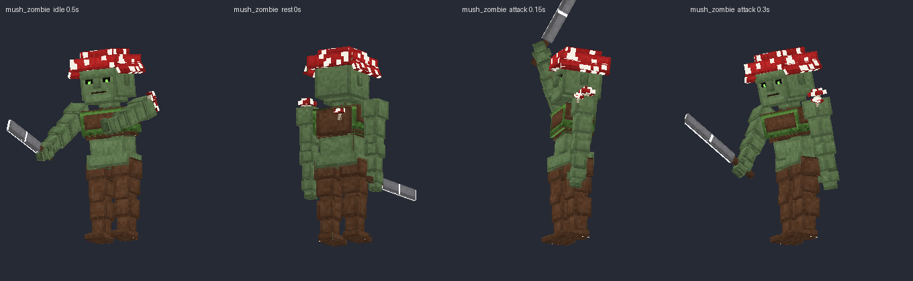
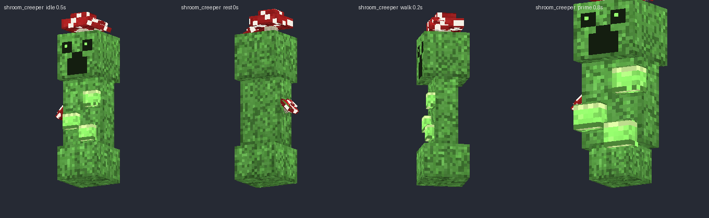
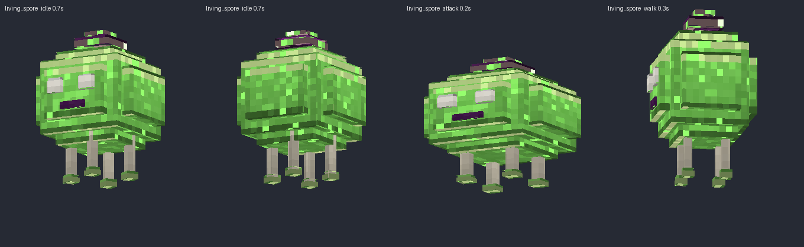
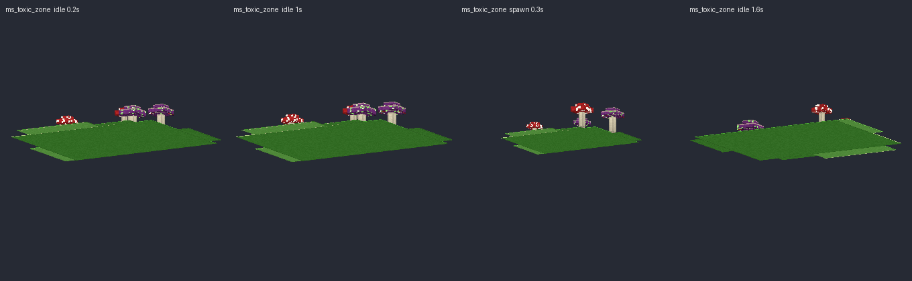
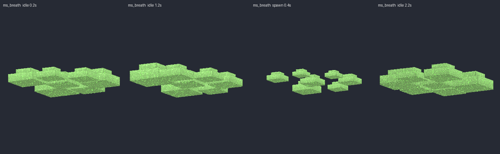

Escucha todos los sonidos en `preview/sonidos_demo.mp3`.
