# LADY OF LAMENTS: boss 07 con modelos de ModelEngine

Reina espectral del Castillo Púrpura que flota. Lleva corona de cristales de amatista, velo, melena blanca y cuello gótico en abanico. Viste corsé de encaje, mangas acampanadas y un vestido en tres capas con cola. Tiene cadenas espectrales en las muñecas, un cetro de cristal y una linterna de almas.

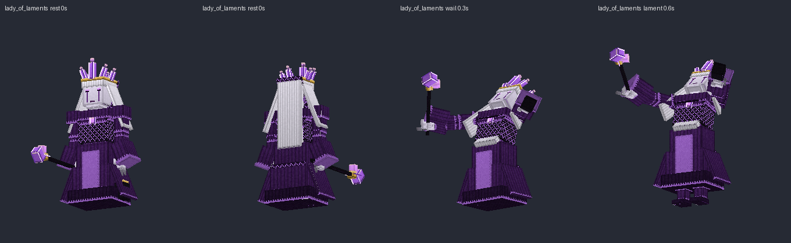
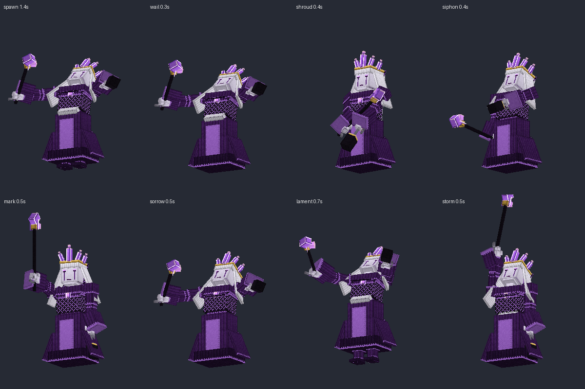

## Contenido

| Archivo | Qué es |
|---|---|
| `ModelEngine/blueprints/lady_of_laments/` | Modelo del boss: 94 cubos y 15 animaciones |
| `ModelEngine/blueprints/banshee/`, `lament_shadow/`, `tormented_spirit/`, `castle_vindicator/` | Súbditos |
| `ModelEngine/blueprints/ll_fx_*/` | Efectos de los ataques |
| `../../MythicMobs-3D/Mobs/Boss_07_LadyOfLaments/Ladyoflaments_mobs.yml` | Mobs con `model{}`, bossbar con moldura y mobs de efectos `LL_FX_*` |
| `../../MythicMobs-3D/Skills/lady_of_laments_skills.yml` | Skills con animaciones, sonidos, efectos y título |
| `../DextraBossesPack/assets/dextra/sounds/lady_of_laments/` | Sonidos propios |
| `../ItemsAdder/contents/dextra_bosses/lady_of_laments.yml` | Moldura de la bossbar |
| `../../tools/b07_lady.py`, `b07_fx.py`, `b07_sounds.py`, `b07_hud.py` | Scripts que lo generan todo |

## Instalación

1. Copia todas las carpetas de `ModelEngine/blueprints/` en `plugins/ModelEngine/blueprints/`: 5 modelos y 8 efectos.
2. Sustituye en el servidor 3D `Mobs/Boss_07_LadyOfLaments/Ladyoflaments_mobs.yml` y `Skills/lady_of_laments_skills.yml`.
3. Copia de nuevo `Modelos/DextraBossesPack/` y `Modelos/ItemsAdder/contents/dextra_bosses/`.
4. Ejecuta `/meg reload`, `/iazip` y `/mm reload`, y vuelve a entrar. Pruébalo con `/mm m spawn LadyOfLaments`.

## Bossbar y título

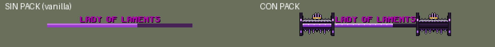
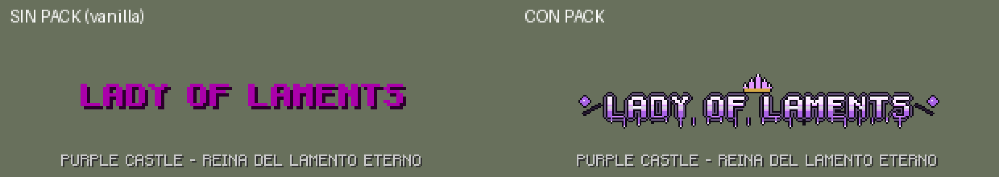

- **Bossbar con pack:** moldura gótica de encaje negro con amatistas, una corona en el centro, lágrimas colgando y agujas en los extremos.
- **Título con pack:** logo de amatista con corona y lágrimas.
- **Sin pack:** se ve como siempre.
- **Barra morada:** es la misma de Old Ender.

## Animaciones y efectos de cada ataque

| Skill | Animación | Efecto 3D | Sonido |
|---|---|---|---|
| `LL_Spawn` | `spawn` (sale del suelo y grita) | Espejo espectral que se abre | `intro`: campana, susurros, coro soprano y lamento |
| `LL_Wail`, `LL_EchoOfGrief` | `wail` (grito con los brazos abiertos) | Ondas de sonido moradas de 7 bloques | `wail` |
| `LL_ShroudOfNight` | `shroud` (se cubre con el manto) | Cúpula de oscuridad | `shroud` |
| `LL_SpiritSiphon` | `siphon` (tira del alma del jugador) | Almas que suben en espiral desde el jugador | `siphon` |
| `LL_GriefMark` | `mark` (señala con el cetro) | Círculo de amatistas bajo el jugador que estalla al 1.2 s, justo con el daño | `mark` |
| `LL_SharedSorrow` | `sorrow` | Anillo de pinchos de amatista | `sorrow` |
| `LL_MassLament` | `lament` (se eleva y grita) | Columna de lamento y ola de 12 bloques | `lament` |
| `LL_StormOfSorrow` | `storm` (cetro al cielo) | Rayos de amatista que caen del cielo | `storm` |
| `LL_ShadowHunt` | `siphon` | — | `shadow_growl` |
| Invocaciones | `summon` (alza la linterna) | Espejo espectral | `summon` |
| Cambio de fase | `phase_change` | Espejo espectral | `phase` |
| Daño / muerte | `hurt` / `death` (se deshace en el aire) | — | `hurt` / `death` |

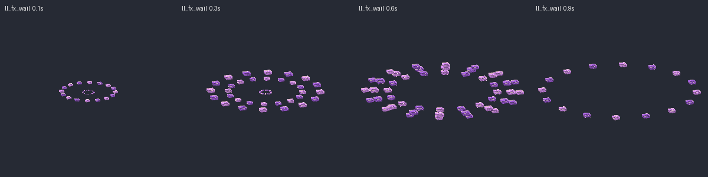
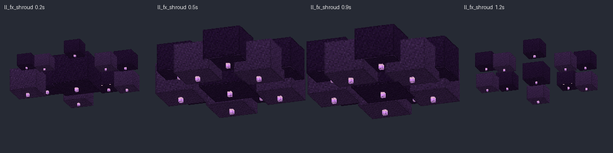
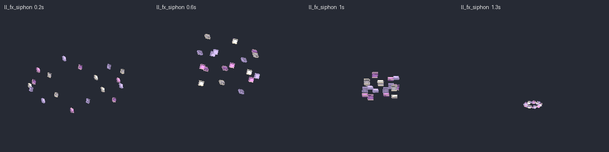
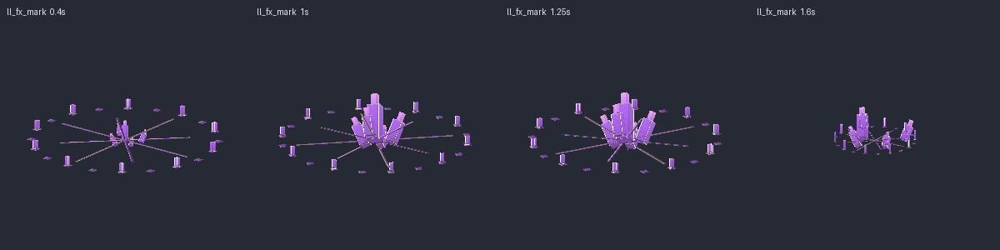
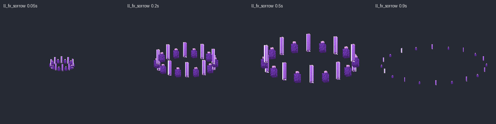
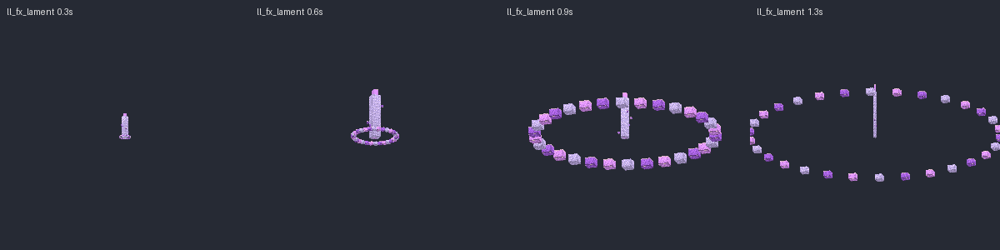
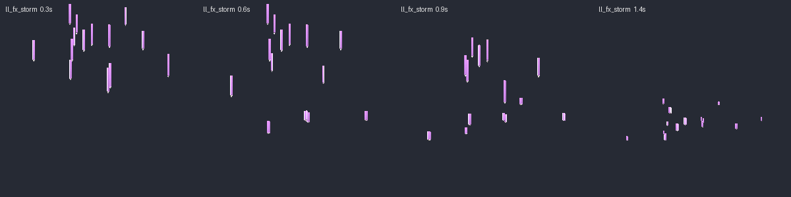
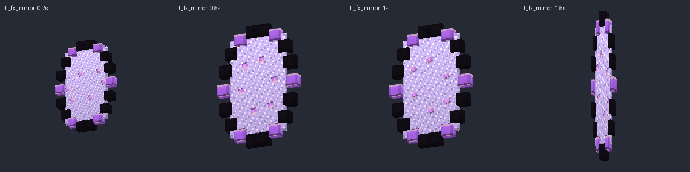

## Súbditos

| Mob | Modelo | Aspecto | Sonidos |
|---|---|---|---|
| `BansheeOfLaments` | `banshee` | Banshee que grita, con melena blanca y vestido que acaba en jirones | `banshee_scream`, `banshee_hit` |
| `LamentShadow` | `lament_shadow` | Bestia de humo negro con ojos rosas, orejas y pinchos | `shadow_growl`, `shadow_bite` |
| `TormentedSpirit` | `tormented_spirit` | Máscara de tragedia que llora, con capucha, jirones y cadenas | `spirit_moan`, `spirit_drain` |
| `CastleVindicator_Laments` | `castle_vindicator` | Verdugo encapuchado con ojos rojos, tabardo morado y hacha grande | `vindicator_grunt`, `vindicator_chop` |

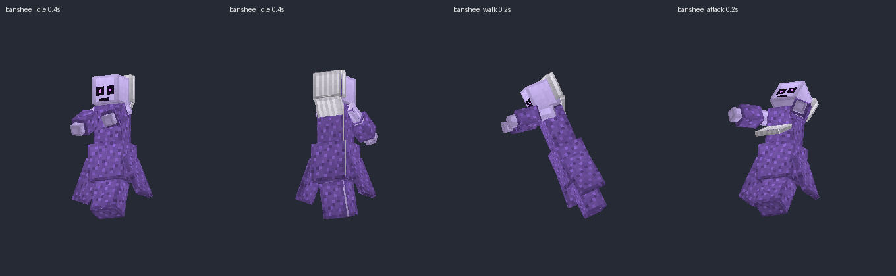
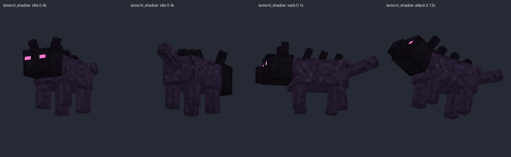
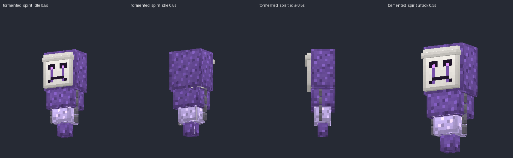
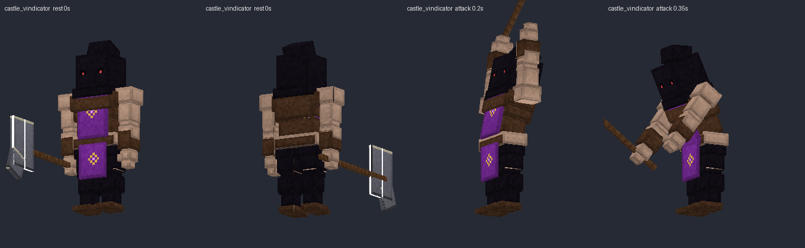

Escucha todos los sonidos en `preview/sonidos_demo.mp3`.
