# YETI: boss 08 con modelos de ModelEngine

Bestia de las montañas heladas, encorvada y cubierta de pelo blanco en mechones. Tiene la cara azul con colmillos, cuernos curvos, cristales de hielo en la espalda y garras de marfil.

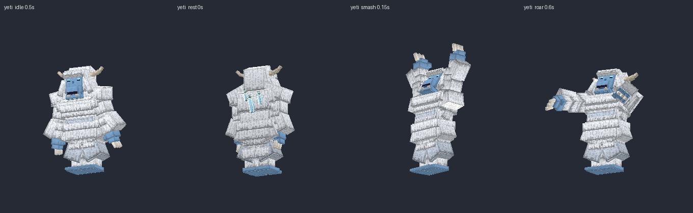
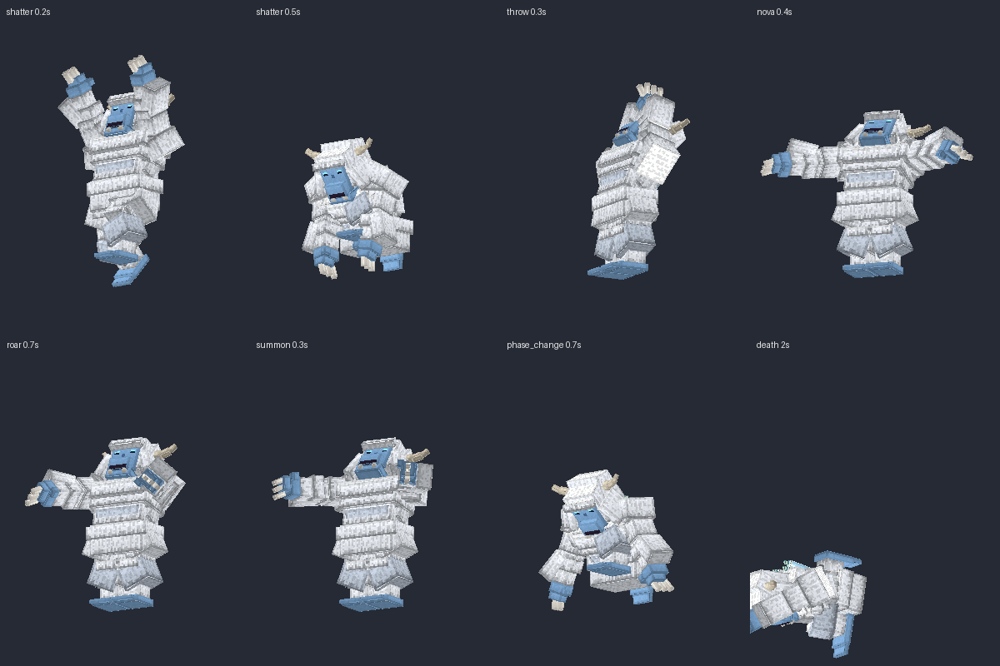

## Contenido

| Archivo | Qué es |
|---|---|
| `ModelEngine/blueprints/yeti/` | Modelo del boss: 81 cubos y 13 animaciones |
| `ModelEngine/blueprints/frost_brute/`, `glacier_raider/`, `blizzard_spirit/` | Súbditos |
| `ModelEngine/blueprints/yt_fx_*/` | Efectos de los ataques |
| `../../MythicMobs-3D/Mobs/Boss_08_Yeti/Yeti_mobs.yml` | Mobs con `model{}`, bossbar con moldura y mobs de efectos `Yeti_FX_*` |
| `../../MythicMobs-3D/Skills/yeti_skills.yml` | Skills con animaciones, sonidos, efectos y título |
| `../DextraBossesPack/assets/dextra/sounds/yeti/` | Sonidos propios |
| `../ItemsAdder/contents/dextra_bosses/yeti.yml` | Moldura de la bossbar |
| `../../tools/b08_yeti.py`, `b08_fx.py`, `b08_sounds.py`, `b08_hud.py` | Scripts que lo generan todo |

## Instalación

1. Copia todas las carpetas de `ModelEngine/blueprints/` en `plugins/ModelEngine/blueprints/`: 4 modelos y 9 efectos.
2. Sustituye en el servidor 3D `Mobs/Boss_08_Yeti/Yeti_mobs.yml` y `Skills/yeti_skills.yml`.
3. Copia de nuevo `Modelos/DextraBossesPack/` y `Modelos/ItemsAdder/contents/dextra_bosses/`.
4. Ejecuta `/meg reload`, `/iazip` y `/mm reload`, y vuelve a entrar. Pruébalo con `/mm m spawn Yeti`.

## Bossbar y título

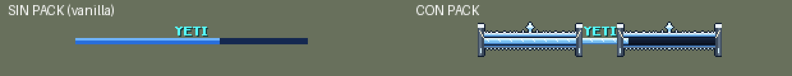
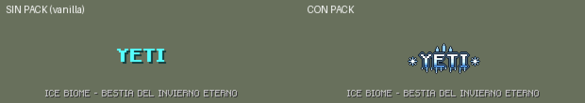

- **Bossbar con pack:** moldura de hielo con nieve acumulada encima, carámbanos colgando, un cristal en el centro y pilares de roca con colmillos de marfil.
- **Título con pack:** logo de hielo con cristales, carámbanos y copos de nieve.
- **Sin pack:** se ve como siempre.
- **Barra azul:** es la misma de Ragnarok.

## Animaciones y efectos de cada ataque

| Skill | Animación | Efecto 3D | Sonido |
|---|---|---|---|
| `Yeti_Spawn` | `spawn` | Estallido de nieve | `intro`: ventisca, hielo que cruje y rugido |
| `Yeti_GroundShatter` | `shatter` (salta y golpea el suelo con los dos puños al 0.4 s, justo con el daño) | Grietas y ola de pinchos de hielo de 7 bloques | `shatter` |
| `Yeti_IceSmash` | `smash` (martillazo con los dos brazos) | Racimo de cristales que revienta | `smash` |
| `Yeti_IceRockThrow` | `throw` | Roca de hielo que cae sobre el jugador al 0.55 s | `throw` |
| `Yeti_IceRockBarrage` | `throw` | Lluvia de rocas de hielo en 9 bloques | `barrage` |
| `Yeti_FrostNova` | `nova` (abre los brazos) | Ola de nieve y escarcha de 7 bloques | `nova` |
| `Yeti_IntenseBlizzard` | `nova` | Remolino de ventisca | `blizzard` |
| `Yeti_Roar` | `roar` | Anillos de nieve | `roar` |
| Invocaciones | `summon` (se golpea el pecho) | Estallido de nieve | `summon` |
| Cambio de fase | `phase_change` (se arrodilla y ruge) | — | `phase` |
| Fase 3 (escudo de súbditos) | `phase_change` | Cúpula de hielo | `shield` (también al romperse) |
| Golpe normal / daño / muerte | `attack` / `hurt` / `death` | — | `smash` / `hurt` / `death` |

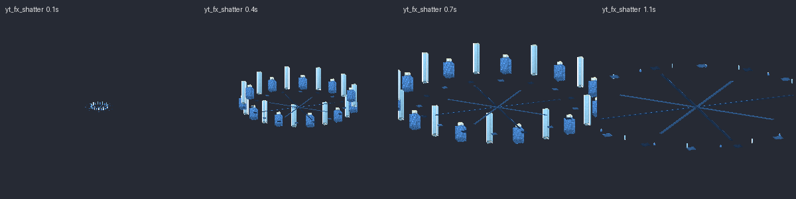
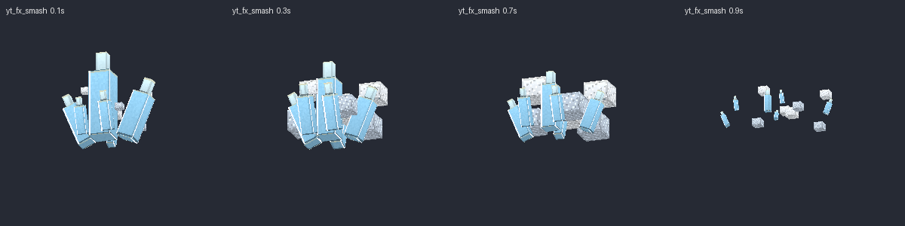
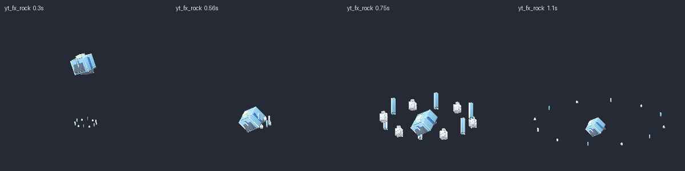
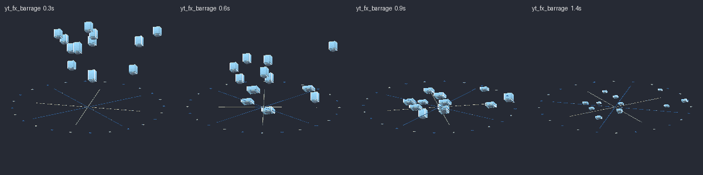
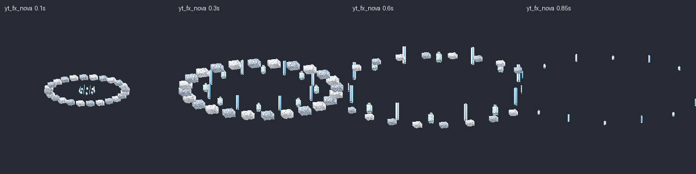
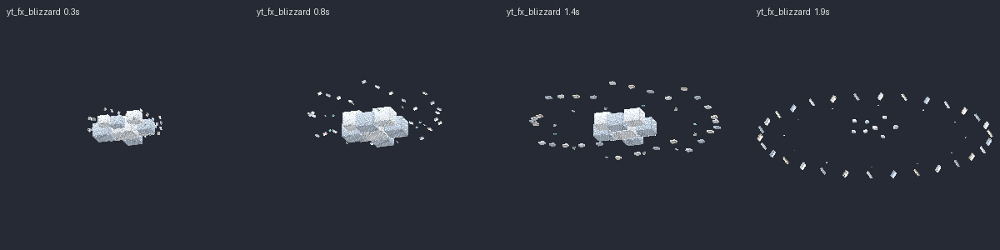
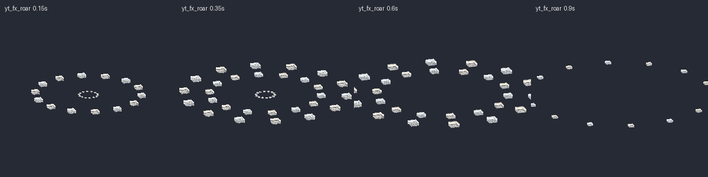
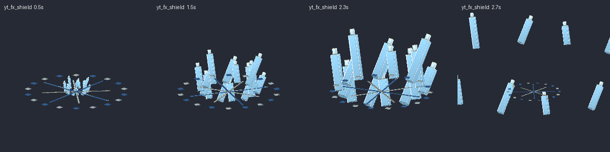
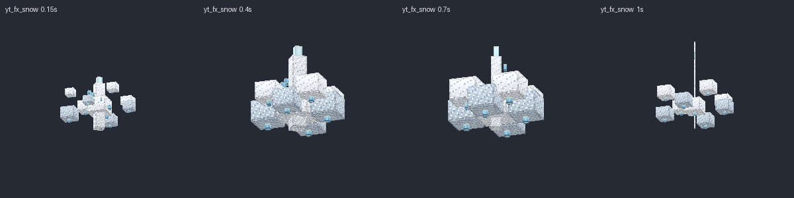

## Súbditos

| Mob | Modelo | Aspecto | Sonidos |
|---|---|---|---|
| `FrostBrute_Yeti` | `frost_brute` | Troll de piel azul con pinchos de hielo en la espalda y maza de hielo | `brute_grunt`, `brute_maul` |
| `GlacierRaider_Yeti` | `glacier_raider` | Asaltante con capucha de piel, gafas de nieve y hacha de cristal | `raider_shout`, `raider_cleave` |
| `BlizzardSpirit_Yeti` | `blizzard_spirit` | Espíritu de ventisca con máscara de hielo, corona de cristales y cola en remolino | `spirit_howl`, `spirit_claw` |

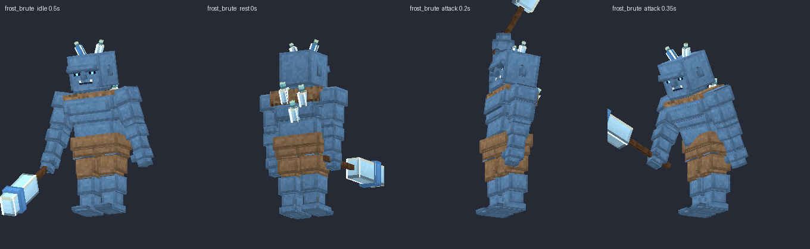
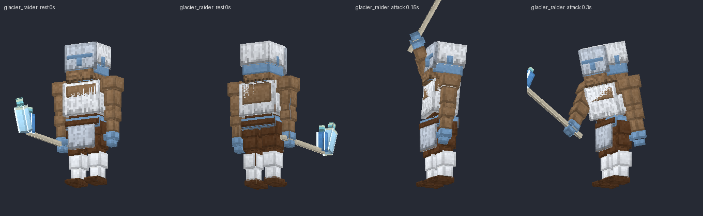
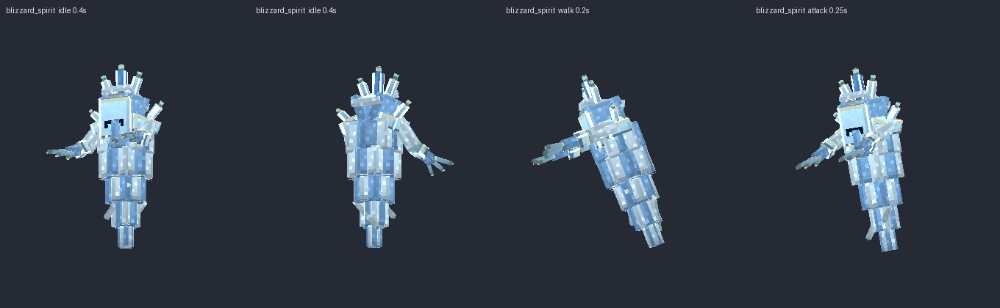

Escucha todos los sonidos en `preview/sonidos_demo.mp3`.
