# KRONOS: boss 10 con modelos de ModelEngine

Titán del tiempo. Tiene barba blanca larga y una corona de agujas de reloj. Detrás de la cabeza flota una aureola de reloj con manecillas que giran. Lleva peto de oro con una esfera de reloj, hombreras inclinadas, túnica morada en capas y engranajes que giran en la espalda. Un reloj de arena le cuelga de la cadera y empuña una guadaña.

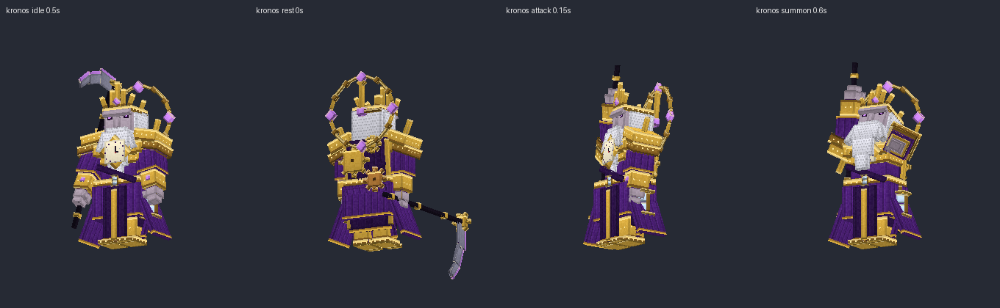
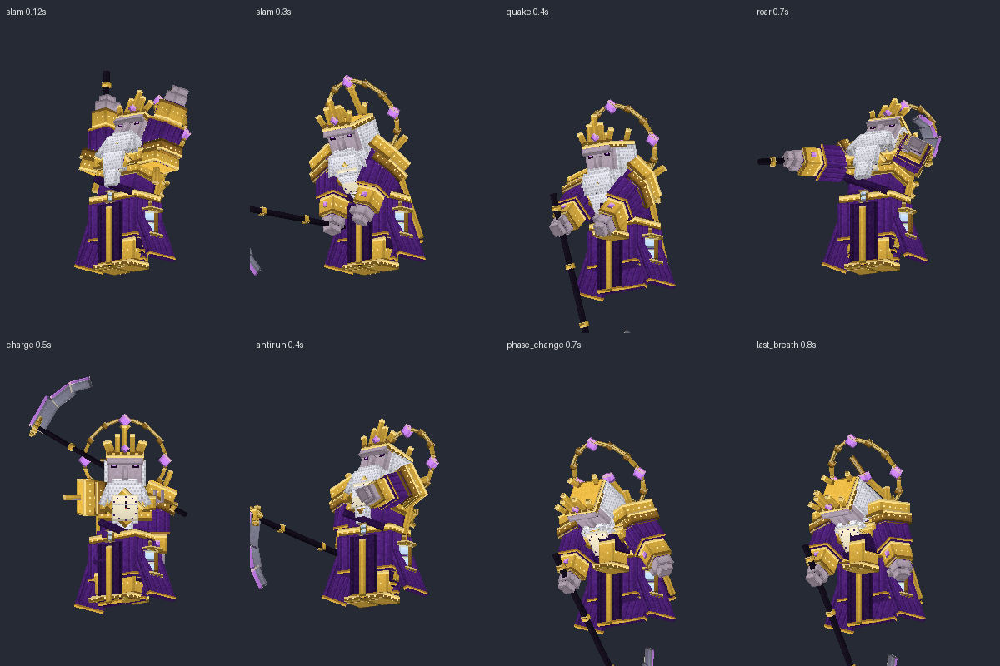

## Contenido

| Archivo | Qué es |
|---|---|
| `ModelEngine/blueprints/kronos/` | Modelo del boss: 183 cubos y 14 animaciones |
| `ModelEngine/blueprints/kr_sentinel/`, `kr_guardian/`, `kr_archer/`, `kr_devourer/` | Súbditos |
| `ModelEngine/blueprints/kr_fx_*/` | Efectos de los ataques |
| `../../MythicMobs-3D/Mobs/Boss_10_Kronos/Kronos_Mobs.yml` | Mobs con `model{}`, bossbar con moldura y mobs de efectos `KR_FX_*` |
| `../../MythicMobs-3D/Skills/Kronos_Combate.yml` | Skills con animaciones, sonidos, efectos y título |
| `../DextraBossesPack/assets/dextra/sounds/kronos/` | Sonidos propios |
| `../ItemsAdder/contents/dextra_bosses/kronos.yml` | Moldura de la bossbar |
| `../../tools/b10_kronos.py`, `b10_fx.py`, `b10_sounds.py`, `b10_hud.py` | Scripts que lo generan todo |

## Instalación

1. Copia todas las carpetas de `ModelEngine/blueprints/` en `plugins/ModelEngine/blueprints/`: 5 modelos y 8 efectos.
2. Sustituye en el servidor 3D `Mobs/Boss_10_Kronos/Kronos_Mobs.yml` y `Skills/Kronos_Combate.yml`.
3. Copia de nuevo `Modelos/DextraBossesPack/` y `Modelos/ItemsAdder/contents/dextra_bosses/`.
4. Ejecuta `/meg reload`, `/iazip` y `/mm reload`, y vuelve a entrar. Pruébalo con `/mm m spawn Kronos`.

## Bossbar y título

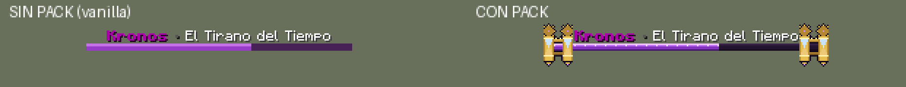
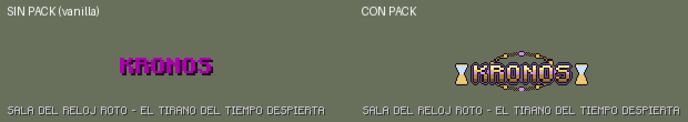

- **Bossbar con pack:** pilares de oro a cada lado del texto `Kronos • El Tirano del Tiempo`. Cada pilar lleva un engranaje arriba y un reloj de arena que cruza la barra.
- **Título con pack:** logo de oro con aureola de reloj y relojes de arena a los lados.
- **Sin pack:** se ve como siempre.
- **Barra morada:** es la misma de Old Ender.

## Animaciones y efectos de cada ataque

| Skill | Animación | Efecto 3D | Sonido |
|---|---|---|---|
| `KR_Intro` | `spawn` (se levanta y alza la guadaña) | Engranajes que salen del suelo, esfera de reloj y columna | `intro`: tic-tac que se acelera, campana al revés, campanada y coro |
| `KR_Slam` | `slam` (guadañazo a dos manos contra el suelo) | Grieta y anillo de cristales de 5 bloques | `slam` |
| `KR_Quake` | `quake` (salta y clava la guadaña al 0.3 s, justo con el daño) | Esfera de reloj gigante en el suelo y ola de pinchos de 8 bloques | `quake` |
| `KR_RugidoDelTiempo` | `roar` (las manecillas giran hacia atrás) | Reloj fantasma que sube girando, con arena en espiral | `time`: todo suena lento y al revés |
| `KR_Charge` | `charge` (tajo horizontal) | Media luna de la guadaña al caer el salto | `charge` |
| `KR_AntiRun` | `antirun` (agarra el tiempo con la mano) | Reloj de arena que cae sobre el que huye | `hourglass` |
| Invocaciones y fase 3 | `summon` (guadaña al cielo) | Grieta en el tiempo | `summon` |
| Cambio de fase | `phase_change` | Engranajes y esfera de reloj | `phase` |
| `KR_LastBreath` | `last_breath` (de rodillas y se levanta) | Columna y ola de arena | `last_breath` |
| Golpe normal / daño / muerte | `attack` / `hurt` / `death` (la aureola se apaga) | — | `swing` / `hurt` / `death` |

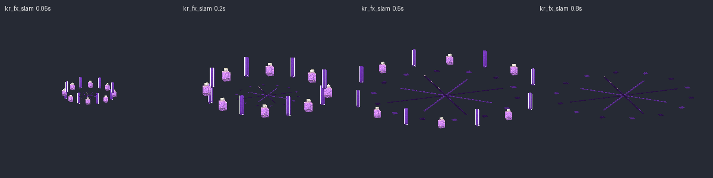
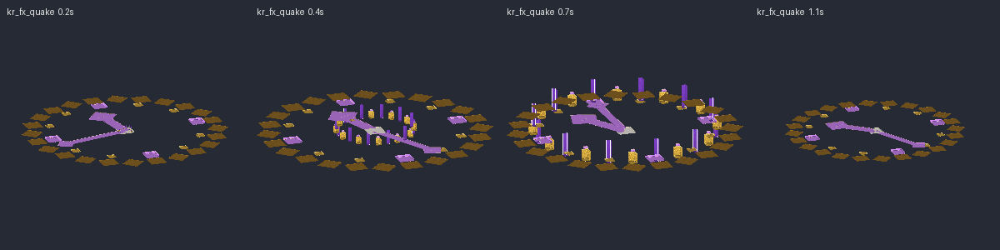
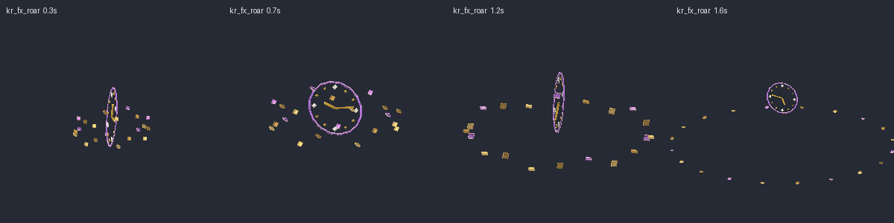
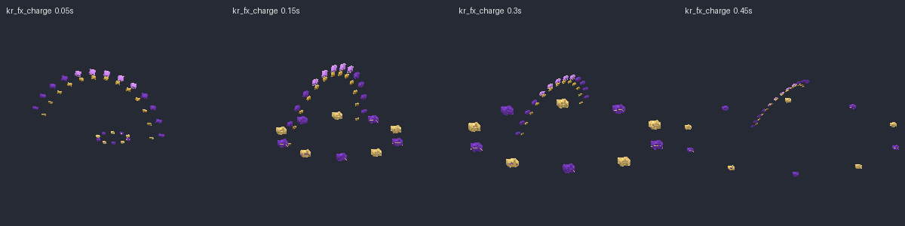
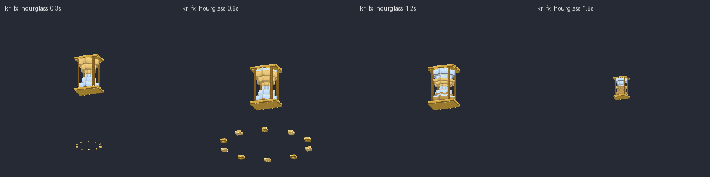
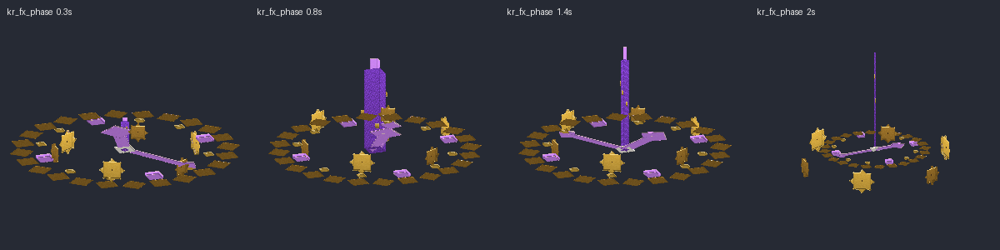
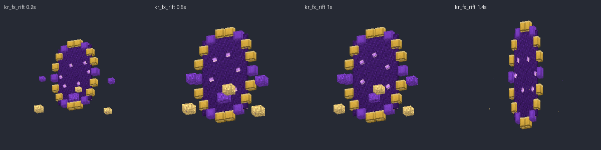
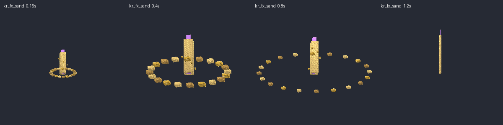

## Súbditos

| Mob | Modelo | Aspecto | Sonidos |
|---|---|---|---|
| `Kronos_Centinela` | `kr_sentinel` | Soldado de cuerda de bronce con casco-esfera de reloj, llave de cuerda que gira en la espalda, espada y reloj de bolsillo | `sentinel_wind`, `sentinel_slash` |
| `Kronos_Guardian` | `kr_guardian` | Armadura pesada de hierro y oro con un reloj de arena en el yelmo, escudo-engranaje y hacha. Se cubre con el escudo al recibir daño | `guardian_grunt`, `guardian_block` |
| `Kronos_Saetero` | `kr_archer` | Arquero con capucha y capa de atardecer, ojos brillantes, arco y carcaj | `archer_chime`, `archer_shot` |
| `Kronos_Devorador` | `kr_devourer` | Bestia enorme a cuatro patas con mandíbula, cuernos y un engranaje con esfera en el lomo | `devourer_roar`, `devourer_bite` |

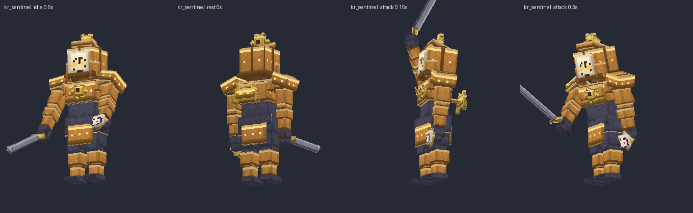
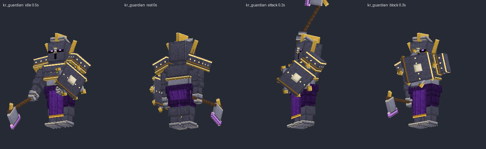
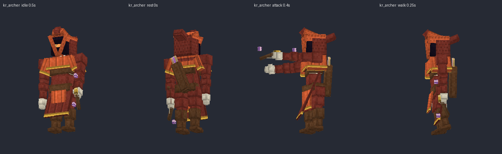
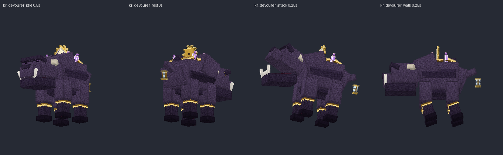

Escucha todos los sonidos en `preview/sonidos_demo.mp3`.
