# AZATHOTH: boss 11 con modelos de ModelEngine

El Caos Ancestral. Es una masa cósmica que flota, con piel de vacío llena de estrellas. Tiene fauces con dientes y un gran ojo central con párpados que se abren. Le salen ojos por todo el cuerpo, una corona de tentáculos arriba y un faldón de tentáculos abajo que ondulan sin parar. Usa dos tentáculos como brazos, tiene tres planetas en órbita y un aro de nebulosa a la espalda.

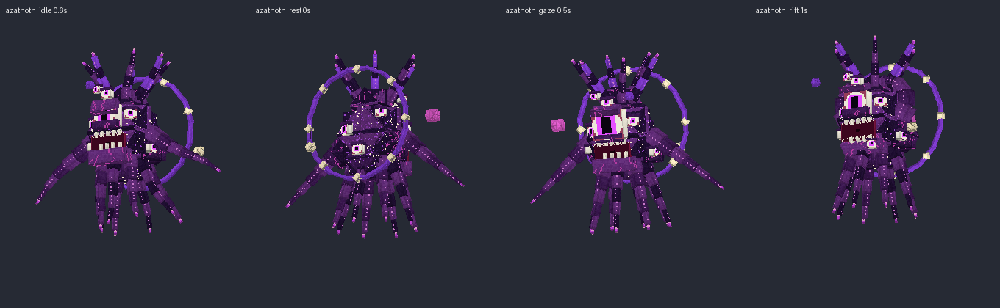
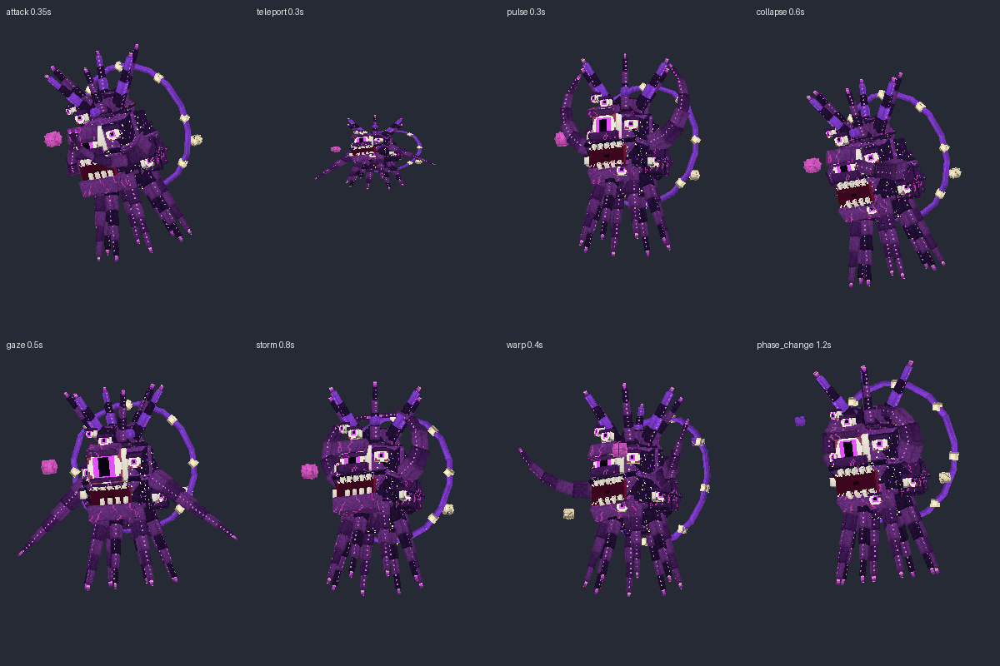

## Contenido

| Archivo | Qué es |
|---|---|
| `ModelEngine/blueprints/azathoth/` | Modelo del boss: 183 cubos, 126 huesos y 15 animaciones |
| `ModelEngine/blueprints/az_spawn/`, `az_piper/`, `az_larva/`, `az_priest/` | Súbditos |
| `ModelEngine/blueprints/az_fx_*/` | Efectos de los ataques |
| `../../MythicMobs-3D/Mobs/Boss_11_Azathoth/Azathoth_Mobs.yml` | Mobs con `model{}`, bossbar con moldura y mobs de efectos `AZ_FX_*` |
| `../../MythicMobs-3D/Skills/Azathoth_Combate.yml` | Skills con animaciones, sonidos, efectos y título |
| `../DextraBossesPack/assets/dextra/sounds/azathoth/` | Sonidos propios |
| `../ItemsAdder/contents/dextra_bosses/azathoth.yml` | Moldura de la bossbar |
| `../../tools/b11_azathoth.py`, `b11_fx.py`, `b11_sounds.py`, `b11_hud.py` | Scripts que lo generan todo |

## Instalación

1. Copia todas las carpetas de `ModelEngine/blueprints/` en `plugins/ModelEngine/blueprints/`: 5 modelos y 10 efectos.
2. Sustituye en el servidor 3D `Mobs/Boss_11_Azathoth/Azathoth_Mobs.yml` y `Skills/Azathoth_Combate.yml`.
3. Copia de nuevo `Modelos/DextraBossesPack/` y `Modelos/ItemsAdder/contents/dextra_bosses/`.
4. Ejecuta `/meg reload`, `/iazip` y `/mm reload`, y vuelve a entrar. Pruébalo con `/mm m spawn Azathoth`.

## Bossbar y título

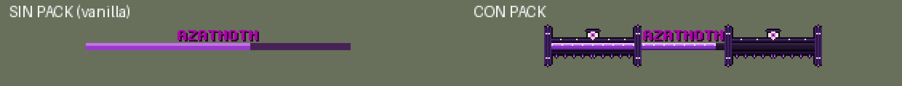
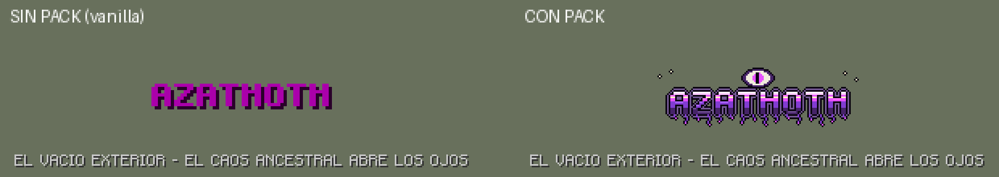

- **Bossbar con pack:** moldura de vacío con estrellas, un ojo abierto en el centro, tentáculos colgando y pilares con ojos.
- **Título con pack:** logo morado con un gran ojo encima y tentáculos debajo.
- **Sin pack:** se ve como siempre.
- **Barra morada:** es la misma de Old Ender.

## Animaciones y efectos de cada ataque

| Skill | Animación | Efecto 3D | Sonido |
|---|---|---|---|
| `AZ_Spawn` | `spawn` (crece de la nada y abre el ojo) | Ojo cósmico y cúpula de esquirlas | `intro`: zumbido, flautas desafinadas, tambores y voz imposible |
| `AZ_TeleportStrike` | `teleport` (se encoge y reaparece) | Implosión de vacío al salir y al golpear | `blink` |
| `AZ_SandPulse` | `pulse` (se hincha con los tentáculos abiertos) | Onda de entropía de 8 bloques | `pulse` |
| `AZ_DesertCollapse` | `collapse` (sube y aplasta con los tentáculos al 0.5 s, justo con el daño) | Grietas, esquirlas y ola de 9 bloques | `collapse` |
| `AZ_EnderGaze` | `gaze` (abre el ojo central) | Ojo gigante que se abre sobre el jugador y lo fulmina | `gaze` |
| `AZ_Sandstorm` | `storm` | Tormenta de vacío en espiral de 16 bloques | `storm` |
| `AZ_SandWarp` | `warp` (agarra y tira) | Vórtice que arrastra y estalla | `warp` |
| `AZ_SandstormRift` | `rift` (desgarra el espacio con los tentáculos) | Desgarro y explosión de 12 bloques al 0.9 s | `rift` |
| `AZ_Skyfall` | `storm` | Estrellas que caen sobre cada jugador | `skyfall` |
| Invocaciones | `summon` | Tentáculos que salen del suelo | `summon` |
| Cambio de fase | `phase_change` (se encoge y estalla) | Ojo cósmico y cúpula de esquirlas | `phase` |
| Golpe normal / daño / muerte | `attack` / `hurt` / `death` (se deshace) | — | `lash` / `hurt` / `death` |

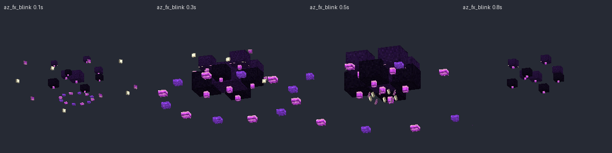
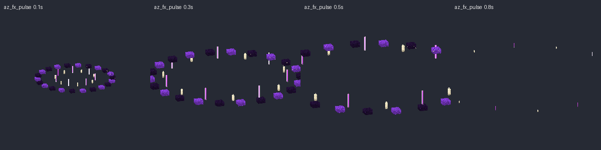
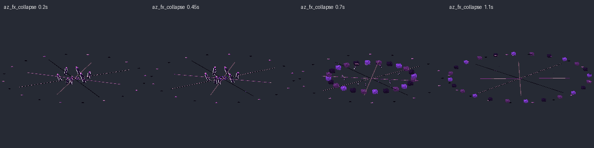
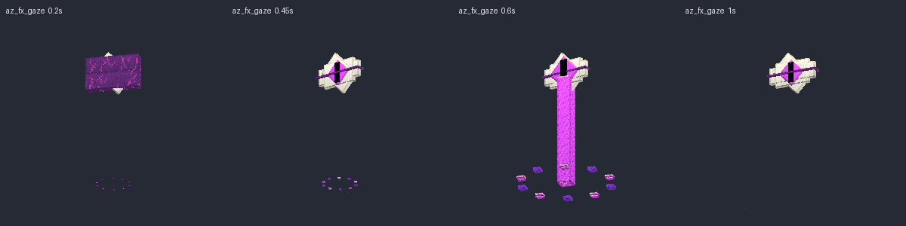
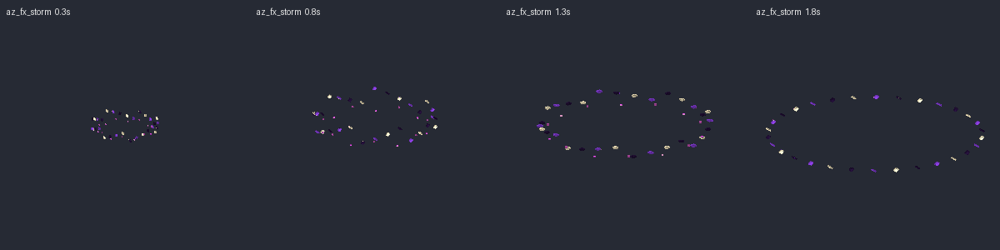
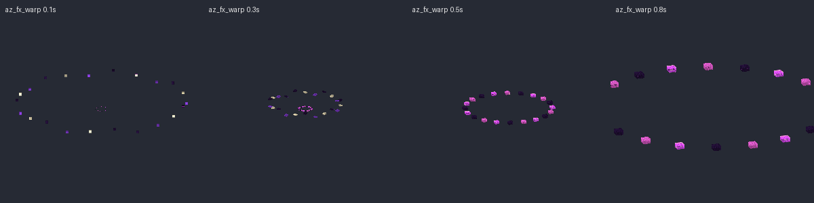
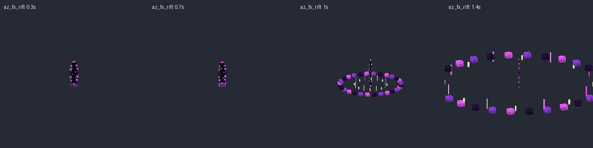
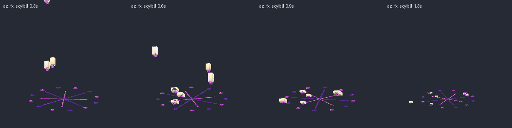
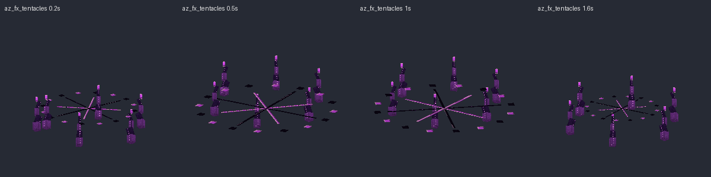
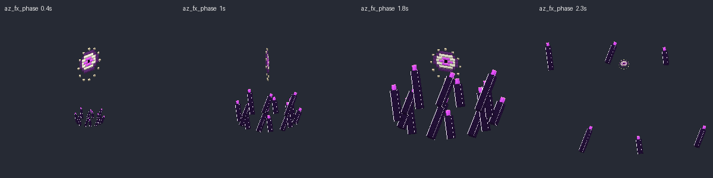

## Súbditos

| Mob | Modelo | Aspecto | Sonidos |
|---|---|---|---|
| `Azathoth_Engendro` | `az_spawn` | Humanoide del vacío encorvado, con tentáculos en la cara y la espalda, muchos ojos y garras brillantes | `spawn_gurgle`, `spawn_lash` |
| `Azathoth_Flautista` | `az_piper` | Encapuchado con máscara de espiral y flauta de hueso. Toca al atacar | `piper_tune`, `piper_curse` |
| `Azathoth_Larva` | `az_larva` | Gusano segmentado con manchas de estrellas, mandíbulas y seis patas | `larva_chitter`, `larva_bite` |
| `Azathoth_Sacerdote` | `az_priest` | Calavera con mitra alta (con un ojo), estola de nebulosa y báculo con ojo. Alza el báculo al curar | `priest_chant`, `priest_heal` |

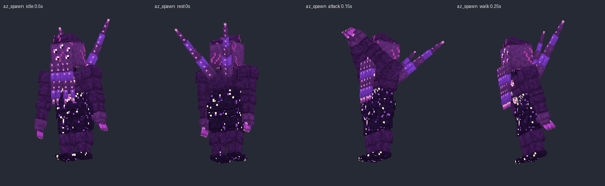
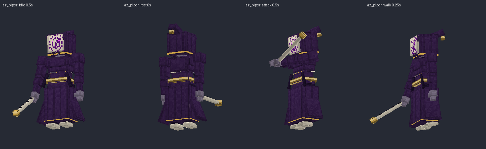
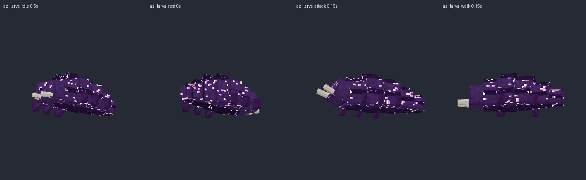
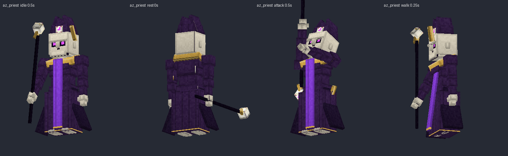

Escucha todos los sonidos en `preview/sonidos_demo.mp3`.
