# LEVIATÁN: boss 12 con modelos de ModelEngine

El Rey del Abismo: mitad rey y mitad serpiente marina. Tiene torso de escamas con coraza de coral y una perla, y cabeza de dragón marino con hocico largo, mandíbula con dientes, aletas y corona de coral. Lleva una aleta dorsal, aletas en los antebrazos y garras. En lugar de piernas tiene una cola de serpiente que repta y ondula. Empuña un tridente de oro.

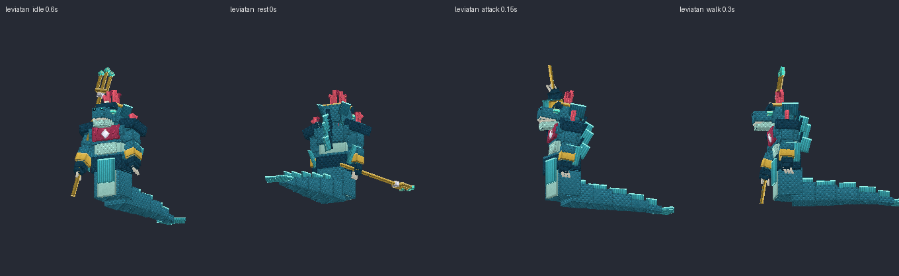
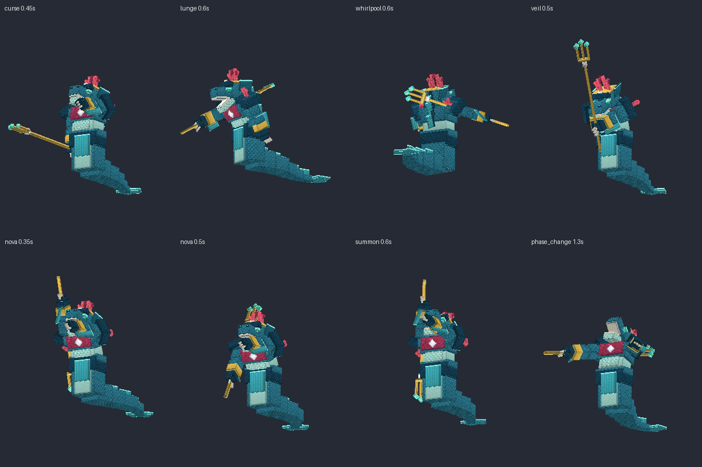

## Contenido

| Archivo | Qué es |
|---|---|
| `ModelEngine/blueprints/leviatan/` | Modelo del boss: 105 cubos y 13 animaciones |
| `ModelEngine/blueprints/lv_drowned/`, `lv_tide/`, `lv_eel/` | Súbditos |
| `ModelEngine/blueprints/lv_fx_*/` | Efectos de los ataques |
| `../../MythicMobs-3D/Mobs/Boss_12_Leviatan/Leviatan_Mobs.yml` | Mobs con `model{}`, bossbar con moldura y mobs de efectos `LV_FX_*` |
| `../../MythicMobs-3D/Skills/Leviatan_Combate.yml` | Skills con animaciones, sonidos, efectos y título |
| `../DextraBossesPack/assets/dextra/sounds/leviatan/` | Sonidos propios |
| `../ItemsAdder/contents/dextra_bosses/leviatan.yml` | Moldura de la bossbar |
| `../../tools/b12_leviatan.py`, `b12_fx.py`, `b12_sounds.py`, `b12_hud.py` | Scripts que lo generan todo |

## Instalación

1. Copia todas las carpetas de `ModelEngine/blueprints/` en `plugins/ModelEngine/blueprints/`: 4 modelos y 7 efectos.
2. Sustituye en el servidor 3D `Mobs/Boss_12_Leviatan/Leviatan_Mobs.yml` y `Skills/Leviatan_Combate.yml`.
3. Copia de nuevo `Modelos/DextraBossesPack/` y `Modelos/ItemsAdder/contents/dextra_bosses/`.
4. Ejecuta `/meg reload`, `/iazip` y `/mm reload`, y vuelve a entrar. Pruébalo con `/mm m spawn Leviatan`.

## Bossbar y título

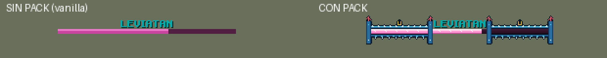
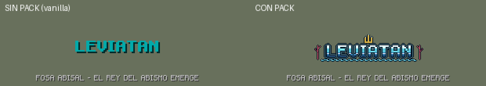

- **Bossbar con pack:** moldura de olas con espuma, perlas colgando, un tridente en el centro y pilares de roca con coral.
- **Título con pack:** logo aguamarina con tridente, olas y corales.
- **Sin pack:** se ve como siempre.
- **Barra rosa:** es la misma de Baal.

## Animaciones y efectos de cada ataque

| Skill | Animación | Efecto 3D | Sonido |
|---|---|---|---|
| `LV_Spawn` | `spawn` (sale del suelo y ruge) | Columna de agua y cúpula de coral | `intro`: olas, canto de ballena, cuerno del abismo y rugido |
| `LV_SpiritCurse` | `curse` (abre las fauces y señala) | Remolino de agua y almas en el jugador | `curse` |
| `LV_ShadowStep` | `lunge` (embestida con el tridente) | Géiser al saltar y al caer | `splash` |
| `LV_SakuraHex` | `whirlpool` (gira sobre sí mismo) | Remolino de 7 bloques | `whirlpool` |
| `LV_ShadowVeil` | `veil` (se cubre) | Nube de tinta | `ink` |
| `LV_SpiritNova` | `nova` (clava el tridente) | Ola gigante de 8 bloques | `tsunami` |
| Invocaciones | `summon` | Corales que brotan del suelo | `summon` |
| Cambio de fase | `phase_change` | Columna de agua y cúpula de coral que estalla | `phase` |
| Golpe normal / daño / muerte | `attack` / `hurt` / `death` (se hunde) | — | `stab` / `hurt` / `death` |

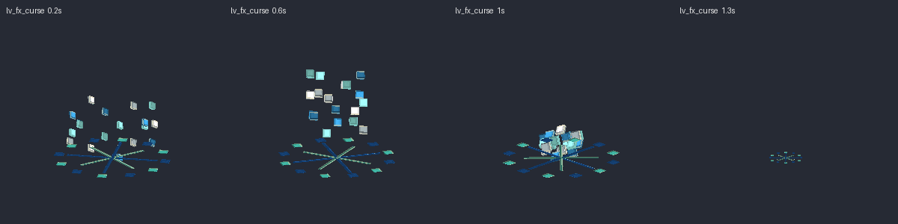
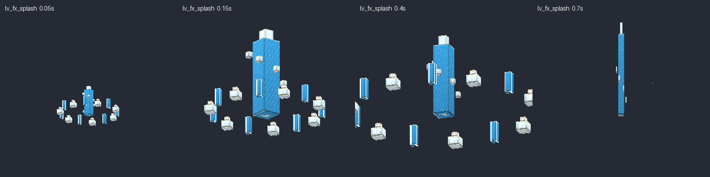
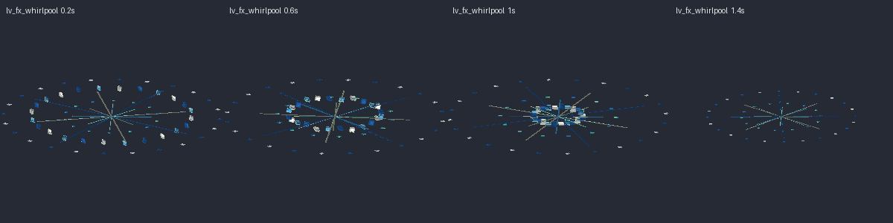
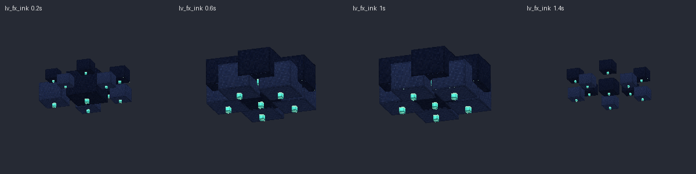
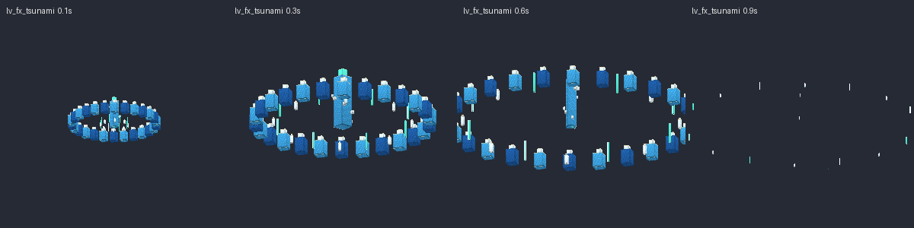
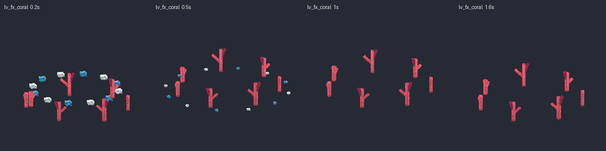
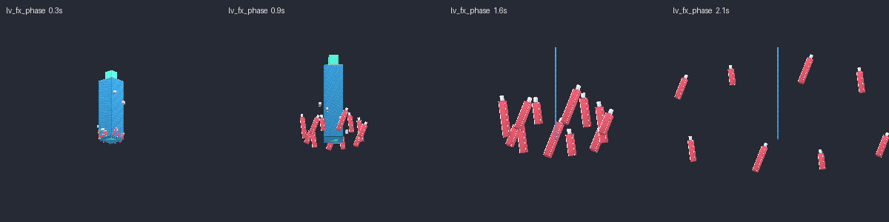

## Súbditos

| Mob | Modelo | Aspecto | Sonidos |
|---|---|---|---|
| `Leviatan_Ahogado` | `lv_drowned` | Marinero ahogado con percebes, algas, caparazón de tortuga y sable | `drowned_groan`, `drowned_slash` |
| `Leviatan_Marea` | `lv_tide` | Medusa luminosa con campana y tentáculos que ondulan | `tide_chime`, `tide_pulse` |
| `Leviatan_Anguila` | `lv_eel` | Anguila espectral larga con aletas, branquias brillantes y colmillos | `eel_hiss`, `eel_bite` |

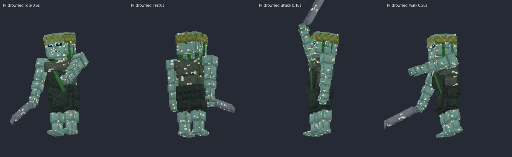
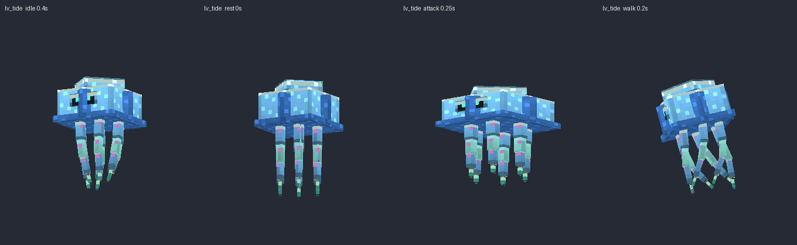
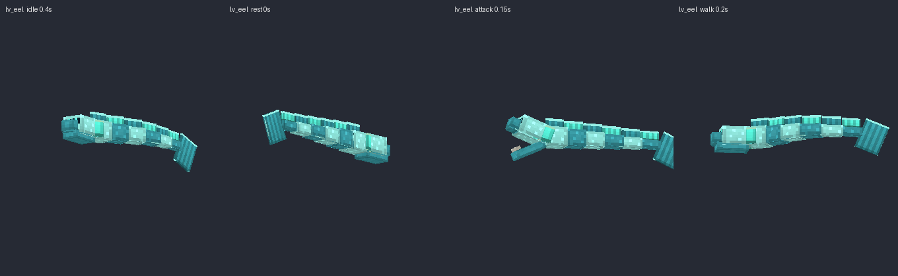

Escucha todos los sonidos en `preview/sonidos_demo.mp3`.
