# XYLAR: boss 13 con modelos de ModelEngine

El Señor Galáctico. Lleva armadura de metal estelar negra con filos y vetas de energía magenta. Su yelmo tiene visor brillante y una corona de cristales. En el pecho late un agujero negro con un aro de energía. Las hombreras van en capas, con cristales y fragmentos de estrellas que orbitan. Viste una capa de cielo estrellado y empuña un espadón de energía.

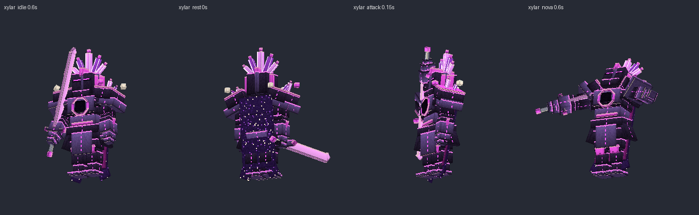
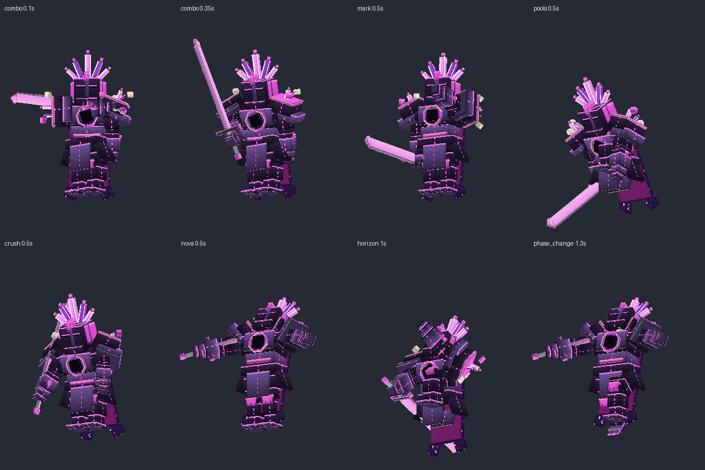

## Contenido

| Archivo | Qué es |
|---|---|
| `ModelEngine/blueprints/xylar/` | Modelo del boss: 109 cubos y 15 animaciones |
| `ModelEngine/blueprints/xy_soldier/`, `xy_knight/`, `xy_shard/` | Súbditos |
| `ModelEngine/blueprints/xy_well/` | Pozo gravitatorio: disco negro con aro de acreción que gira |
| `ModelEngine/blueprints/xy_fx_*/` | Efectos de los ataques |
| `../../MythicMobs-3D/Mobs/Boss_13_Xylar/Xylar_Mobs.yml` | Mobs con `model{}`, bossbar con moldura y mobs de efectos `XY_FX_*` |
| `../../MythicMobs-3D/Skills/Xylar_Combate.yml` | Skills con animaciones, sonidos, efectos y título |
| `../DextraBossesPack/assets/dextra/sounds/xylar/` | Sonidos propios |
| `../ItemsAdder/contents/dextra_bosses/xylar.yml` | Moldura de la bossbar |
| `../../tools/b13_xylar.py`, `b13_fx.py`, `b13_sounds.py`, `b13_hud.py` | Scripts que lo generan todo |

## Instalación

1. Copia todas las carpetas de `ModelEngine/blueprints/` en `plugins/ModelEngine/blueprints/`: 5 modelos y 8 efectos.
2. Sustituye en el servidor 3D `Mobs/Boss_13_Xylar/Xylar_Mobs.yml` y `Skills/Xylar_Combate.yml`.
3. Copia de nuevo `Modelos/DextraBossesPack/` y `Modelos/ItemsAdder/contents/dextra_bosses/`.
4. Ejecuta `/meg reload`, `/iazip` y `/mm reload`, y vuelve a entrar. Pruébalo con `/mm m spawn Xylar`.

## Bossbar y título

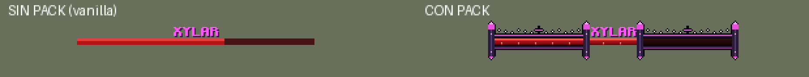
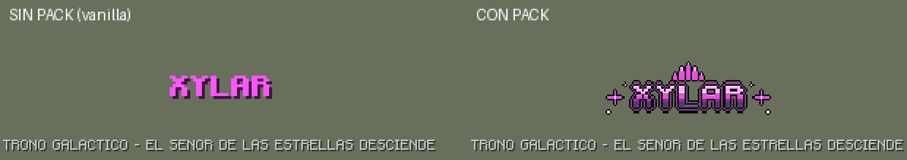

- **Bossbar con pack:** moldura de metal estelar con filo magenta, una estrella de cuatro puntas en el centro, una constelación arriba y pilares con cristales.
- **Título con pack:** logo magenta con corona de cristales y estrellas.
- **Sin pack:** se ve como siempre.
- **Barra roja:** es la misma de Red Hand.

## Animaciones y efectos de cada ataque

| Skill | Animación | Efecto 3D | Sonido |
|---|---|---|---|
| `XY_Spawn` | `spawn` | Constelación y cúpula de cristales | `intro`: zumbido espacial, coro, trueno y voz |
| `XY_SlashCombo` | `combo` (tres tajos: 0, 0.3 y 0.6 s, como los tres golpes) | Tres medias lunas de energía | `combo` |
| `XY_RedMark` | `mark` (señala) | Órbita de estrellas y constelación sobre el marcado | `mark` |
| `XY_ShadowDash` | `dash` (desaparece y reaparece) | Estallido de estrellas al irse y al llegar | `dash` |
| `XY_BloodPools` | `pools` (golpea el suelo) | Pozos gravitatorios (modelo `xy_well`) | `pools` y `well_hum` |
| `XY_HandCrush` | `crush` (agarra y aplasta al 0.5 s) | La gravedad aspira y aplasta | `crush` |
| `XY_BloodNova` | `nova` | Nova galáctica de 9 bloques al 0.4 s | `nova` |
| `XY_Execution` | `horizon` (2 s de rodillas cargando) | Agujero negro que crece y estalla a los 2 s | `horizon` |
| Invocaciones | `summon` | Cápsulas que caen desde la órbita | `summon` |
| Cambio de fase | `phase_change` | Constelación y cúpula de cristales | `phase` |
| Golpe normal / daño / muerte | `attack` / `hurt` / `death` | — | `swing` / `hurt` / `death` |

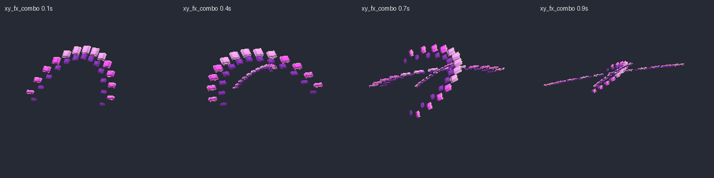
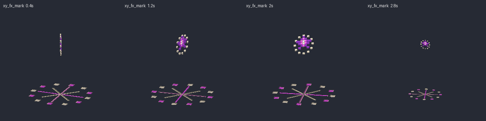
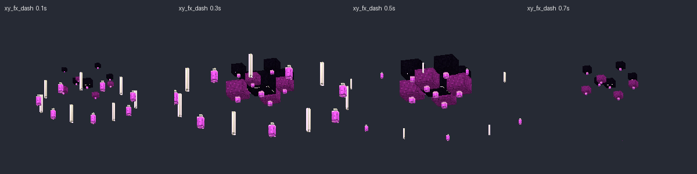
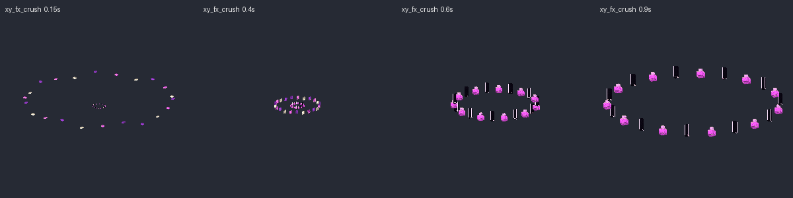
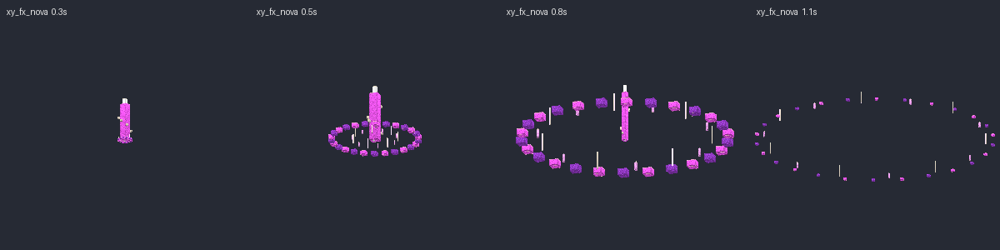
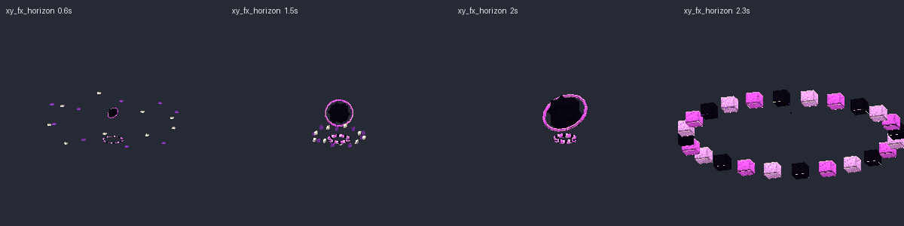
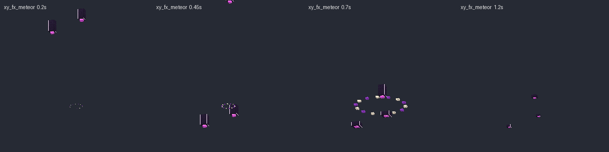
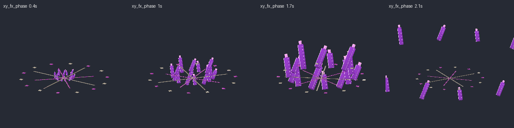

## Súbditos

| Mob | Modelo | Aspecto | Sonidos |
|---|---|---|---|
| `Xylar_Soldado` | `xy_soldier` | Soldado con casco de cúpula y antena, mochila con propulsores y espada de energía | `soldier_radio`, `soldier_slash` |
| `Xylar_Caballero` | `xy_knight` | Armadura de vacío con estrellas, yelmo con cuernos, escudo con estrella y espadón negro | `knight_growl`, `knight_strike` |
| `Xylar_Fragmento` | `xy_shard` | Racimo de cristales con núcleo brillante y alas de cristal que gira | `shard_chime`, `shard_hit` |
| `Xylar_PozoGravitatorio` | `xy_well` | Disco negro en el suelo con aro de acreción y polvo de estrellas que giran | `well_hum` |

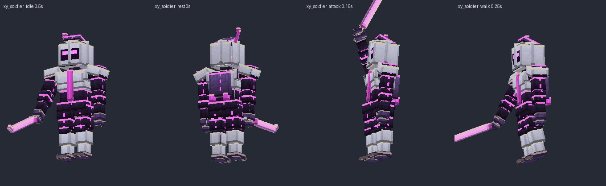
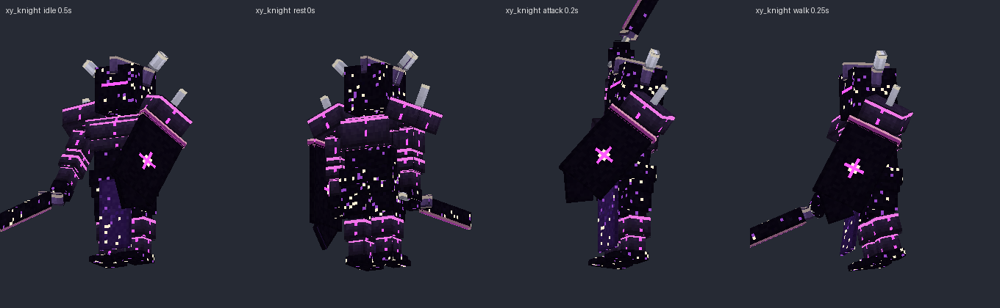
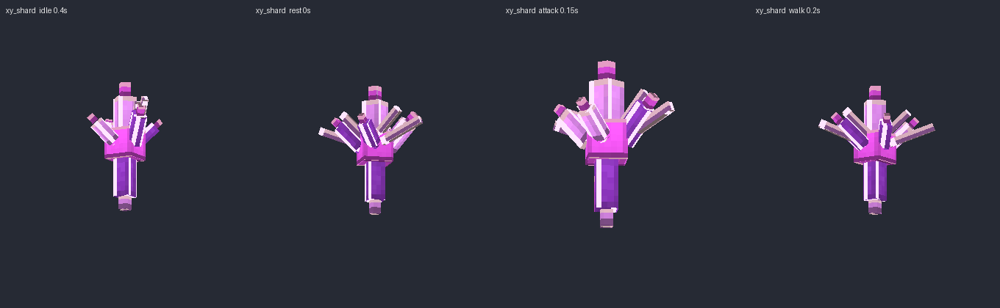
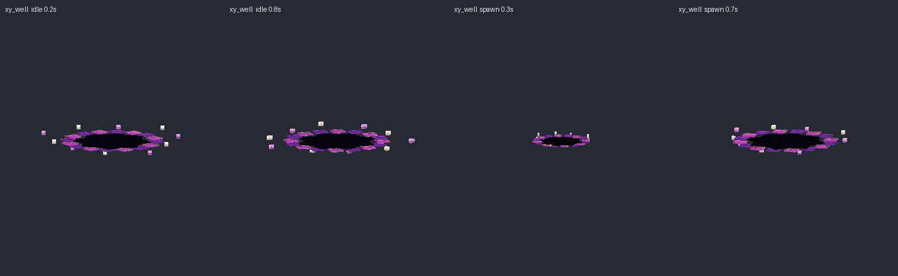

Escucha todos los sonidos en `preview/sonidos_demo.mp3`.
