# SAMHAIN: boss 14 con modelos de ModelEngine

El Señor de las Ánimas. Su cabeza es una calabaza tallada con tallo, hojas y enredaderas, y le salen llamas por arriba. Tiene el cuerpo flaco y viste una túnica negra y naranja hecha jirones. Le asoma paja por el cuello y las muñecas. Lleva velas encendidas en los hombros, dos faroles de almas en la cintura y una guadaña de cosecha.

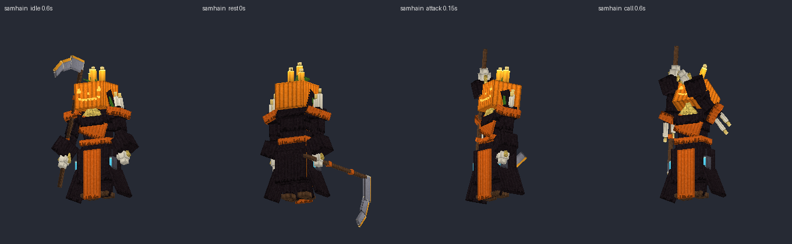
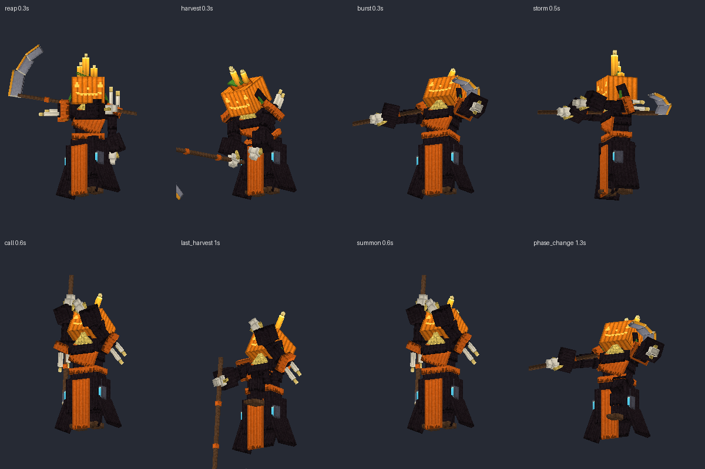

## Contenido

| Archivo | Qué es |
|---|---|
| `ModelEngine/blueprints/samhain/` | Modelo del boss: 98 cubos y 14 animaciones |
| `ModelEngine/blueprints/sh_scarecrow/`, `sh_wisp/`, `sh_rider/` | Súbditos |
| `ModelEngine/blueprints/sh_fx_*/` | Efectos de los ataques |
| `../../MythicMobs-3D/Mobs/Boss_14_Samhain/Samhain_Mobs.yml` | Mobs con `model{}`, bossbar con moldura y mobs de efectos `SH_FX_*` |
| `../../MythicMobs-3D/Skills/Samhain_Combate.yml` | Skills con animaciones, sonidos, efectos y título |
| `../DextraBossesPack/assets/dextra/sounds/samhain/` | Sonidos propios |
| `../ItemsAdder/contents/dextra_bosses/samhain.yml` | Moldura de la bossbar |
| `../../tools/b14_samhain.py`, `b14_fx.py`, `b14_sounds.py`, `b14_hud.py` | Scripts que lo generan todo |

## Instalación

1. Copia todas las carpetas de `ModelEngine/blueprints/` en `plugins/ModelEngine/blueprints/`: 4 modelos y 8 efectos.
2. Sustituye en el servidor 3D `Mobs/Boss_14_Samhain/Samhain_Mobs.yml` y `Skills/Samhain_Combate.yml`.
3. Copia de nuevo `Modelos/DextraBossesPack/` y `Modelos/ItemsAdder/contents/dextra_bosses/`.
4. Ejecuta `/meg reload`, `/iazip` y `/mm reload`, y vuelve a entrar. Pruébalo con `/mm m spawn Samhain`.

## Bossbar y título

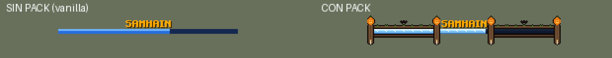
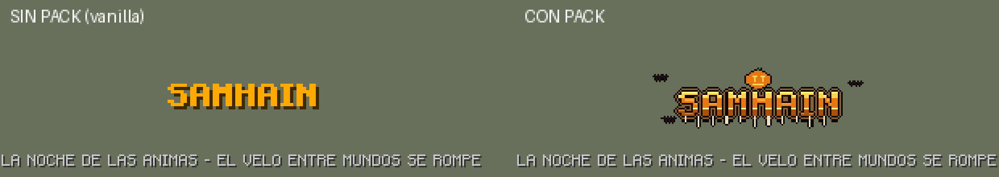

- **Bossbar con pack:** moldura de madera vieja con enredaderas y un murciélago. En cada pilar hay una calabaza tallada arriba y una vela abajo.
- **Título con pack:** logo naranja con una calabaza encima, cera que gotea y murciélagos.
- **Sin pack:** se ve como siempre.
- **Barra azul:** es la misma de Ragnarok.

## Animaciones y efectos de cada ataque

| Skill | Animación | Efecto 3D | Sonido |
|---|---|---|---|
| `SH_Spawn` | `spawn` | Círculo de velas y columna de fuego de almas | `intro`: viento, campana, cuervos, órgano y risa |
| `SH_HeavyStrike` | `reap` (barrido de guadaña) | Media luna de fuego | `reap` |
| `SH_DevastatingBlow` | `harvest` (guadañazo al suelo al 0.3 s, justo con el daño) | Grietas y llamas de 4 bloques | `harvest` |
| `SH_FreezeBurst` | `burst` | Anillo de fuego de ánimas de 7 bloques | `burst` |
| `SH_IceStorm` | `storm` (gira con la guadaña) | Tormenta de almas y ola al 0.4 s | `souls` |
| `SH_LightningStorm` | `call` (guadaña al cielo) | Lluvia de fuegos fatuos durante 1 s | `wisps` |
| `SH_RunOrDie` | `last_harvest` (2 s de rodillas) | Luna de calabaza que crece 2 s y estalla en 12 bloques | `last_harvest` |
| Invocaciones | `summon` | Calabazas y lápidas que salen del suelo | `summon` |
| Cambio de fase | `phase_change` | Círculo de velas y columna de fuego | `phase` |
| Golpe normal / daño / muerte | `attack` / `hurt` / `death` | — | `reap` / `hurt` / `death` |

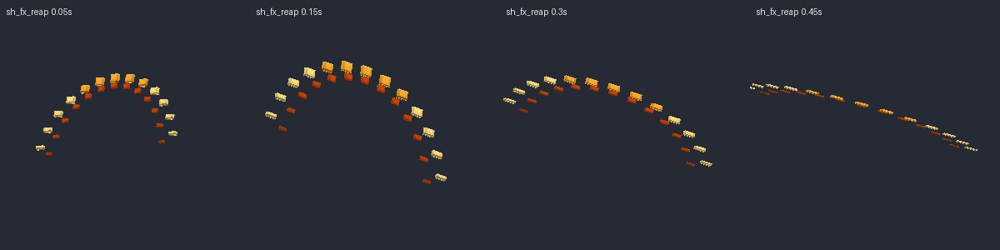
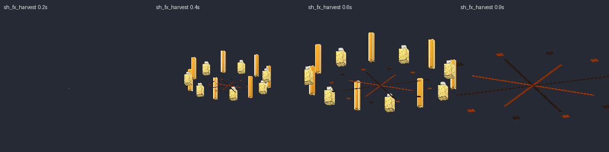
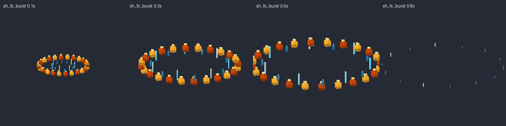
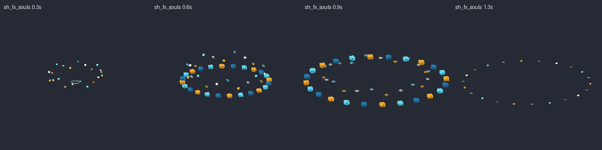
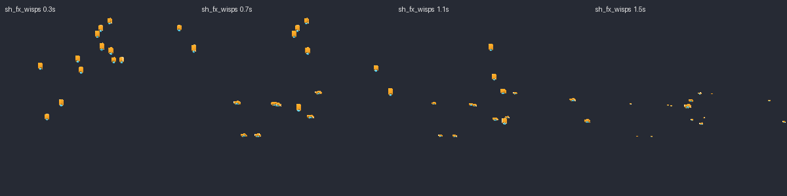
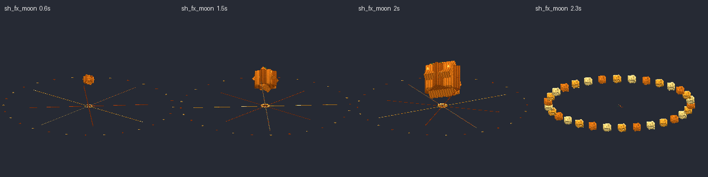
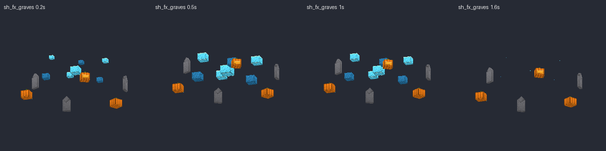
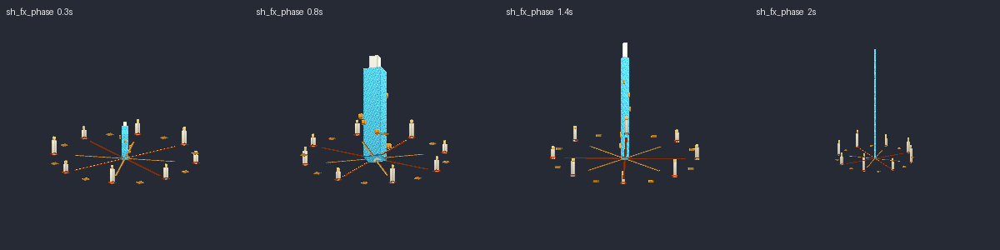

## Súbditos

| Mob | Modelo | Aspecto | Sonidos |
|---|---|---|---|
| `Samhain_Espantapajaros` | `sh_scarecrow` | Espantapájaros de arpillera remendada con calabaza tallada, sombrero de bruja, paja y horca | `scarecrow_rustle`, `scarecrow_stab` |
| `Samhain_FuegoFatuo` | `sh_wisp` | Bola de fuego con carita, llamas que bailan y estela | `wisp_giggle`, `wisp_strike` |
| `Samhain_Jinete` | `sh_rider` | Jinete sin cabeza con llamas en el cuello, armadura oscura, capa, espada y una calabaza en la mano | `rider_laugh`, `rider_slash` |

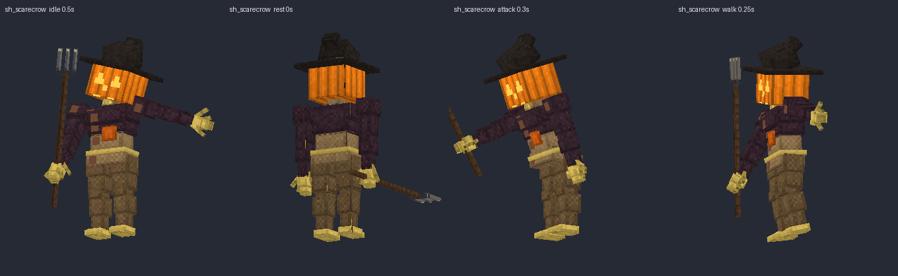
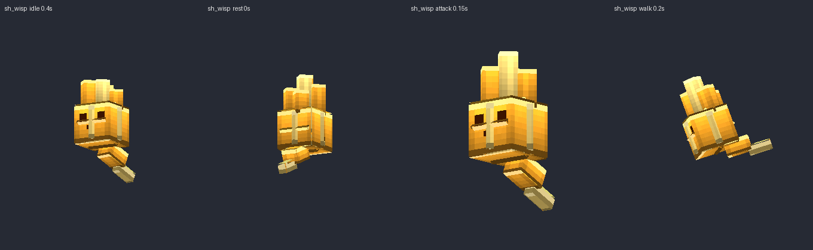
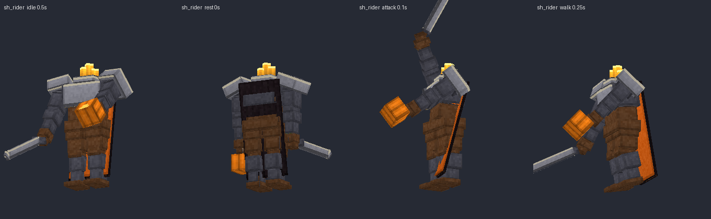

Escucha todos los sonidos en `preview/sonidos_demo.mp3`.
