# THOR: boss 15 con modelos de ModelEngine

El Dios del Trueno. Es corpulento, con barba y melena rojas trenzadas con anillas de oro y un casco con alas. Lleva coraza con runas que brillan, cinturón de fuerza (Megingjord), pieles en los hombros, guanteletes de hierro y capa roja. Empuña a Mjolnir, del que salen rayos que chisporrotean.

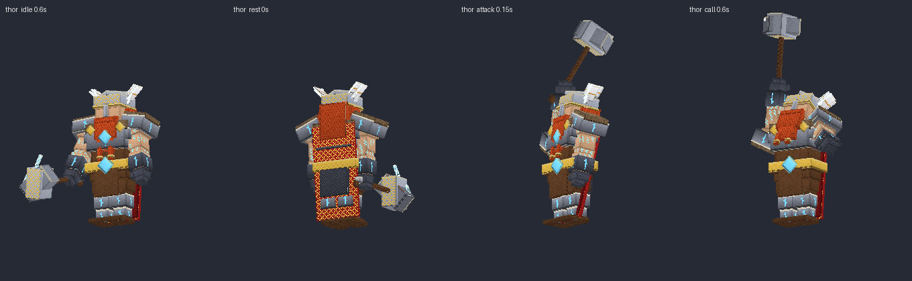
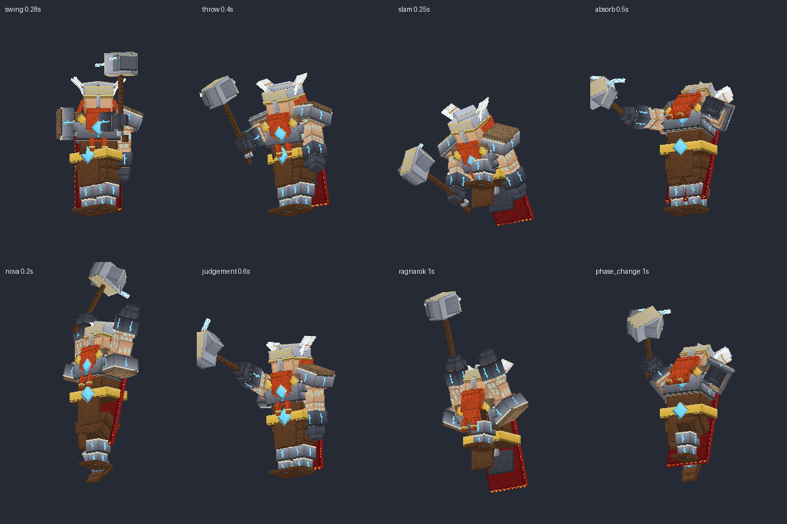

## Contenido

| Archivo | Qué es |
|---|---|
| `ModelEngine/blueprints/thor/` | Modelo del boss: 93 cubos y 18 animaciones |
| `ModelEngine/blueprints/th_einherjar/`, `th_creeper/`, `th_spark/` | Súbditos |
| `ModelEngine/blueprints/th_field/`, `th_cloud/` | Campo estático y nube de tormenta, los dos con animación |
| `ModelEngine/blueprints/th_fx_*/` | Efectos de los ataques |
| `../../MythicMobs-3D/Mobs/Boss_15_Thor/Thor_Mobs.yml` | Mobs con `model{}`, bossbar con moldura y mobs de efectos `TH_FX_*` |
| `../../MythicMobs-3D/Skills/Thor_Combate.yml` | Skills con animaciones, sonidos, efectos y título |
| `../DextraBossesPack/assets/dextra/sounds/thor/` | Sonidos propios |
| `../ItemsAdder/contents/dextra_bosses/thor.yml` | Moldura de la bossbar |
| `../../tools/b15_thor.py`, `b15_fx.py`, `b15_sounds.py`, `b15_hud.py` | Scripts que lo generan todo |

## Instalación

1. Copia todas las carpetas de `ModelEngine/blueprints/` en `plugins/ModelEngine/blueprints/`: 6 modelos y 10 efectos.
2. Sustituye en el servidor 3D `Mobs/Boss_15_Thor/Thor_Mobs.yml` y `Skills/Thor_Combate.yml`.
3. Copia de nuevo `Modelos/DextraBossesPack/` y `Modelos/ItemsAdder/contents/dextra_bosses/`.
4. Ejecuta `/meg reload`, `/iazip` y `/mm reload`, y vuelve a entrar. Pruébalo con `/mm m spawn Thor`.

## Bossbar y título

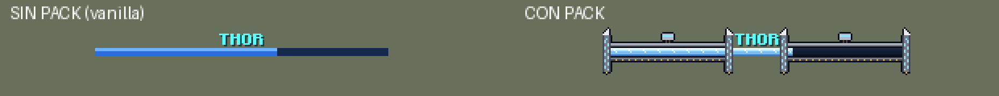
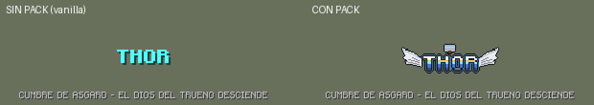

- **Bossbar con pack:** moldura de acero con remaches de oro y Mjolnir en el centro. Por los pilares bajan rayos y arriba tienen alas.
- **Título con pack:** logo azul eléctrico con alas y el martillo encima.
- **Sin pack:** se ve como siempre.
- **Barra azul:** es la misma de Ragnarok.

## Animaciones y efectos de cada ataque

| Skill | Animación | Efecto 3D | Sonido |
|---|---|---|---|
| `TH_Spawn` | `spawn` | Columna de luz dorada del Valhalla | `intro`: cuerno, tambores, trueno, coro y voz |
| `TH_ToxicSwipe` | `swing` (martillazo lateral) | Media luna eléctrica | `swing` |
| `TH_SporeBolt` | `throw` (lanza el rayo) | Rayo que cae sobre el jugador al 0.4 s | `throw` |
| `TH_SporeBurst` | `slam` | Anillo de descarga de 7 bloques | `shock` |
| `TH_ToxicCloud` | `call` (martillo al cielo) | Nube que revienta con rayos | `thunder` |
| `TH_ToxicZoneCast` | `judgement` | Rayo sobre el jugador al crear los campos | `surge` y `field_hum` |
| `TH_FungalBloom` | `absorb` (los rayos le caen encima) | Rayos sobre Thor | `absorb` |
| `TH_MycotoxinNova`, `TH_PlagueSurge` | `nova` / `surge` (salta o atrae y golpea al 0.5 s) | Nova de trueno de 8 bloques | `nova` / `surge` |
| `TH_CorruptionEruption` | `eruption` | Lluvia de rayos y ola de 9 bloques | `eruption` |
| `TH_GardenSentence` | `judgement` (señala con el martillo) | Círculo de Mjolnir y rayo gigante al 1.2 s | `judgement` |
| `TH_PlagueApocalypse` | `ragnarok` (1.5 s cargando) | Cúpula de tormenta que estalla en 10 bloques | `ragnarok` |
| Invocaciones | `summon` | Columna del Valhalla | `summon` |
| Cambio de fase | `phase_change` | Rayos sobre Thor | `phase` |
| Golpe normal / daño / muerte | `attack` / `hurt` / `death` | — | `swing` / `hurt` / `death` |

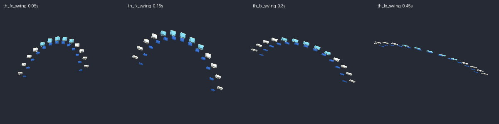
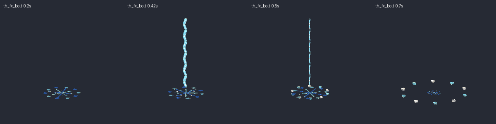
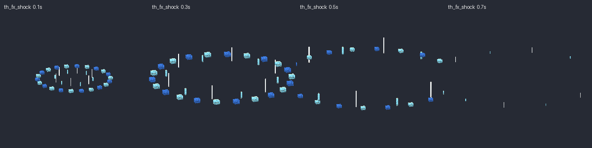
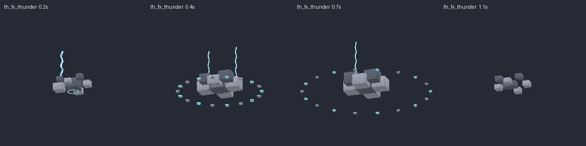
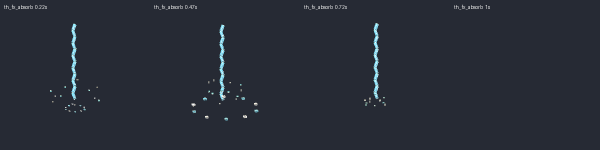
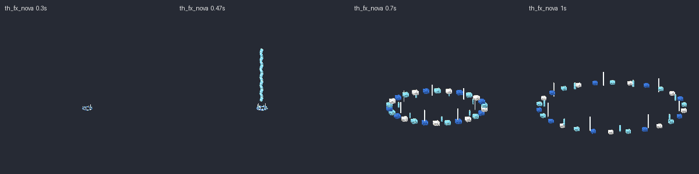
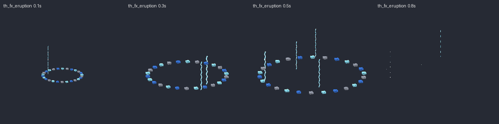
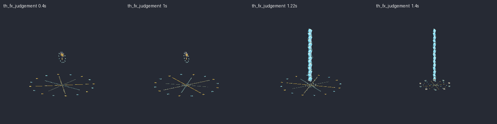
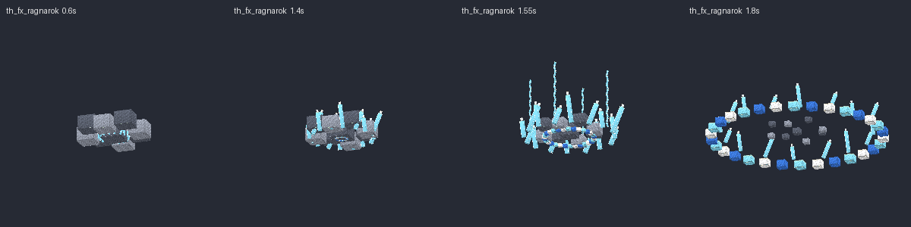
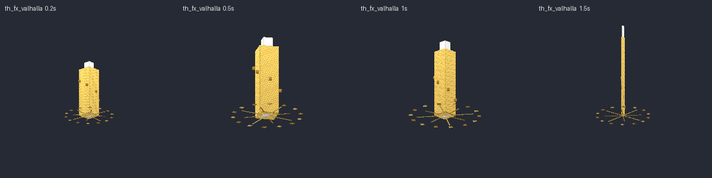

## Súbditos

| Mob | Modelo | Aspecto | Sonidos |
|---|---|---|---|
| `Thor_Einherjar` | `th_einherjar` | Guerrero espectral dorado del Valhalla con casco de cuernos, escudo pintado y hacha con filo de rayo | `einherjar_cry`, `einherjar_chop` |
| `Thor_CreeperTormenta` | `th_creeper` | Creeper azul con franjas de rayo, pararrayos de cobre y una nubecita encima. Se hincha antes de estallar | `creeper_hiss`, `creeper_boom` |
| `Thor_Chispa` | `th_spark` | Bola de rayos con patitas de electricidad que giran | `spark_buzz`, `spark_pop` |
| `Thor_CampoEstatico` | `th_field` | Placa de cobre en el suelo con bobinas y arcos eléctricos que parpadean | `field_hum` |
| `Thor_NubeTormenta` | `th_cloud` | Nube flotante con rayos que caen | `cloud_rumble` |

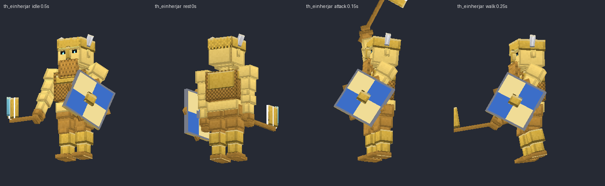
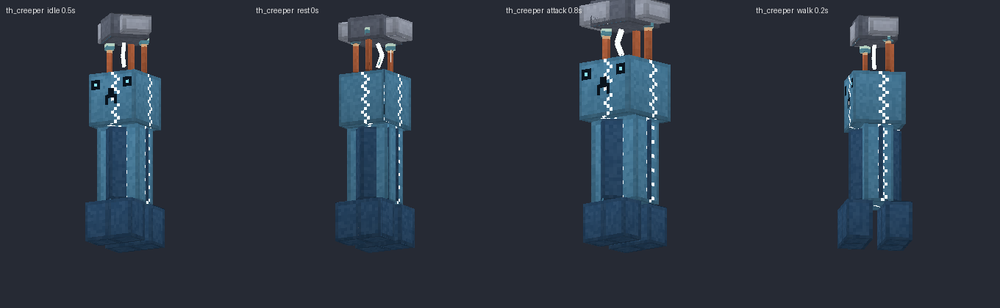
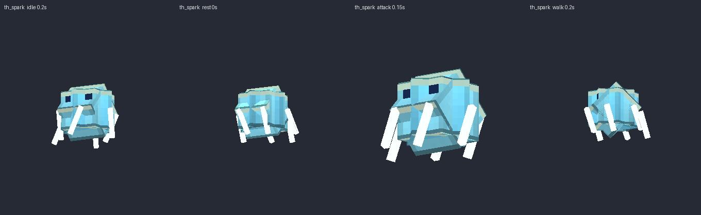
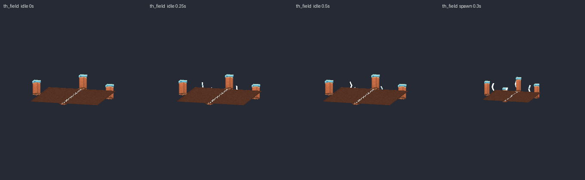
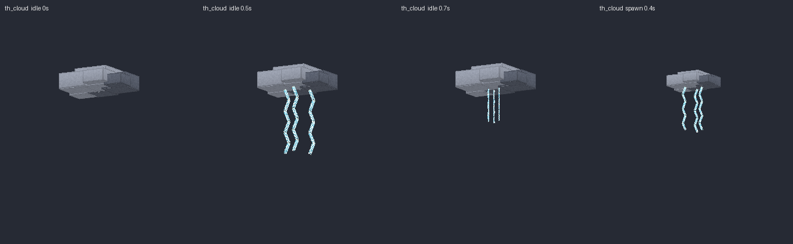

Escucha todos los sonidos en `preview/sonidos_demo.mp3`.
