# KUKULKÁN: boss 16 con modelos de ModelEngine

La Serpiente Emplumada. Tiene cabeza de serpiente con colmillos, lengua bífida y plumas en las mejillas, y un penacho de plumas de quetzal en abanico. Lleva orejeras y collar de jade y oro y una pechera con greca escalonada. A la espalda luce un gran disco solar con rayos y alas de plumas verdes, azules y rojas. En lugar de piernas tiene una cola de serpiente con plumas que acaba en abanico. Empuña un bastón solar.

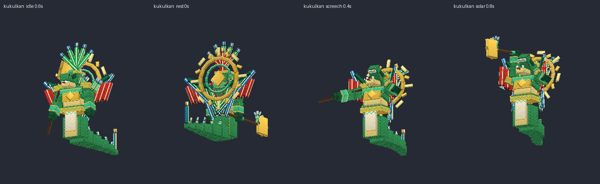
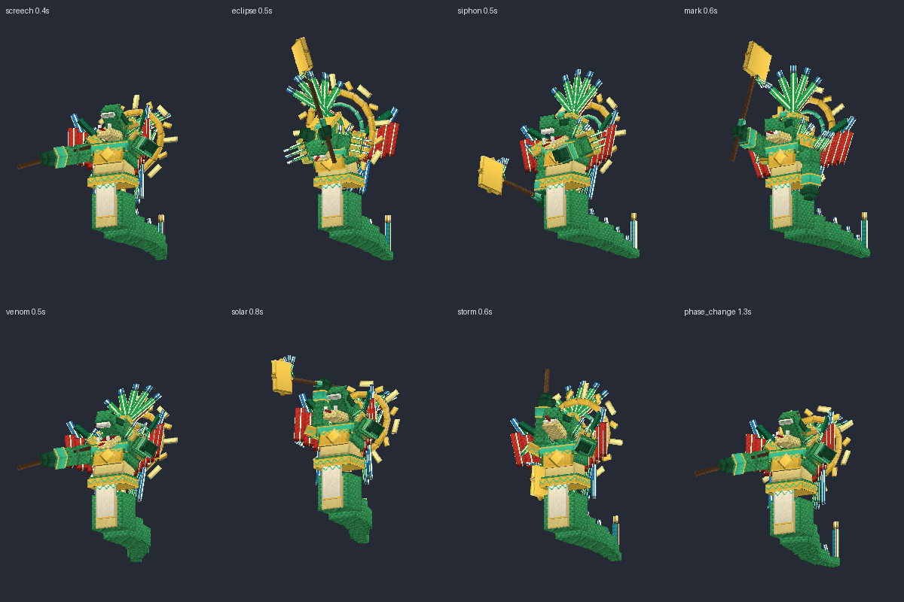

## Contenido

| Archivo | Qué es |
|---|---|
| `ModelEngine/blueprints/kukulkan/` | Modelo del boss: 205 cubos y 15 animaciones |
| `ModelEngine/blueprints/kk_quetzal/`, `kk_serpent/`, `kk_offering/`, `kk_jaguar/` | Súbditos |
| `ModelEngine/blueprints/kk_fx_*/` | Efectos de los ataques |
| `../../MythicMobs-3D/Mobs/Boss_16_Kukulkan/Kukulkan_Mobs.yml` | Mobs con `model{}`, bossbar con moldura y mobs de efectos `KK_FX_*` |
| `../../MythicMobs-3D/Skills/Kukulkan_Combate.yml` | Skills con animaciones, sonidos, efectos y título |
| `../DextraBossesPack/assets/dextra/sounds/kukulkan/` | Sonidos propios |
| `../ItemsAdder/contents/dextra_bosses/kukulkan.yml` | Moldura de la bossbar |
| `../../tools/b16_kukulkan.py`, `b16_fx.py`, `b16_sounds.py`, `b16_hud.py` | Scripts que lo generan todo |

## Instalación

1. Copia todas las carpetas de `ModelEngine/blueprints/` en `plugins/ModelEngine/blueprints/`: 5 modelos y 9 efectos.
2. Sustituye en el servidor 3D `Mobs/Boss_16_Kukulkan/Kukulkan_Mobs.yml` y `Skills/Kukulkan_Combate.yml`.
3. Copia de nuevo `Modelos/DextraBossesPack/` y `Modelos/ItemsAdder/contents/dextra_bosses/`. Si ya tenías el HUD de Heracles, sustituye también `Modelos/01_Heracles/ItemsAdder/contents/heracles_hud/` y `Skills/heracles_skills.yml`: su título se movió para dejar libre el carácter de esta bossbar.
4. Ejecuta `/meg reload`, `/iazip` y `/mm reload`, y vuelve a entrar. Pruébalo con `/mm m spawn Kukulkan`.

## Bossbar y título

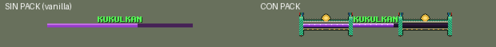
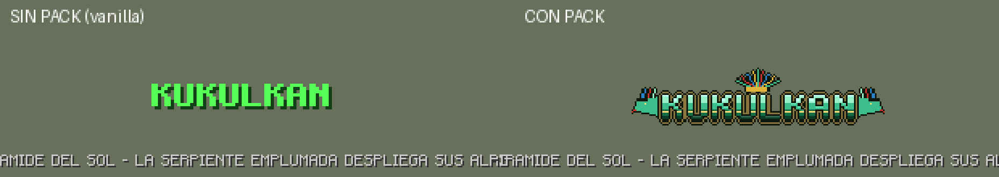

- **Bossbar con pack:** moldura de piedra con greca escalonada de jade, un sol de oro en el centro y pilares de serpiente con plumas de quetzal.
- **Título con pack:** logo de jade con penacho de plumas y cabezas de serpiente emplumada a los lados.
- **Sin pack:** se ve como siempre.
- **Barra morada:** es la misma de Old Ender.

## Animaciones y efectos de cada ataque

| Skill | Animación | Efecto 3D | Sonido |
|---|---|---|---|
| `KK_Spawn` | `spawn` (sale del suelo y abre las alas) | Escalones de pirámide y sol | `intro`: caracola, tambores, sonajas, silbato de la muerte y siseo |
| `KK_Wail`, `KK_EchoOfGrief` | `screech` (chillido con las alas abiertas) | Ondas doradas | `screech` |
| `KK_ShroudOfNight` | `eclipse` (se envuelve en las alas) | Sol negro y sombra del eclipse | `eclipse` |
| `KK_SpiritSiphon` | `siphon` | Plumas que suben en espiral desde el jugador | `siphon` |
| `KK_GriefMark` | `mark` (señala con el bastón) | Piedra del sol bajo el elegido que estalla al 1.2 s, justo con el daño | `altar` |
| `KK_SharedSorrow` | `venom` | Anillo de colmillos de jade al 0.5 s | `venom` |
| `KK_ShadowHunt` | `summon` | Serpientes emplumadas que salen junto al jugador | `serpent_hiss` |
| `KK_MassLament` | `solar` (se eleva con el bastón al sol) | Columna de luz y ola de 12 bloques al 0.6 s | `solar` |
| `KK_StormOfSorrow` | `storm` | Rayos de sol que caen a los 0.5 y 1.0 s | `sunrays` |
| Invocaciones | `summon` | Serpientes o escalones de pirámide | `summon` |
| Cambio de fase | `phase_change` | Escalones de pirámide y sol | `phase` |
| Golpe normal / daño / muerte | `attack` / `hurt` / `death` (se hunde) | — | `strike` / `hurt` / `death` |

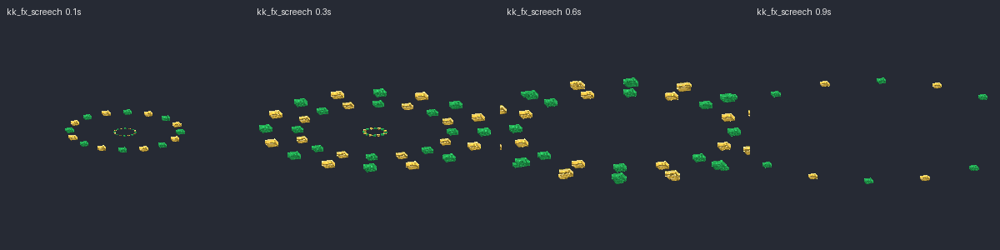
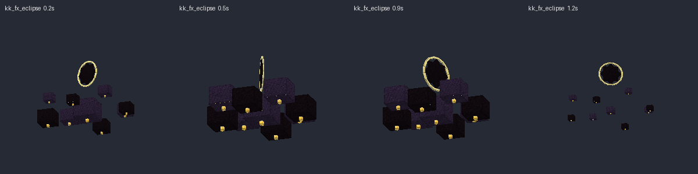
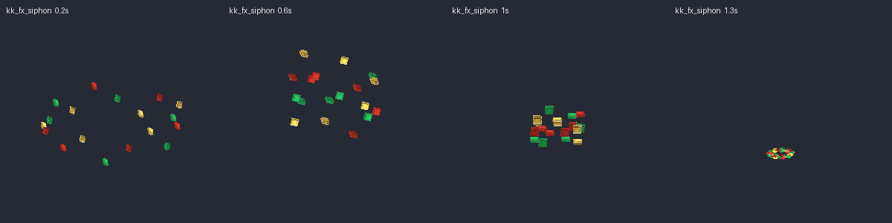
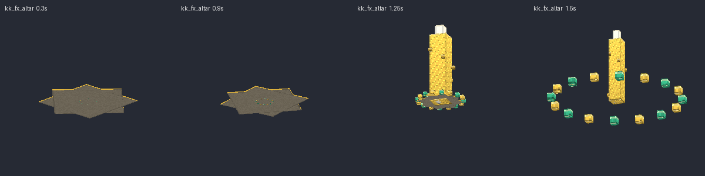
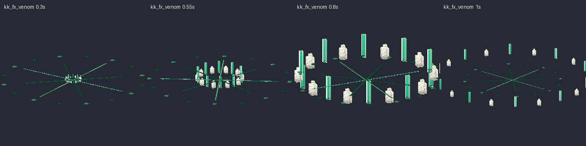
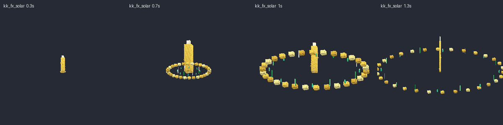
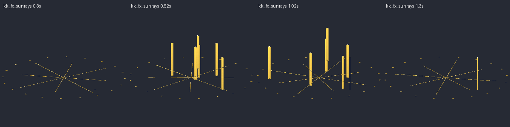
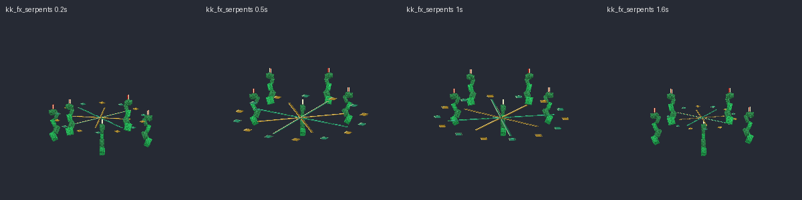
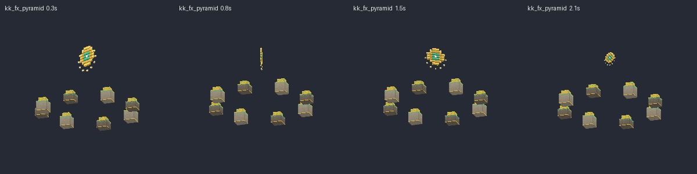

## Súbditos

| Mob | Modelo | Aspecto | Sonidos |
|---|---|---|---|
| `Kukulkan_Quetzal` | `kk_quetzal` | Quetzal de pecho rojo con cola larga, cresta y alas que aletean | `quetzal_call`, `quetzal_peck` |
| `Kukulkan_Sierpe` | `kk_serpent` | Serpiente pequeña con cresta de plumas que repta ondulando | `serpent_hiss`, `serpent_bite` |
| `Kukulkan_Ofrenda` | `kk_offering` | Máscara de jade y oro con plumas y humo de copal | `offering_chant`, `offering_drain` |
| `Kukulkan_Jaguar` | `kk_jaguar` | Guerrero con casco de cabeza de jaguar, piel con manchas, macuahuitl de obsidiana y escudo con plumas | `jaguar_roar`, `jaguar_slash` |

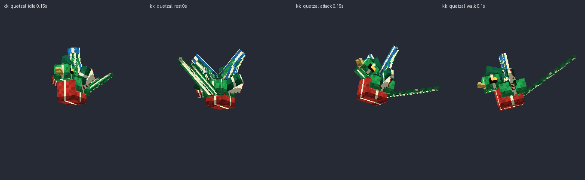
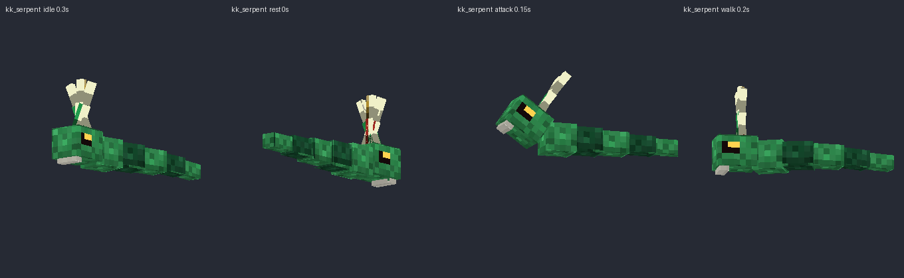
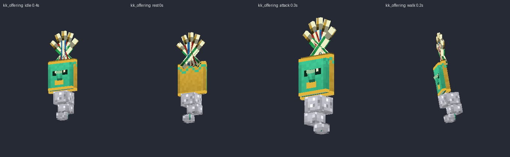
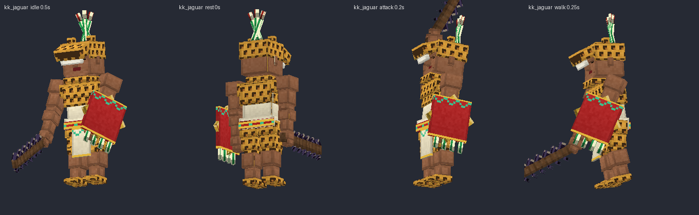

Escucha todos los sonidos en `preview/sonidos_demo.mp3`.
