# NEZARETH: boss 17 con modelos de ModelEngine

La Tejedora Eterna: una reina araña. La parte de arriba es una mujer pálida con seis ojos rojos, mandíbulas, melena negra y corona de púas. Viste túnica de seda gris con un cuello de telaraña en abanico. Tiene garras-hoz en las manos de las que cuelgan hilos. La parte de abajo es una araña gigante con cefalotórax, un abdomen enorme con telaraña y reloj de arena rojo pintados, hileras que sueltan seda y ocho patas articuladas.

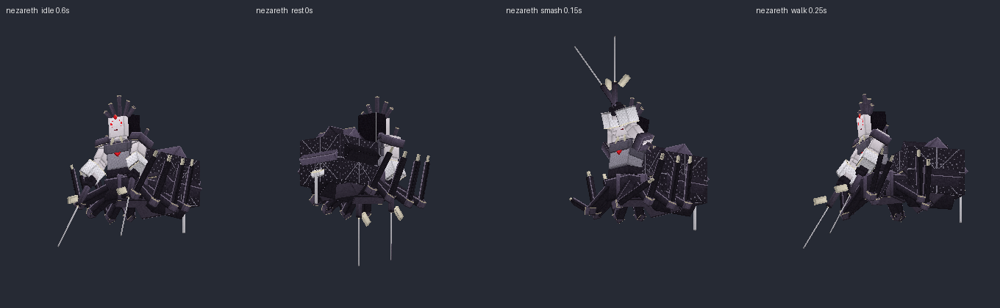
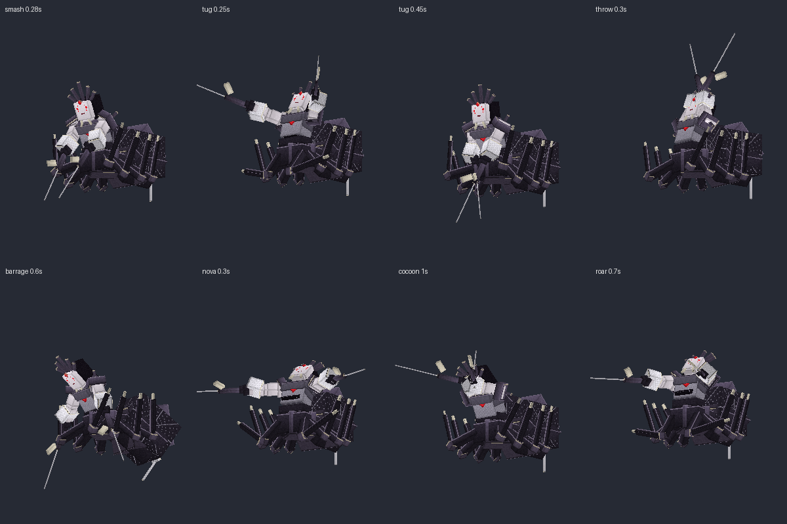

## Contenido

| Archivo | Qué es |
|---|---|
| `ModelEngine/blueprints/nezareth/` | Modelo del boss: 98 cubos, 39 huesos y 16 animaciones |
| `ModelEngine/blueprints/nz_puppet/`, `nz_spinner/`, `nz_moth/` | Súbditos |
| `ModelEngine/blueprints/nz_fx_*/` | Efectos de los ataques |
| `../../MythicMobs-3D/Mobs/Boss_17_Nezareth/Nezareth_Mobs.yml` | Mobs con `model{}`, bossbar con moldura y mobs de efectos `NZ_FX_*` |
| `../../MythicMobs-3D/Skills/Nezareth_Combate.yml` | Skills con animaciones, sonidos, efectos y título |
| `../DextraBossesPack/assets/dextra/sounds/nezareth/` | Sonidos propios |
| `../ItemsAdder/contents/dextra_bosses/nezareth.yml` | Moldura de la bossbar |
| `../../tools/b17_nezareth.py`, `b17_fx.py`, `b17_sounds.py`, `b17_hud.py` | Scripts que lo generan todo |

## Instalación

1. Copia todas las carpetas de `ModelEngine/blueprints/` en `plugins/ModelEngine/blueprints/`: 4 modelos y 9 efectos.
2. Sustituye en el servidor 3D `Mobs/Boss_17_Nezareth/Nezareth_Mobs.yml` y `Skills/Nezareth_Combate.yml`.
3. Copia de nuevo `Modelos/DextraBossesPack/` y `Modelos/ItemsAdder/contents/dextra_bosses/`. Si ya tenías el HUD de Heracles, sustituye también `Modelos/01_Heracles/ItemsAdder/contents/heracles_hud/` y `Skills/heracles_skills.yml`: su título se movió para dejar libre el carácter de esta bossbar.
4. Ejecuta `/meg reload`, `/iazip` y `/mm reload`, y vuelve a entrar. Pruébalo con `/mm m spawn Nezareth`.

## Bossbar y título

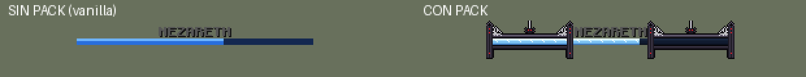
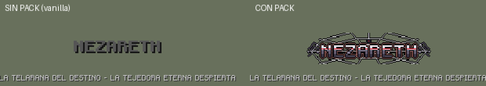

- **Bossbar con pack:** moldura de quitina negra con telarañas en las esquinas y una araña que cuelga de su hilo en el centro. Los pilares tienen ojos rojos.
- **Título con pack:** logo gris con franja roja, una telaraña detrás, patas de araña a los lados y una araña colgando.
- **Sin pack:** se ve como siempre.
- **Barra azul:** es la misma de Ragnarok.

## Animaciones y efectos de cada ataque

| Skill | Animación | Efecto 3D | Sonido |
|---|---|---|---|
| `NZ_Spawn` | `spawn` (baja del techo colgada) | Hilos del cielo y capullos | `intro`: caja de música desafinada, susurros, patas e hilo que chasquea |
| `NZ_GroundShatter` | `tug` (tira de los hilos y pisa al 0.4 s, justo con el daño) | Telaraña en el suelo que se tensa y revienta en 7 bloques | `tug` |
| `NZ_IceSmash` | `smash` (doble zarpazo con las patas delanteras alzadas) | Dos tajos en cruz | `smash` |
| `NZ_IceRockThrow` | `throw` | Capullo que cae sobre el jugador al 0.5 s | `cocoon` |
| `NZ_IceRockBarrage` | `barrage` (alza el abdomen y dispara seda) | Lluvia de capullos en 9 bloques | `rain` |
| `NZ_FrostNova` | `nova` | Red que estalla en 7 bloques | `web` |
| `NZ_IntenseBlizzard` | `weave` (teje con las manos) | Tormenta de hilos en 14 bloques | `silk` |
| `NZ_Roar` | `roar` (chillido con las patas alzadas) | Anillos del chillido | `roar` |
| Fase 3 (escudo de súbditos) | `cocoon` (se encoge en su capullo) | Capullo-escudo que se rompe | `shield` (también al liberarse) |
| Invocaciones | `summon` | Capullos que bajan colgados de hilos | `summon` |
| Cambio de fase | `phase_change` | — | `phase` |
| Golpe normal / daño / muerte | `attack` / `hurt` / `death` (las patas se encogen) | — | `claw` / `hurt` / `death` |

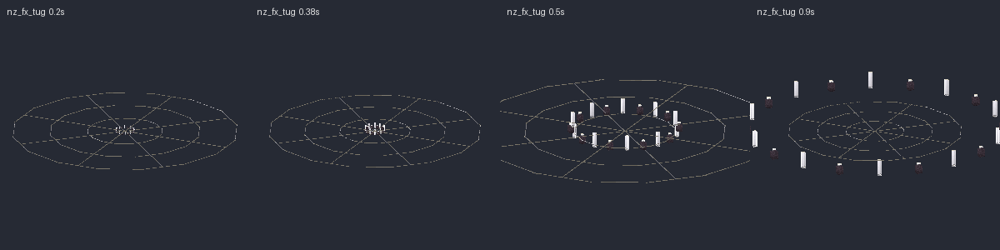
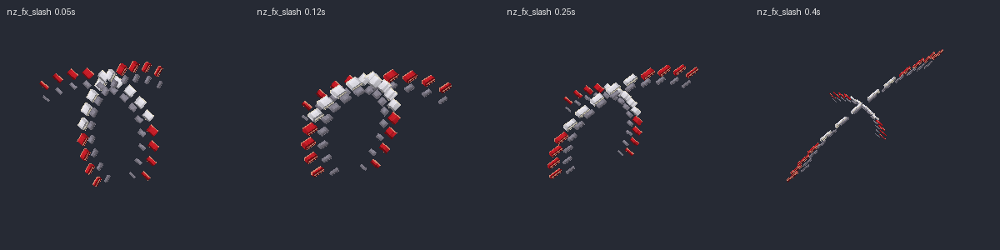
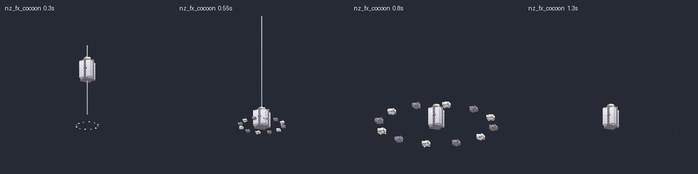
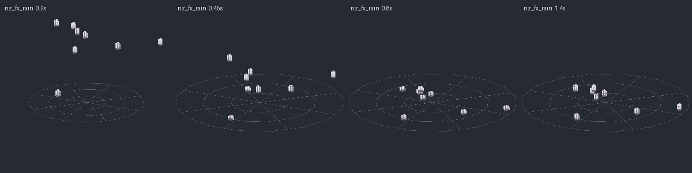
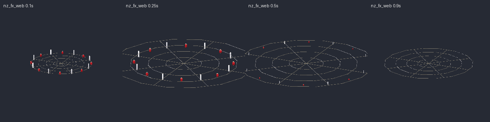
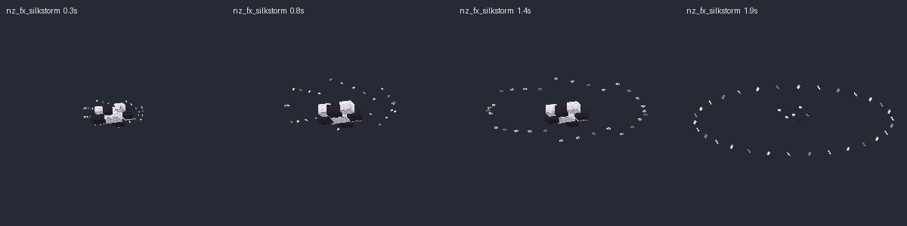
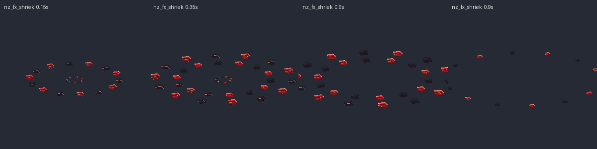
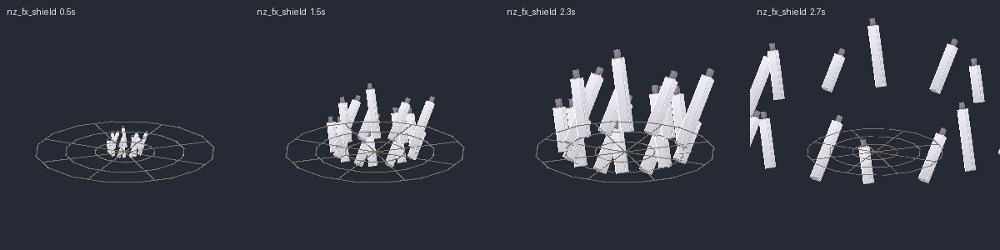
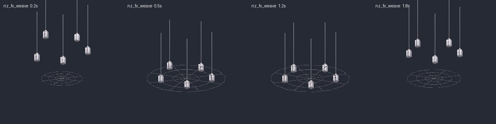

## Súbditos

| Mob | Modelo | Aspecto | Sonidos |
|---|---|---|---|
| `Nezareth_Marioneta` | `nz_puppet` | Muñeco de madera con máscara de porcelana agrietada y la cruceta con los hilos flotando encima | `puppet_creak`, `puppet_hit` |
| `Nezareth_Hilandera` | `nz_spinner` | Encapuchada con ojos cosidos, huso con hilo y tijeras enormes | `spinner_hum`, `spinner_snip` |
| `Nezareth_Polilla` | `nz_moth` | Polilla peluda con alas con ojos pintados, antenas y ojos rojos | `moth_flutter`, `moth_bite` |

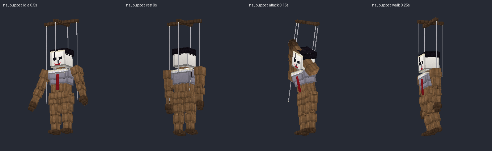
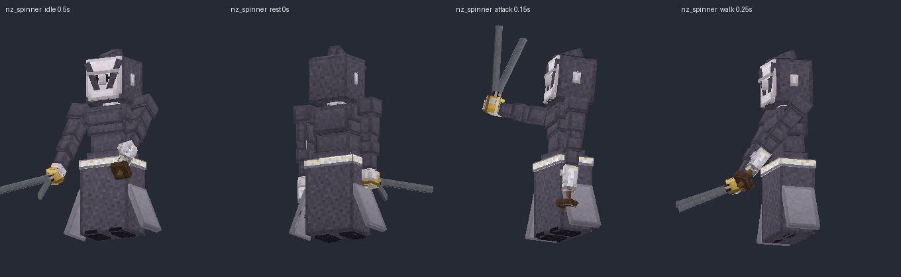
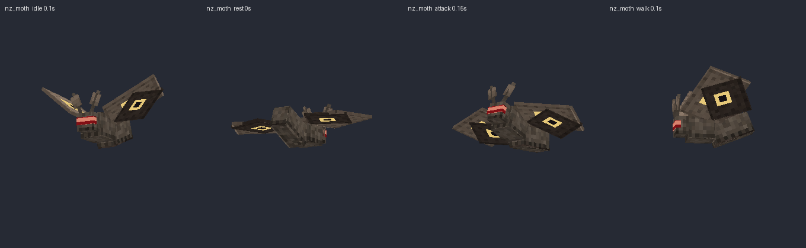

Escucha todos los sonidos en `preview/sonidos_demo.mp3`.
